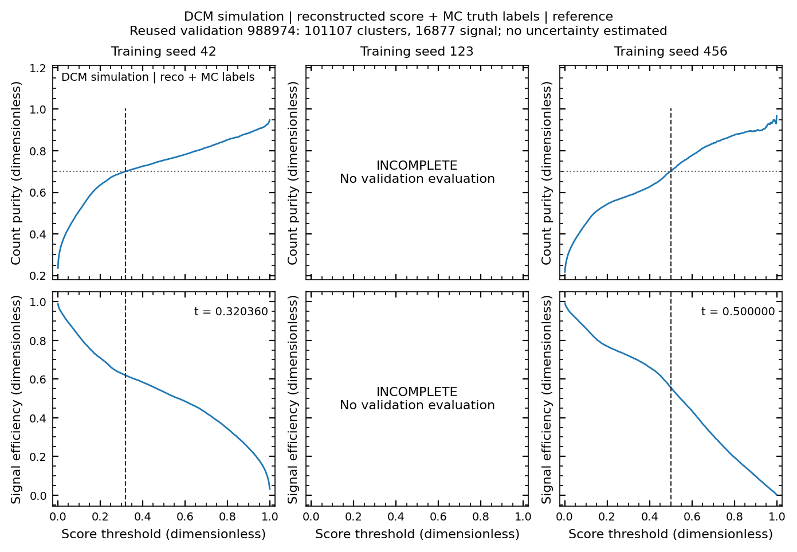
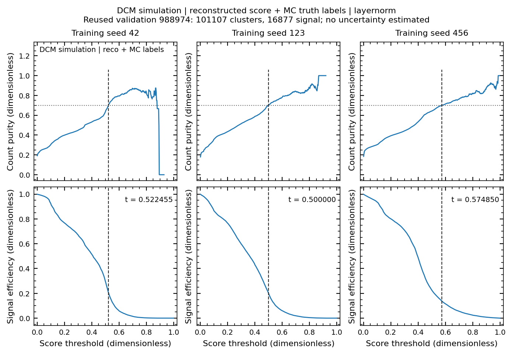
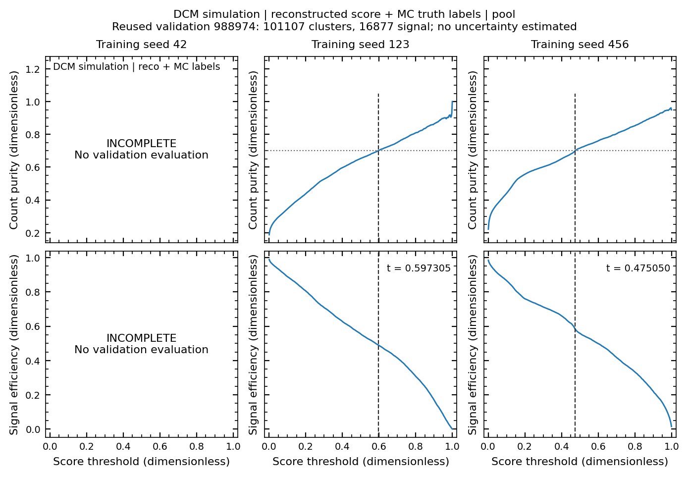
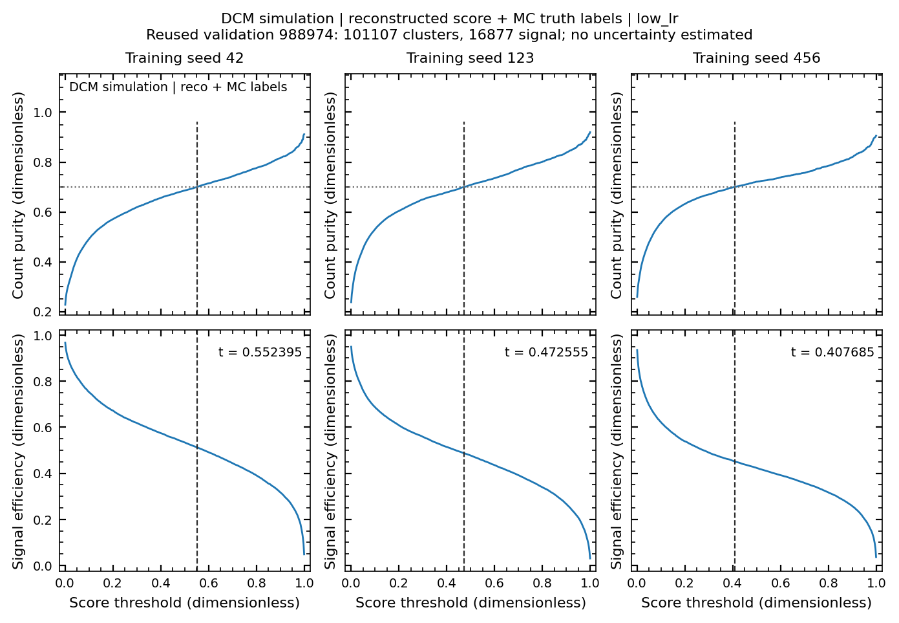

# DCM development: итог разрешённой серии, 2026-10-17

Массив `4413514` завершён: 10 из 12 runs прошли 30 epochs и полную проверку; `pool_42` и `reference_123` остановились при checkpoint I/O после 16 и 13 committed epochs. Их partial checkpoints сохранены, но не считаются результатами 30-epoch recipes. Дополнительные recovery jobs не отправлены: требуется ранее запрошенное явное разрешение пользователя.

Это закрытие разрешённого бюджета с неполным cohort. Primary LayerNorm minus reference по seeds 42/123/456 недоступен из-за reference_123; exploratory pool и low-LR contrasts также неполны. Mean/SE/t на 2 df оставлены null. Неполные или непарные cohorts не усреднялись. Доступные отдельные paired differences сохранены в JSON как descriptive values без статистического вывода.

## Population и fitted provenance

DCM frozen detector cache `ndet_dataset_dcm_xecs_own_tw1p0`, schema 2. Фактические collision settings и связь с primary-truth / corrected-detector generations не установлены. Selection: reconstructable detector clusters; impact-parameter selection отсутствует, b unavailable. Нового test evaluation нет; ранее открытый source 988976 не оценивался.

Train source 988975: 92252 arm graphs / 64138 physical events / 159085 clusters, 26244 signal. Reused validation 988974: 59973 / 41808 / 101107, 16877 signal. Scalers fitted только на восстановленных float32 train-hit features; graph edges, labels, timing noise и indices заморожены. Все arms заново обучались с population-weighted per-head validation selector. Эти development metrics не являются independent-test generalisation. Training-seed SE, если cohort будет восстановлен, не оценит between-source variance.

<!-- table-provenance: all metrics scored on reused validation source 988974, 101107 reconstructed clusters/16877 MC signal labels, no b selection (b unavailable); model weights trained on source 988975, affine scalers fitted on train hits only, DCM frozen detector cache schema 2; collision settings/generation lineage unverified. -->

## Все запланированные seeds

Reconstructed cluster ROC AUC, dimensionless, higher is better. Каждая строка — один training seed; per-row uncertainty не оценена. Threshold dimensionless: первая из 401 точек [0.001,0.999] с validation count purity >=0.70. Это inherited convention: более строгий cut меняет purity/efficiency, EoS optimum не определялся. Недостижимый target сохранялся бы как null. «—» у failed run означает отсутствие полной evaluation, а не недостижимый target. Epoch выбранного checkpoint zero-based; число параметров не является quality score.

| Recipe | Training seed | Status / epochs | Parameters (count) | AUC ↑ | Selected epoch | Threshold |
|---|---:|---|---:|---:|---:|---:|
| reference | 42 | COMPLETED / 30 | 12479173 | 0.91326 | 6 | 0.320360 |
| layernorm | 42 | COMPLETED / 30 | 12479173 | 0.85518 | 2 | 0.522455 |
| pool | 42 | FAILED / 16 | 16673477 | — | — | — |
| low_lr | 42 | COMPLETED / 30 | 12479173 | 0.87225 | 2 | 0.552395 |
| reference | 123 | FAILED / 13 | 12479173 | — | — | — |
| layernorm | 123 | COMPLETED / 30 | 12479173 | 0.86285 | 2 | 0.500000 |
| pool | 123 | COMPLETED / 30 | 16673477 | 0.87813 | 8 | 0.597305 |
| low_lr | 123 | COMPLETED / 30 | 12479173 | 0.86328 | 2 | 0.472555 |
| reference | 456 | COMPLETED / 30 | 12479173 | 0.90500 | 1 | 0.500000 |
| layernorm | 456 | COMPLETED / 30 | 12479173 | 0.85809 | 1 | 0.574850 |
| pool | 456 | COMPLETED / 30 | 16673477 | 0.90491 | 10 | 0.475050 |
| low_lr | 456 | COMPLETED / 30 | 12479173 | 0.85499 | 4 | 0.407685 |

## Что проверено и что остаётся открытым

Для всех 10 complete runs проверены 30 sequential histories, finite components, per-head counts, actual model kwargs/parameter counts, LR used/next, common split и shard manifest hashes, первый минимум validation composite loss, selected checkpoint hash и 401-point scans. Все 10 достигли conventional purity target. Selected epochs лежат от 1 до 10; поздние training losses не заменяют выбранные validation checkpoints. Это наблюдение не изолирует причину ранних minima.

RA-01–RA-08 и их проверки сохранены в [pipeline audit](pipeline_reaudit_20261017.md). RA-09 остаётся OPEN: временная недоступность пути / EACCES при сохранении checkpoint и затем failure status; точная Lustre/node причина не доказана. Оба failures были на cn-008, но pool_123 там завершился успешно. Slurm status имеет приоритет над оставшимся `training` в двух raw run-status files.

Проверенные coherent atomic resumes и отдельные backups оставлены без изменений. Proposal pool_42: 14 epochs до total 30; reference_123: 17 epochs до total 30. Раздельные last/optim files на эпоху впереди atomic resume и не могут быть смешаны с ним; orphan temporary resume сохранён без promotion. Предложения возобновления не равны отправленным jobs. Healthy runs не перезапускались.

Pooling увеличил capacity с 12479173 до 16673477 parameters при выключенном size feature; pure fixed-capacity pooling gain этим дизайном не измеряется. LayerNorm сохраняет affine parameter count. Low-LR меняет только initial rate на одну декаду при том же 30-epoch budget. Это конечные perturbations, а не найденные optima. Recipes не менялись после запуска.

## Графики и воспроизведение

Каждый run имеет шесть panels с суммой population head means и пятью heads. Train curves — population means измеренных minibatch losses во время изменения weights; validation curves — epoch-end evaluation на другом source run. Они являются trajectories двух явно разных populations, а не performance ratio. Поэтому ratio panel для этих learning diagnostics не строится. Train population sum в figure вычислен из сохранённых components; исходный train.total остаётся minibatch-mean objective и не переписан. Vertical dotted line — selected validation epoch только у complete run. Partial histories обрываются и подписаны incomplete; никаких extrapolated epochs нет.

Threshold plots показывают все 401 points отдельно для каждого training seed; пустые panels двух failed runs явно обозначены. Dotted horizontal line = conventional purity 0.70; dashed vertical = первый достигающий target cut. Изменение cut обычно повышает purity за счёт efficiency, весь trade-off виден без выбора лучшего seed. Curves используют reconstructed score и MC truth labels. Error bands/uncertainty не оценены; отсутствие bands не означает нулевую неопределённость. Source settings не переносятся с других MC generations.

Файлы — `results/dcm_development_20261017/closure/histories/` (12 PDF/PNG), `closure/thresholds/` (4 PDF/PNG), `closure/summary.json`, `closure/per_seed.csv`. Каждый PDF векторный с embedded TrueType, PNG 200 dpi; limits derived from plotted data. Source hashes и визуальная проверка записываются в closure.

Воспроизведение из small artifacts: `PYTHONPATH=.. python -m HGNDRecoGNN.scripts.summarize_dcm_development` из HGNDRecoGNN. Скрипт не загружает weights/prediction pickles, не выполняет inference и не отправляет jobs.

Manuscript сохраняет прежний inconclusive cosine test и archived four-epoch SMASH result. Development table в статью не добавлена: primary cohort неполон. Фактический historical minibatch-mean selector уже исправлен в Methods и проверенном PDF; его эффект отдельно не измерен. Claims о pure scaler ablation, independent legacy holdout, физическом unfolded spectrum или neutron-track response не добавлялись.

Полные recipes и обоснования фиксированных параметров: [preregistered protocol](dcm_development_protocol_20261017.md). Thresholds напечатаны до шести decimals, чтобы сохранить исходные grid points.

## Просмотр графиков

Per-head histories (PDF; по шесть panels на run):

- [reference_42: 30/30 epochs](../results/dcm_development_20261017/closure/histories/reference_42.pdf)
- [layernorm_42: 30/30 epochs](../results/dcm_development_20261017/closure/histories/layernorm_42.pdf)
- [pool_42: 16/30 epochs](../results/dcm_development_20261017/closure/histories/pool_42.pdf)
- [low_lr_42: 30/30 epochs](../results/dcm_development_20261017/closure/histories/low_lr_42.pdf)
- [reference_123: 13/30 epochs](../results/dcm_development_20261017/closure/histories/reference_123.pdf)
- [layernorm_123: 30/30 epochs](../results/dcm_development_20261017/closure/histories/layernorm_123.pdf)
- [pool_123: 30/30 epochs](../results/dcm_development_20261017/closure/histories/pool_123.pdf)
- [low_lr_123: 30/30 epochs](../results/dcm_development_20261017/closure/histories/low_lr_123.pdf)
- [reference_456: 30/30 epochs](../results/dcm_development_20261017/closure/histories/reference_456.pdf)
- [layernorm_456: 30/30 epochs](../results/dcm_development_20261017/closure/histories/layernorm_456.pdf)
- [pool_456: 30/30 epochs](../results/dcm_development_20261017/closure/histories/pool_456.pdf)
- [low_lr_456: 30/30 epochs](../results/dcm_development_20261017/closure/histories/low_lr_456.pdf)

Полные threshold scans; каждый panel соответствует одному training seed:

