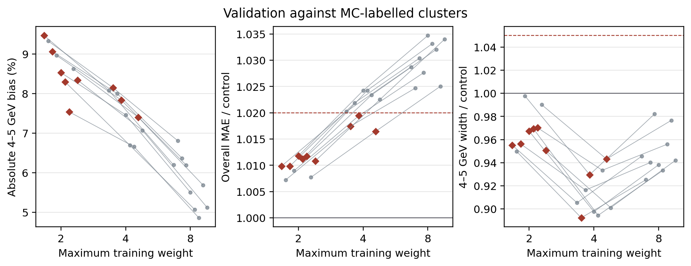
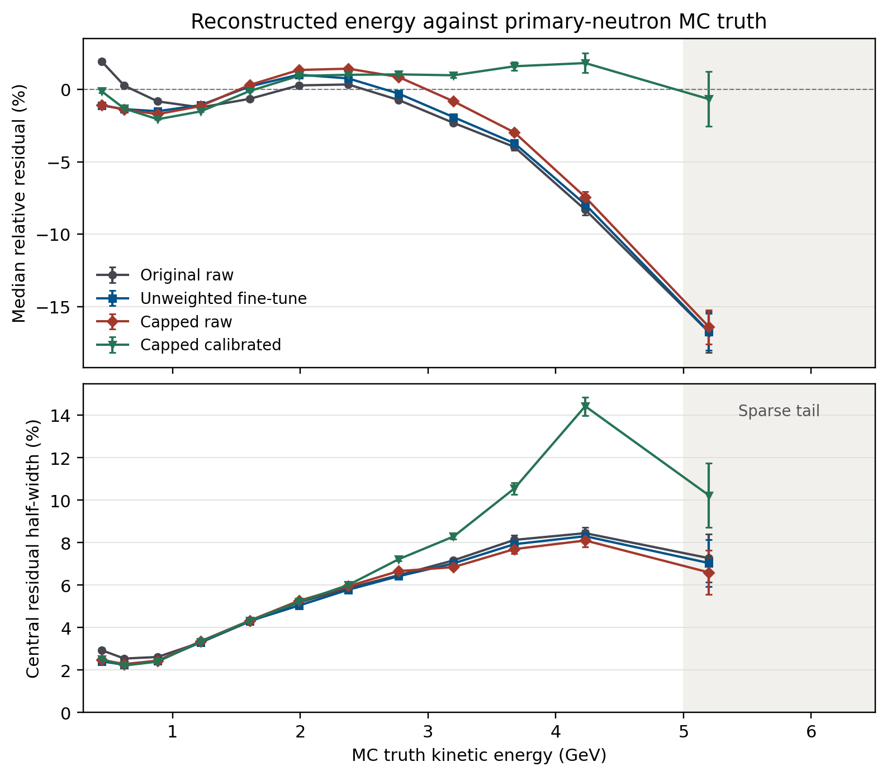
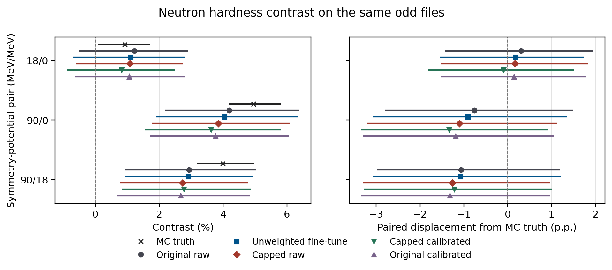

# SMASH. Ограничение весов и калибровка энергии

Взвешенное дообучение с ограничением веса уменьшает занижение raw в 4–5 ГэВ с
−8,31% до −7,44% и сужает центральный интервал ошибки. Калибровка
сдвигает медиану до +1,82% и расширяет интервал. На тех же нечётных
файлах центральный контраст 90/0 последовательно снижается с 4,19%
до 3,85% и 3,62% при почти одинаковой ширине.

## Выбор веса и калибровки

SMASH Xe+Cs при 2,87 ГэВ на нуклон, номинальное геометрическое окно
на передней плоскости HGND, без отбора по параметру удара.
В каждом из трёх fold и для каждого
из seed 42, 123 и 456 дообучалась только энергетическая ветвь, 15 эпох.
Использовались исходные графы, цели, скейлеры и чекпойнты. По десяти
равношироким бинам положительных обучающих targets вес каждого объекта
равен `min(cap, k/√p)`, где `p` — доля обучающих объектов в бине и
`k` нормирует средний вес к единице. Проверены пределы 2, 4 и 8.

Выбор сделан отдельно для каждой пары fold и seed на нативных положительных
кластерах её валидации. Среди вариантов с общей MAE не более 102% от контроля
с обычной MSE и полушириной в 4–5 ГэВ не более 105% от того же контроля
выбиралось минимальное абсолютное медианное смещение в 4–5 ГэВ.
Монотонное обратное преобразование медианного отклика обучено для
выбранной ветви на тех же валидационных кластерах. Предел веса выбран по raw.
Калибровка применена после замораживания. [Протокол](protocol.md)

Каждая линия соответствует одной паре fold и seed. Ромбы показывают
выбранный предел. Штриховые линии задают допуски относительно обычной MSE.

Предел 2 выбран в шести случаях, 4 в трёх. Предел 2 прошёл оба допуска
во всех девяти случаях, предел 4 в трёх, предел 8 ни в одном.
Ограничивающим критерием была общая MAE. В бине 4–5 ГэВ валидация
содержала 492–541 положительный кластер на fold. Все выбранные варианты
прошли оба допуска.

## Энергия на исходной сопоставленной выборке

Те же 286 чётных файлов, исходные пороги двух классификаторов, маска
физического ToF и 80 515, 81 097 и 77 384 изолированных пар
нейтрон–кластер по трём seed. Эталон — начальная кинетическая энергия
первичного нейтрона MC. Смещение — медиана относительного остатка,
разрешение — его центральная полуширина `(Q84 − Q16)/2`. Центры
усреднены по seed. Планки на рисунке — SD из тех же 400 парных
файловых перевыборок. [Исходная выборка first-hit ToF](../first_hit_tof_20261110/README.md)

| Энергия MC, ГэВ | Исходный raw | Обычная MSE | С ограничением, raw | С ограничением и калибровкой |
| --- | ---: | ---: | ---: | ---: |
| 3–3,5 | −2,32% / 7,17% | −1,92% / 7,02% | −0,83% / 6,85% | +0,97% / 8,29% |
| 3,5–4 | −3,98% / 8,13% | −3,72% / 7,93% | −2,97% / 7,70% | +1,59% / 10,55% |
| 4–5 | −8,31% / 8,45% | −7,94% / 8,30% | −7,44% / 8,10% | +1,82% / 14,43% |
| 5–6,5 | −16,77% / 7,27% | −16,74% / 7,04% | −16,40% / 6,60% | −0,67% / 10,23% |

В таблице указаны смещение и полуширина. В бине 4–5 ГэВ есть
483–540 объектов на seed. В 5–6,5 ГэВ остаётся 30–42 объекта,
поэтому результат там описательный.

| Парное изменение в 4–5 ГэВ | Смещение, п.п. | Полуширина, п.п. |
| --- | ---: | ---: |
| Ограниченный raw минус исходный raw | +0,87 [+0,69 … +1,00] | −0,34 [−0,54 … −0,22] |
| Ограниченный raw минус обычная MSE | +0,50 [+0,38 … +0,58] | −0,20 [−0,38 … −0,19] |
| Калиброванный минус ограниченный raw | +9,26 [+8,84 … +9,69] | +6,32 [+6,15 … +6,63] |

В скобках Q16–Q84 из общих файловых перевыборок. MAE по всей
сопоставленной выборке составляет 86,48 МэВ у исходного raw,
85,47 МэВ у обычной MSE, 87,56 МэВ у ограниченного raw и
92,32 МэВ после его калибровки. Веса увеличивают MAE относительно
исходного raw на 1,07 [0,98 … 1,17] МэВ. Калибровка добавляет
4,76 [4,58 … 4,92] МэВ к ограниченному raw.

## Контраст на тех же нечётных файлах

В сравнении 1 165 216 событий из 282 нечётных файлов. Каждый файл
оценивается моделью, обученной без этого файла. Базовые результаты
этих файлов ранее изучались. Сохранённые пороги классификации
выбраны на чётных файлах. Число прошедших отбор кандидатов совпадает
между вариантами. Для `Rn = Nhard/Nsoft` мягкая полоса реконструкции
`0,3 < E < 1` ГэВ, основная жёсткая полоса `E ≥ 2` ГэВ.
Эталон — геометрические первичные нейтроны MC в тех же событиях.
Внутри каждого seed вычисляется
`C(a/b) = 100 × (Rn(a)/Rn(b) − 1)` после суммирования файлов,
затем центры усредняются по seed. Все варианты используют одни и те же
400 стратифицированных файловых перевыборок. Три пары коррелированы.
Интервалы относятся к фиксированным моделям. [Исходное сравнение на нечётных файлах](../rule_tof_odd_20261110/README.md)

| Пара | MC | Исходный raw | С ограничением, raw | С ограничением и калибровкой |
| --- | ---: | ---: | ---: | ---: |
| 18/0 | 0,92% / 0,82 | 1,22% / 1,72 | 1,09% / 1,67 | 0,82% / 1,69 |
| 90/0 | 4,95% / 0,80 | 4,19% / 2,11 | 3,85% / 2,15 | 3,62% / 2,14 |
| 90/18 | 4,00% / 0,89 | 2,93% / 2,06 | 2,73% / 2,01 | 2,78% / 2,02 |

В ячейках контраст в процентах и полуширина Q16–Q84 в п.п.

| Пара | Исходный raw − MC | Ограниченный raw − MC | Калиброванный − MC |
| --- | ---: | ---: | ---: |
| 18/0 | +0,30 [−1,44 … +1,95] | +0,17 [−1,52 … +1,82] | −0,10 [−1,81 … +1,51] |
| 90/0 | −0,76 [−2,80 … +1,49] | −1,10 [−3,22 … +1,11] | −1,33 [−3,34 … +0,91] |
| 90/18 | −1,06 [−2,98 … +1,19] | −1,26 [−3,29 … +0,96] | −1,22 [−3,27 … +1,01] |

В таблице парные сдвиги в п.п. и интервалы Q16–Q84.

| Пара | Ограниченный raw минус исходный raw | Калибровка поверх ограниченного raw |
| --- | ---: | ---: |
| 18/0 | −0,14 [−0,38 … +0,10] | −0,26 [−0,44 … −0,09] |
| 90/0 | −0,34 [−0,61 … −0,05] | −0,23 [−0,39 … −0,07] |
| 90/18 | −0,20 [−0,44 … +0,07] | +0,04 [−0,15 … +0,25] |

В таблице парные изменения контраста в п.п. и интервалы Q16–Q84.
Для 90/0 ограниченный raw даёт −0,20 [−0,33 … −0,06] п.п.
относительно обычной MSE. Калибровка дополнительно снижает
центральный контраст. Полуширина почти одинакова во всех трёх
основных вариантах. Парное изменение абсолютного отклонения от MC
равно +0,34 [−0,33 … +0,54] п.п. при переходе от исходного raw
к ограниченному и +0,23 [−0,20 … +0,35] п.п. при его калибровке.
Оба интервала включают ноль. В жёсткой полосе 2–4 ГэВ контраст
90/0 меняется с 3,96% до 3,61% и 3,39% при 4,65% у MC.
Калибровка приближает медиану энергии к MC в 4–5 ГэВ. Изменения контраста
зависят от миграции кандидатов между полосами. При калибровке число
мягких кандидатов выросло на 1,63% при 0 МэВ и на 1,90% при 90 МэВ,
а число жёстких уменьшилось на 1,05% и 1,00% соответственно
(равные веса seed, описательное сравнение).

## Приёмка и воспроизведение

Девять задач завершены 0:0. Приняты 1 776 архивных файлов, в том числе
1 704 таблицы предсказаний. Исходные счётчики raw и контрольные
контрасты MC и прежней калиброванной модели воспроизведены. Счётчики
обычной MSE совпали с предыдущим опытом. Независимый пересчёт новой
калибровки на локальной платформе отличается не более чем на
8,9 × 10⁻¹⁶ ГэВ. Решения на границах полос совпали для всех кандидатов.
Калибровка проверена из замороженных коэффициентов, выбор предела
воспроизведён по сохранённым валидационным показателям.

[Числа и значения по seed](reduction/results.json) ·
[Файловые счётчики и перевыборки](reduction/odd_counts.npz) ·
[Квитанции Slurm](terminal_slurm.txt) · [Пакет исходного кода](source_package.json) ·
[Редукция](reduce.py) · [Проверка экспортов](accept.py)
