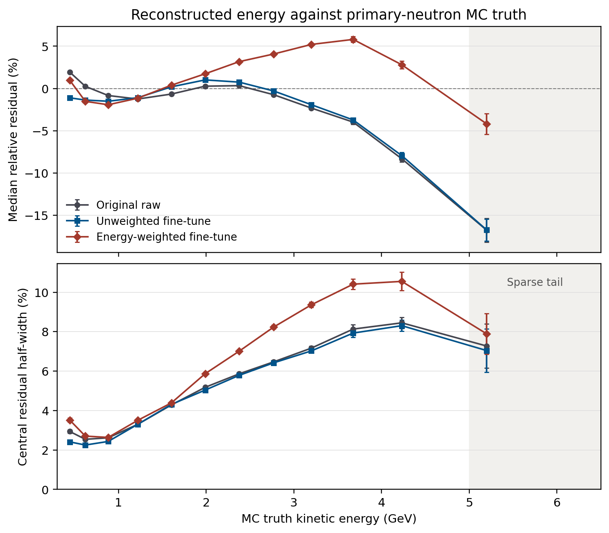
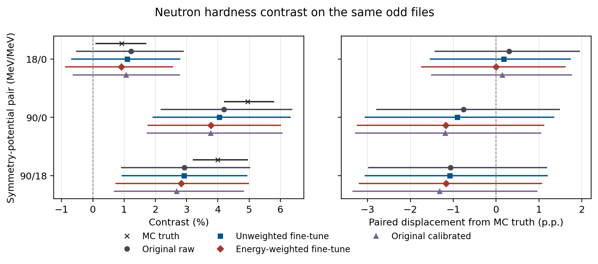

# Взвешенное дообучение энергетической головы на SMASH

Взвешивание по энергии уменьшило занижение шкалы raw GNN в бине
4–5 ГэВ с −8,31% до +2,81%. Полуширина центрального интервала
ошибки там выросла с 8,45% до 10,55%, а MAE на всей сопоставленной
выборке выросла с 86,48 до 108,29 МэВ. При замороженном пороге
контраст 90/0 на нечётных файлах уменьшился с 4,19% до 3,78%.
Его полуширина практически сохранилась, а центральный сдвиг от MC
изменился с −0,76 до −1,18 п.п.

## Что сравнивается

SMASH Xe+Cs, 2,87 ГэВ на нуклон, номинальное геометрическое окно HGND,
без отбора по параметру удара. Девять исходных SMASH-моделей образуют
три fold с seed 42, 123 и 456 в каждом. Дообучались только слои
энергетической ветви, начиная с принятого энергетического чекпойнта
каждого запуска. Порог, сохранённые оценки классификатора, графы,
скейлеры, targets и разбиение фиксированы.

Две новые ветви прошли по 15 эпох с одинаковыми исходными параметрами,
батчами и расписанием. Одна использует обычную MSE, другая взвешивает
квадраты ошибок обратно пропорционально числу объектов в десяти
равношироких бинах истинной энергии. Это адаптация рецепта Dombay:
гистограмма строится только по обучающим объектам соответствующего fold,
вместо последнего батча тестового загрузчика в старом ноутбуке.
Используется выход сети без посткалибровки. Старый калиброванный
вариант на графике контраста служит контекстом. [Протокол](protocol.md)

## Энергия на тех же нейтронах

В исходной выборке first-hit ToF из 286 чётных файлов ровно 80 515,
81 097 и 77 384 изолированных пар первичный нейтрон–кластер по трём
seed. Совпадают идентификаторы, исходные пороги обоих классификаторов
и маска физически допустимого ToF. Эталон энергии — начальная
кинетическая энергия первичного нейтрона MC. По бинам показаны
медиана относительной ошибки и полуширина её центрального интервала
`(Q84 − Q16)/2`. Центры усреднены по seed с равным весом. Планки на
рисунке показывают SD из 400 общих файловых перевыборок.

| Энергия MC, ГэВ | Raw, смещение / полуширина | MSE, смещение / полуширина | Взвешенная MSE, смещение / полуширина |
| --- | ---: | ---: | ---: |
| 3–3,5 | −2,32% / 7,17% | −1,92% / 7,02% | +5,21% / 9,36% |
| 3,5–4 | −3,98% / 8,13% | −3,72% / 7,93% | +5,81% / 10,41% |
| 4–5 | −8,31% / 8,45% | −7,94% / 8,30% | +2,81% / 10,55% |
| 5–6,5 | −16,77% / 7,27% | −16,74% / 7,04% | −4,19% / 7,89% |

В основном бине 4–5 ГэВ есть 483–540 нейтронов на seed.
Относительно MSE без весов парный сдвиг медианы составляет
+10,75 [10,45; 10,93] п.п., а изменение полуширины
+2,25 [1,89; 2,48] п.п. Дополнительные эпохи с обычной MSE
меняют исходную медиану здесь на +0,37 [0,22; 0,49] п.п.
В диапазоне 3–4 ГэВ взвешивание увеличивает абсолютное смещение
и ширину. Верхний бин содержит 30–42 объекта на seed. Там
изменение полуширины относительно raw составляет
+0,62 [−0,26; +1,12] п.п.

MAE на общей выборке составляет 86,48 МэВ для исходной сети,
85,47 МэВ после обычной MSE и 108,29 МэВ после взвешенной MSE.
Парное изменение взвешенного варианта относительно raw равно
+21,80 [21,49; 22,17] МэВ. На обучении верхние бины содержат
4, 4 и 9 объектов в трёх fold. Их максимальные веса составляют
8 034, 8 218 и 3 628, а эффективные объёмы по формуле Киша
равны 337, 329 и 793 при 321–329 тыс. положительных кластеров на fold.
Эти веса характеризуют зависимость обучающей функции от хвоста.

## Контраст жёсткости на нечётных файлах

В расчёт входят 1 165 216 событий из 282 нечётных файлов. Использованы
те же сохранённые пороги по fold и seed, выбранные по контрасту на чётных
файлах. Каждый нечётный файл оценён моделью, обученной без этого файла.
Базовые результаты этих файлов уже изучались. Счётчик включает всех
прошедших отбор кандидатов до коррекции
фона. Для `Rn = Nhard/Nsoft` мягкая полоса реконструкции — `0,3 < E < 1`
ГэВ, жёсткая — `E ≥ 2` ГэВ. Эталон использует геометрические первичные
нейтроны MC на тех же событиях. Контраст
`C(a/b) = 100 × (Rn(a)/Rn(b) − 1)` вычисляется внутри каждого seed
после суммирования файлов, затем усредняется по seed. Все значения и
парные разности используют одни и те же 400 стратифицированных
файловых перевыборок. Интервалы [Q16; Q84] характеризуют разброс
по файлам при фиксированных моделях. Три пары коррелированы.

| Пара | MC, % | Raw, % | MSE, % | Взвешенная MSE, % | Полуширина raw → взвешенная, п.п. | Взвешенная минус raw, п.п. |
| --- | ---: | ---: | ---: | ---: | ---: | ---: |
| 18/0 | 0,92 | 1,22 | 1,10 | 0,92 | 1,72 → 1,73 | −0,30 [−0,57; −0,02] |
| 90/0 | 4,95 | 4,19 | 4,04 | 3,78 | 2,11 → 2,14 | −0,42 [−0,70; −0,10] |
| 90/18 | 4,00 | 2,93 | 2,91 | 2,83 | 2,06 → 2,14 | −0,10 [−0,34; +0,15] |

| Пара | Raw − MC, п.п. | Взвешенная MSE − MC, п.п. | Парное изменение абсолютного отклонения, п.п. |
| --- | ---: | ---: | ---: |
| 18/0 | +0,30 [−1,44; +1,95] | 0,00 [−1,75; +1,62] | −0,30 [−0,40; +0,41] |
| 90/0 | −0,76 [−2,80; +1,49] | −1,18 [−3,25; +1,13] | +0,42 [−0,39; +0,65] |
| 90/18 | −1,06 [−2,98; +1,19] | −1,16 [−3,20; +1,07] | +0,10 [−0,19; +0,31] |

Взвешивание уменьшает 90/0 также относительно контроля с обычной MSE
на −0,27 [−0,51; −0,02] п.п. Сдвиги относительно исходного raw
по трём seed равны −1,06, +0,03 и −0,22 п.п., а относительно
контроля с обычной MSE −0,42, −0,36 и −0,03 п.п.
В пределах 2–4 ГэВ изменение
относительно raw равно −0,48 [−0,78; −0,14] п.п., а полуширина
растёт с 2,09 до 2,18 п.п. Улучшение шкалы в бине 4–5 ГэВ
сопровождается меньшим центральным контрастом 90/0 и почти
неизменной шириной контраста. Интервалы изменения абсолютного
отклонения от MC включают ноль для всех трёх пар.

Число жёстких кандидатов при взвешивании выросло на 4,65% для 0 МэВ
и на 4,56% для 90 МэВ. Число мягких кандидатов выросло на 2,32% и
2,64% соответственно. Это средние по seed относительные изменения
счётчиков на тех же событиях. При близком росте жёстких счётчиков
больший рост мягкого знаменателя при 90 МэВ уменьшает контраст.

## Проверка и воспроизведение

Все девять задач завершились 0:0. Приняты 1 749 архивных файлов,
включая 1 704 таблицы предсказаний по паре файл–seed. Максимальное
отклонение повторной GPU-инференции исходного raw от сохранённой
энергии составило 1,43 × 10⁻⁶ ГэВ. Для сравнения использован
сохранённый raw. Побиновые результаты и контрольные контрасты MC
и исходной калиброванной сети воспроизведены до сохранённой
численной точности. Сводка содержит значения по seed, парные
интервалы и обе жёсткие полосы.

[Числа](reduction/results.json) · [Файловые счётчики и веса перевыборок](reduction/odd_counts.npz) ·
[Редукция](reduce.py) · [Проверка архивов](accept.py) ·
[Квитанции Slurm](terminal_slurm.txt) · [Пакет исходного кода](source_package.json)
