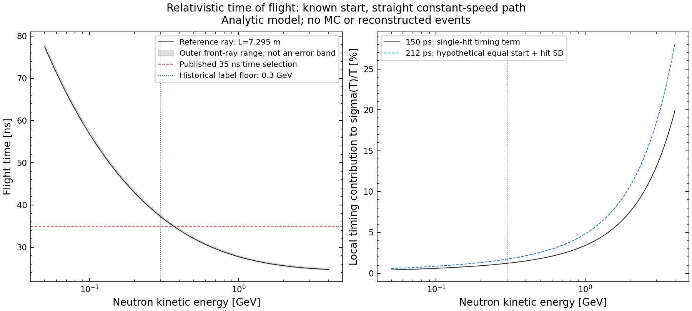
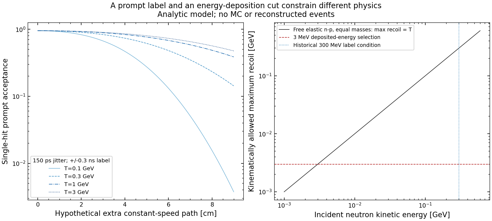
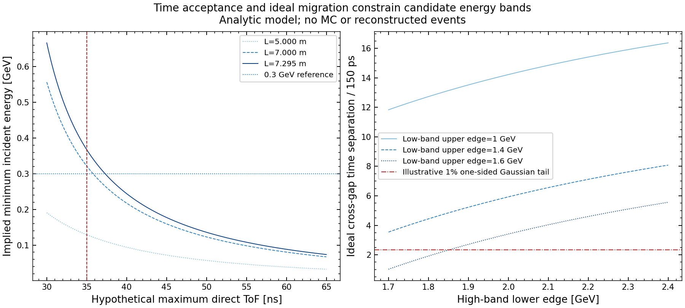

# Энергетические границы HGND: оценка до эмпирической проверки

29.10.2026. Дополнение к [протоколу](energy_label_optimization_protocol_20261029.md).
Рассчитаны кинематика и условная модель временной ошибки. MC-события,
predictions, веса и спектры не использовались. Сечения, фон, световыход и
спектральный отклик потенциала остаются входами будущего исследования.

**Кинематика не требует порога разметки0,3ГэВ.** У этой величины есть
опубликованная операционная мотивация — ограничение времени прихода для
подавления поздних нейтронов. Перенос границы в определение MC-сигнала
требует отдельного обоснования. В идеальном детекторе мягкие нейтроны могут
добавлять информацию; в реальном её ценность ограничивают фон и отклик.

Числа: [first_principles_numbers.json](energy_label_optimization_20261029/first_principles_numbers.json).
Расчёт/рисунки: `first_principles.py` в той же директории;
формулы: `analysis/neutron_tof_bounds.py`. Это детерминированные оценки
при заданных предположениях, не MC truth и не результаты реконструкции.

## 1. Время пролёта не задаёт нижний порог0,3ГэВ

Для прямого полёта с постоянной скоростью, известной вершиной и стартом:

\[
 M=m_nc^2=0{,}93956542052\;\mathrm{ГэВ},\quad
 \gamma=1+T/M,\quad \beta=\sqrt{1-\gamma^{-2}},\quad
 t=\frac{L}{c\beta},\qquad c=0{,}299792458\;\mathrm{м/нс}.
\]

Масса — [PDG/CODATA](https://pdg.lbl.gov/2025/AtomicNuclearProperties/neutron.html).
Исторические939,55МэВ в production `_dfToF` этим расчётом не меняются.
Опорная длина L=7,294964м взята от начала координат до центра внешнего
прямоугольника `hgnd_acceptance.py`; диапазон до его передней плоскости —
7,262959–7,372946м. Центр может лежать в межмодульном зазоре. Это масштаб
оценки, а не подтверждённая активная ячейка или фактическая вершина события.

Из точного якобиана получается локальный timing contribution:

\[
 \frac{\partial T}{\partial t}=-\frac{T}{t}\gamma(\gamma+1),\qquad
 \left.\frac{\sigma_T}{T}\right|_t=\gamma(\gamma+1)\frac{\sigma_t}{t}.
\]

Для σ_t=0,15нс — **одного** jitter хита в текущем коде:

| T, ГэВ | прямой ToF, нс | timing-only σ_T/T, % |
|---:|---:|---:|
| 0,1 | 56,86 | 0,61 |
| 0,2 | 43,00 | 0,94 |
| 0,3 | 37,31 | 1,23 |
| 0,5 | 32,12 | 1,81 |
| 1,0 | 27,81 | 3,41 |
| 2,0 | 25,68 | 7,54 |
| 3,0 | 25,06 | 13,03 |
| 4,0 | 24,79 | 19,91 |

В нерелятивистском пределе T≈ML²/(2c²t²), поэтому σ_T/T≈2σ_t/t∝√T.
При снижении энергии относительная временная ошибка **уменьшается**.
Из неё нижняя граница0,3ГэВ не выводится. На верхнем конце, напротив,
цена по разрешению быстро растёт:3ГэВ уже соответствуют примерно13%
этого изолированного вклада, но не являются кинематическим пределом.

Полная локальная формула включает путь и корреляцию:

\[
 (\sigma_T/T)^2\simeq[\gamma(\gamma+1)]^2
 \left[\sigma_L^2/L^2+\sigma_t^2/t^2-2\operatorname{Cov}(L,t)/(Lt)\right].
\]

В σ_t входят старт, cell timing и синхронизация. Независимые старт и хит
по150пс дали бы212пс; это показанный на графике **сценарий**, не измерение
параметров BM@N. Задержки каскада и ошибочное назначение first hit сюда не
включены. Поэтому таблица не является полным разрешением HGND.

График1. Прямой полёт и локальное распространение timing error. Серая полоса —
диапазон лучей до внешнего прямоугольника, не доверительный интервал.
Кривые условные и детерминированные; статистических error bars здесь нет.

## 2. Примерно300МэВ могут следовать из временного окна

В [описании HGND2024, §§3.1 и4](https://arxiv.org/html/2412.00455v1#S3.SS1)
нижний диапазон около300МэВ связан с отбором времени прихода35нс для
подавления поздних нейтронов. В той работе также заданы deposited-energy
selection3МэВ и Gaussian smearing150пс. Это операционные условия
исследования, а не невозможность регистрации ниже300МэВ.

Точное следствие ограничения t<t_max:

\[
 T_{\min}(L,t_{\max})=M\left[\frac{1}{\sqrt{1-(L/(ct_{\max}))^2}}-1\right].
\]

| максимальный прямой ToF, нс | T_min при7м, ГэВ | T_min при7,295м, ГэВ |
|---:|---:|---:|
| 35 | 0,322 | 0,368 |
| 40 | 0,218 | 0,244 |
| 50 | 0,123 | 0,136 |
| 60 | 0,080 | 0,088 |

При35нс внешняя передняя плоскость даёт0,362–0,381ГэВ. Поэтому
«300МэВ соответствует35нс» — приближение прежней номинальной геометрии,
а не точное равенство для нынешнего окна. Для0,1ГэВ нужно около57нс
прямого полёта. Пригодность такого окна определяется фоном и readout.

**Текущий путь кода отличается:** `audit_smash_sources.observe` оставляет
Edep>3МэВ, finite fields, deterministic jitter, fY≠0 и PDG0 veto. Отбора
t_hit<35нс в нём нет; `smash_transfer.transfer_pack` также его не вводит.
Энергетическое условие label не воспроизводит опубликованный отбор всех
поздних хитов. Наличие35нс в DAQ или при генерации исходных файлов этим
чтением кода не удостоверено.

Полезен **условный algebraic guard**: если t_hit<35нс и prompt требует
|t_hit−t(T,L)|≤0,3нс, то t(T,L)<35,3нс. Значит, T>0,313ГэВ при7м и
T>0,352ГэВ даже на ближайшем краю местного прямоугольника. Тогда Ekin>0,3
избыточно. Sub-0,3 prompt positives означали бы, что отличается хотя бы
одна предпосылка: time window, длина/вершина, t0, единицы или порядок
smearing. Это проверяется до трактовки будущих counts.

## 3. Энерговыделение не даёт общего порога300МэВ

Для упругого рассеяния частицы массы m на свободной мишени M_t в покое:

\[
 T_{R,\max}=\frac{2M_tT(T+2m)}{(m+M_t)^2+2M_tT}.
\]

При равных массах нейтрона и протона T_R,max=T точно. Нейтрон100МэВ
кинематически способен создать отдачу выше3МэВ; из selection Edep>3МэВ
нельзя вывести T_n>300МэВ. Это лишь допустимость: не вся энергия отдачи
остаётся в ячейке; нужны сечения, геометрия, quenching и electronics.

Рядом с0,3ГэВ есть масштаб открытия дополнительного канала:
при равных массах свободных нуклонов порог NN→NNπ⁰ равен
2m_π⁰+m_π⁰²/(2m_N)≈0,280ГэВ ([массаπ⁰, PDG2025](https://pdg.lbl.gov/2025/listings/rpp2025-list-pi-zero.pdf)).
Это не начало упругого рассеяния и не универсальный порог регистрации.
Для связанных ядер действуют Fermi motion и другие каналы. Одной этой
оценкой нельзя доказывать ни обязательность0,3, ни постоянную эффективность
ниже этой энергии.

## 4. Prompt-полоса±0,3нс сама селектирует историю движения

Для добавочного пути при постоянной скорости Δt=Δℓ/(βc). Характерная длина
Δℓ=βc·0,3нс равна3,85см при0,1ГэВ;5,87см при0,3ГэВ;8,73см при3ГэВ.
Мягкие нейтроны получают более строгий допуск на дополнительную траекторию.
При потере энергии это лишь эффективное временное ограничение.

Для отдельного хита с Gaussian jitter σ и задержкой Δt:

\[
 P_{\rm pass}=\Phi((w-\Delta t)/\sigma)-\Phi((-w-\Delta t)/\sigma).
\]

При w=0,3нс, σ=0,15нс и нулевой задержке это95,45%. Это не кластерная
эффективность: несколько хитов имеют коррелированные истории, shower
times распределены иначе. Снятие только energy floor не снимает все
потери мягких нейтронов и не устанавливает их первичное происхождение.

График2. Слева — условная однохитовая модель дополнительного пути; справа —
максимум свободной упругой отдачи при равных массах. Это не модель showers,
light yield или реальной neutron efficiency.

## 5. Кинематический бюджет зазора между полосами

Для идеальной ToF-оценки с σ_t=150пс любая частица T<L_max попадает
в область T_rec≥H с вероятностью не выше

\[
 \Phi\left(-\frac{t(L_{\max})-t(H)}{\sigma_t}\right).
\]

Это Gaussian upper bound данной модели, не оценка реальных tails GNN.

| L_max→H, ГэВ | временной зазор /150пс | условный cross-gap bound |
|---|---:|---:|
| 1,0→2,0 | 14,23 | много ниже1% в идеальной модели |
| 1,4→1,8 | 4,44 | около0,00045% |
| 1,6→1,8 | 1,92 | около2,77% |
| 1,6→2,0 | 3,41 | около0,033% |

Зазор1–2ГэВ велик относительно одного timing contribution, но не обязан
максимизировать информацию. Малый direct cross-gap также не означает
отсутствия смещения: частицы возле каждого края и из промежутка мигрируют
в полосы, меняются efficiency/purity и форма спектра.

График3. Слева — точная граница прямого ToF. Справа — идеальное разделение
краёв; линия1% — иллюстративный one-sided Gaussian budget, не принятый gate.

## 6. Физический критерий энергетического выбора

Пусть f(T;u) — интенсивность первичных нейтронов в фиксированной геометрии,
h=∂_u ln f. При фиксированных полосах:

\[
 R=N_H/N_L,\qquad \partial_u\ln R=\langle h\rangle_H-\langle h\rangle_L=A.
\]

Для больших независимых Poisson counts Var(lnR)≈1/N_H+1/N_L. Идеальная
информация отношения пропорциональна J=A²/(1/N_H+1/N_L). Для реальных
событий подставляется VarN_H/N_H²+VarN_L/N_L²−2Cov(N_H,N_L)/(N_HN_L).
Для независимых продукций дисперсии их lnR складываются. Три seed не
определяют общую статистическую covariance.

Есть условный вывод о нижнем крае l. При N_H,N_L>0, A>0,
фиксированных H,L_max, идеальной регистрации и монотонно возрастающем h(T),
повышение l уменьшает N_L
и приближает ⟨h⟩_L к ⟨h⟩_H: падают статистика и отклик. Стационарная
внутренняя граница J требовала бы

\[
 \frac{2[h(l)-\langle h\rangle_L]}{A}=\frac{N_H}{N_H+N_L}.
\]

Слева неположительная величина, справа положительная; такого максимума нет.
При A=0 деление неприменимо и J=0; строгий выигрыш здесь не утверждается.
**В этом идеальном случае мягкую область полезно включать.** Монотонность h
для нашей продукции здесь не установлена. Это не доказательство выигрыша
от смены обучающей метки.

Для детектора N_i=S_i+B_i и

\[
 \partial_u\ln N_i=\pi_i a_i+(1-\pi_i)b_i,\quad
 a_i=\partial_u\ln S_i,\quad b_i=\partial_u\ln B_i.
\]

S_i определяется спектром, efficiency и migration kernel, включая их
возможную зависимость от u. Наинизшая полоса уже не обязана быть лучшей:
фон и неопределённость отклика могут перекрыть информацию. Без f,h,ε,kernel,B
теория не выдаёт оптимальные0,3/1/2ГэВ, ожидаемый ROC-AUC или EOS precision.
U_sym не приравнивается сдвигу энергии каждого нейтрона на U_sym:
нужны подтверждённая модель транспортного потенциала и её параметры.

## 7. Следствия для подготовленного плана

1. Разделить цель разметки, временной acceptance и область наблюдаемой.
   Если цель — первичные нейтроны, её задаёт ancestry. Если задача только
   T>0,3, это целевая область модели. Для мягких объектов можно сравнить
   включение в signal и исключение из loss; записывание их в background
   — отдельное содержательное решение.
2. Установить upstream time window/t0 и применимость redundancy guard до
   интерпретации label census. Имя датасета не удостоверяет runtime cut.
3. Сохранить0,3 как исторический baseline, disabled — как проверку самого
   floor. Промежуточная сетка диагностическая, физического оптимума ещё нет.
4. До148окон задать бюджет информации и detector bias. Максимум C4/SD и
   минимум closure gap не заменяют эту постановку. ToF ограничивает
   правдоподобные time/gap budgets, но не измеряет фон и h(T).

Формулы проверены независимыми физическим и статистическим критиками.
Девять математических тестов проверяют round-trip, производную, Gaussian
coverage, recoil identity и отказы вне физической области. Они не используют
SMASH/DCM samples. Эмпирическая проверка и GPU-обучение не запускались.

## Уточнение02.11.2026

Чтение `ncx_refactor/Convert2Csv.C:381` устанавливает, что label Ekin —
начальная энергия связанного MCTrack, а не энергия нейтрона в ячейке.
Для exact-bound direct primary это generated-primary энергия; у secondary
это его собственная энергия рождения. Формулы прямого полёта и числа
этой записки не меняются, но нельзя переносить их на secondary или
изменяющую энергию траекторию без условных предположений. Запрос пользователя
на автономные эмпирические опыты дан02.11; статус «не запускались» выше
относится к аналитическому проходу29.10, текущий статус хранится в новом плане.
