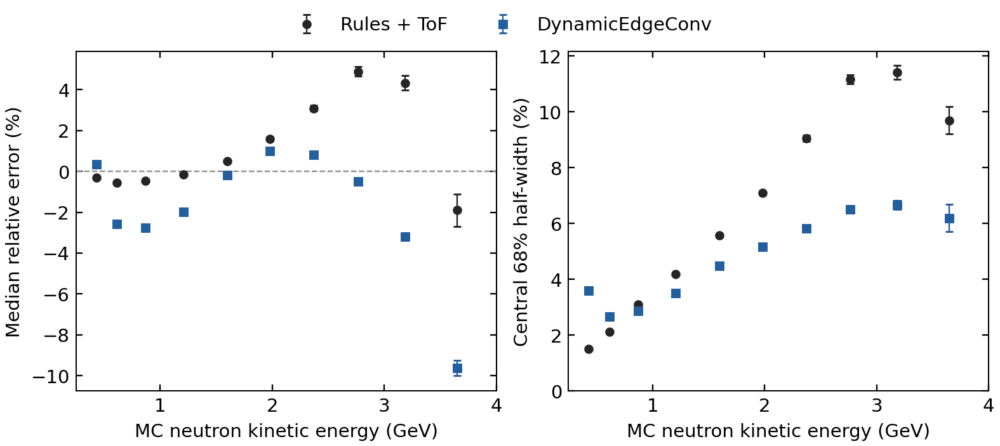
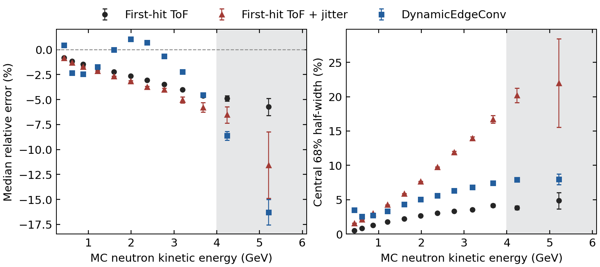
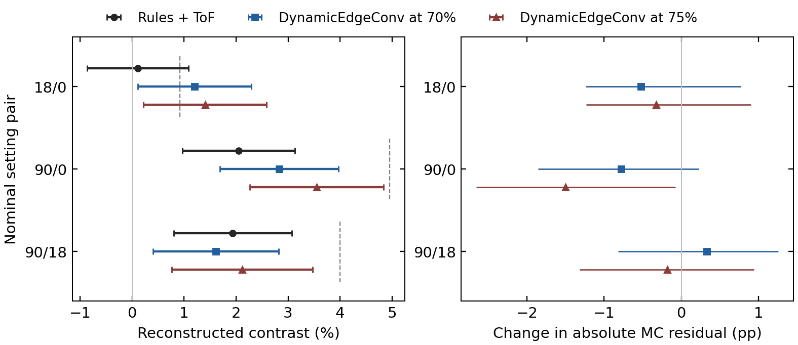

# Final-model comparison on common SMASH events

17 November 2026. DynamicEdgeConv is the selected architecture for this Xe+Cs simulation at 2.87 GeV per nucleon. The model choice is retrospective and uses matched validation losses. This reduction uses the accepted cross-fitted raw scores and energies for seeds 42, 123 and 456. The primary reconstruction comparison uses the 70% native-label validation target. The 75% target is the frozen even-file choice for the hardness example.

## Event accounting and energy assignment

The 286 even files contain 1,180,595 represented events and 897,563 geometric MC primaries. Candidates must satisfy $0.3<E_{\rm reco}<4$ GeV for both methods. The GNN also applies its fold- and seed-specific score cut. The denominator for direct coverage, misses, splits and one-to-one deficit is all geometric primaries in the processed spans, including zero-link events. A merge uses all observed direct-primary links and is normalized to selected candidates. Direct coverage alone measures association to the geometric reference population. The reconstruction would need entrance truth and fuller ancestry for a physical efficiency or background estimate.

| Quantity | Denominator | Rules + ToF | DynamicEdgeConv | Paired GNN − rules, file SD |
|---|---|---:|---:|---:|
| Direct coverage | Geometric primaries | 13.28% | 19.02% | +5.732 ± 0.031 pp |
| Direct misses | Geometric primaries | 86.72% | 80.98% | −5.732 ± 0.031 pp |
| Splits | Geometric primaries | 1.480% | 1.062% | −0.418 ± 0.014 pp |
| Merges | Selected candidates | 0.639% | 1.499% | +0.860 ± 0.020 pp |
| One-to-one matching deficit | Geometric primaries | 86.84% | 81.40% | −5.439 ± 0.030 pp |
| Zero candidates | All represented events | 76.67% | 74.59% | −2.085 ± 0.035 pp |

The full event multiplicity matrix, counts by potential, and the true-energy coverage breakdown are in `even.json`. On the 0.3–4 GeV **true** energy subpopulation, direct coverage is 15.33% and 21.93%, respectively. The denominator is narrower than in the first table row.

For energy assignment, both methods must select the same primary, with degree one at both ends in each observed graph before selection and with true energy in $(0.3,4)$ GeV. The matched counts are 58,998, 58,909 and 58,946. MAE is $101.54\pm0.64$ MeV for rules plus ToF and $73.74\pm0.40$ MeV for raw DynamicEdgeConv. The paired difference is $-27.80\pm0.50$ MeV. The pooled 68% central half-width of the relative error falls from 5.67% to 4.60%. At 3.5–4 GeV the GNN median relative error is −9.63%, versus −1.90% for the rules, and the GNN MAE is larger. The pooled MAE improvement is conditional on selection by both methods and does not establish better energy assignment in every bin.



The energy figure shows the median relative error and $(Q_{84}-Q_{16})/2$ in each true-energy bin. Points are at the equal-seed mean of the per-seed median true energies. Bars show SD from 400 shared whole-file draws at fixed models. The last bin has 275–279 primaries per seed. Both reconstructed estimates must be in the common range, which can affect the bias near its edges.

## First-hit timing diagnostic

The starting cohort contains 142,912 native-qualifying isolated links before score selection. The 70% GNN target and the common valid-$\beta$ mask on the same exported first hit leave 118,711–118,742 links per seed. Restricting the **true** energy to $[0.3,4)$ GeV leaves 118,037, 118,060 and 118,043. Both timings use the same first hit, chosen before smearing. The jitter is independent per hit with SD 0.15 ns. It does not simulate an event-wide start-time error. Finite reconstructed energies are kept without an energy-window cut.

| Energy estimator | MAE (MeV), mean ± file SD | Median relative error (%) | Central 68% half-width (%) |
|---|---:|---:|---:|
| Original-time first-hit ToF | 152.2 ± 4.4 | −2.26 | 2.28 |
| Jittered first-hit ToF | 183.4 ± 6.1 | −2.38 | 6.17 |
| Raw DynamicEdgeConv | 75.23 ± 0.27 | −0.82 | 4.56 |

DynamicEdgeConv lowers MAE relative to original-time first-hit ToF by $77.0\pm4.4$ MeV on the same links. Original-time ToF yields the narrower central response. Above 4 GeV the network increasingly underestimates energy. The sparse 5–6.5 GeV bin has 48–51 neutrons per seed and is shown for diagnosis outside the nominal reach.



Points and error bars use the same definitions as in the rules-energy figure. Shading marks true energy above 4 GeV. The two energy figures answer different questions and condition on different samples.

## Spectral-hardness contrast on the odd files

The 282 odd files contain 1,165,216 processed events. The comparison verifies file order, all MC band counts and all 400 shared whole-file draws exactly. The soft band is $[0.3,1)$ GeV for geometric MC and $(0.3,1)$ GeV for candidates. The hard bands are $E\ge2$ and $2\le E<4$ GeV. The latter bounds the upper energy uniformly across methods and MC. $R_n$ is the hard-to-soft yield ratio and $C_{a/b}=100[R_n(a)/R_n(b)-1]$. Counts include all selected candidates and zero-output events. The nominal setting pairs use correlated samples. Within each draw, contrast is calculated separately by seed, then averaged before taking the residual or its absolute value. The reference is geometric MC on the identical spans.

The 75% target maximized signed open-band $C_{90/0}$ over the eligible even-file scan of DynamicEdgeConv. Eligibility required positive yields and file SD at most 2.49 pp, the registered common ceiling of twice the even GraphSAGE 70% SD. That ceiling is a comparison convention. The scan did not minimize the MC residual and its numerical cuts were frozen before the odd comparison. See [the accepted scan](../smash_architecture_20261112/even_result/frozen_policy.json).

For open-band 90/0 the entries below use the same 400 file draws. Q16–Q84 is a central 68% summary conditional on fixed models. The last column gives the paired difference in absolute residuals relative to rules plus ToF. Negative values favor smaller central bias.

| Method | Contrast (%) | File SD (pp) | Signed MC shift (pp), Q16–Q84 | Change in absolute shift vs rules (pp), Q16–Q84 |
|---|---:|---:|---:|---:|
| Geometric MC | 4.95 | 0.85 | — | — |
| Rules + ToF | 2.05 | 1.08 | −2.90 [−4.21, −1.81] | — |
| DynamicEdgeConv 70% | 2.83 | 1.14 | −2.12 [−3.17, −1.06] | −0.78 [−1.86, +0.23] |
| DynamicEdgeConv 75% | 3.55 | 1.29 | −1.40 [−2.68, −0.17] | −1.50 [−2.66, −0.08] |

At 75%, the 90/0 central absolute residual is smaller than for rules plus ToF in both bands. In the bounded band the paired change is −1.62 [−2.70, −0.08] pp, and the contrast SD is 1.29 pp versus 1.23 pp for rules. The two bands reuse most of the same counts. The 70% endpoint interval and the 75% intervals for 18/0 and 90/18 include zero in both bands. The 75% endpoint intervals are descriptive 68% intervals on a retrospective check. They show the trade-off on this production and leave superiority at a prespecified confidence level and agreement with the MC contrast unresolved.



Left shows open-band contrast with one file SD and geometric MC centers as dashed marks. Right shows DynamicEdgeConv minus rules plus ToF in absolute residual, with paired Q16–Q84 intervals. Both panels use the same 282 files and 400 draws.

## Procedure and reproducibility

Use raw DynamicEdgeConv as the reconstruction procedure evaluated here. Retain the 70% validation target for the reconstruction benchmark and the frozen 75% target as the separate worked example for the hardness observable. The observed reconstruction gains coexist with increased merges and energy bias near the upper boundary. The narrower timing core and the wider 75% contrast motivate keeping precision separate from mean error and mean contrast in the publication.

An independent compatible simulation is still needed to confirm the retrospective selection. A calibrated variant would require validation inference for the selected DynamicEdgeConv energy checkpoint and its own mapping. The local preparation contains the pinned manifests and receipts. Optional calibration and energy weighting are outside the evidence for the raw procedure. The previous GraphSAGE calibration and weighting results apply to those checkpoints.

Run from `HGNDRecoGNN` with the accepted local input exports and a Python environment with NumPy, pandas, SciPy, scikit-learn and Matplotlib:

```sh
python reports/final_model_comparison_20261117/reduce_final.py even /path/to/new/even.json
python reports/final_model_comparison_20261117/reduce_final.py odd /path/to/new/odd.json
```

`reduce_final.py` reuses the accepted rule-accounting, first-hit timing, geometry and bootstrap routines. `even.npz` stores the joined per-file accounting and moments. `even.json` and `odd.json` record input and reducer hashes. The odd reducer checks named MC, rules and DynamicEdgeConv marginal summaries against the accepted independent ledgers before computing the paired differences. The evaluation uses no new fits, inference or threshold scan.
