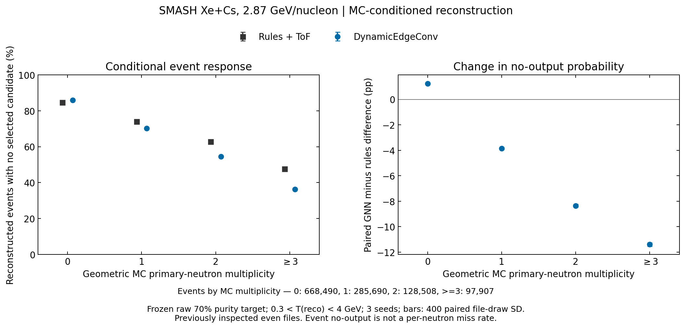

# Зависимость отклика события от геометрической MC-множественности

18 ноября 2026. На принятых локальных счётчиках проверено, как часто методы
возвращают ноль выбранных кандидатов при разном числе геометрически отобранных
первичных MC-нейтронов. Это часть проверки зависимости от множественности в
[плане восстановления выхода](../../neutron_yield_rapidity_plan_20261117.md).
Доступ к ROOT для этого расчёта не требуется.

SMASH Xe+Cs, 2,87 ГэВ/нуклон; 286 ранее просмотренных чётных файлов,
1 180 595 событий в принятых processed spans. DynamicEdgeConv использует raw
энергию и замороженный порог, соответствующий целевой native-label purity
70% на валидации. Оба метода выбирают кандидатов с 0,3 < T(reco) < 4 ГэВ.
MC-множественность включает все истинные энергии в прежней геометрической
популяции. Это разные условия для MC и кандидатов; входные пересечения
детектора здесь не определяются.

| Геометрическая MC-множественность | Событий | Без кандидатов, правила + ToF (%) | Без кандидатов, GNN (%) | Парная разность GNN − правила (п.п.), ± SD |
|---|---:|---:|---:|---:|
| 0 | 668 490 | 84,70 | 85,94 | +1,244 ± 0,041 |
| 1 | 285 690 | 74,03 | 70,17 | −3,860 ± 0,072 |
| 2 | 128 508 | 62,89 | 54,53 | −8,35 ± 0,11 |
| ≥3 | 97 907 | 47,68 | 36,27 | −11,40 ± 0,14 |

В знаменателе каждой строки — события с указанной **MC truth**
множественностью; в числителе — события без выбранных **reconstructed**
кандидатов. Отношение считается отдельно для каждого seed внутри каждого
draw, затем усредняется поровну по seeds 42/123/456. Ошибка — sample SD
400 общих парных пофайловых перевыборок при фиксированных моделях; она не
включает неопределённость обучения. Неопределённых отношений нет.

GNN реже оставляет события с геометрическими MC-нейтронами без кандидатов;
размер парной разности растёт по этим категориям множественности. При нулевой
геометрической MC-множественности GNN чаще возвращает нулевой результат.
Знаки этих разностей одинаковы для всех трёх настроек потенциала.
Эти наблюдения не устанавливают эффективность каждого нейтрона или причину
зависимости от множественности. Выбранный кандидат может происходить от другой
частицы или нейтрона вне геометрической популяции. Ненулевой выход при нулевой
геометрической множественности не является доказанным физическим фоном.

Слева — вероятность нулевого выхода в каждой MC-категории, справа — её парное
изменение; точки и полосы показывают центральные значения и один файловый SD.
Категории 0/1/2/≥3 унаследованы из сохранённой матрицы. Последняя объединяет
все более высокие множественности; их отдельный отклик здесь не разрешён.
[Векторный рисунок](no_output_by_multiplicity.pdf).

Для измерения влияния наложений нужны сопоставленные нейтроны и граф связей
в тех же классах загрузки; для физической эффективности — входные пересечения
и родословная. Обращение отклика, замыкание выхода и n/p по этой таблице не
выполняются. Пороги, модели и окна не менялись. Рукопись в этой задаче не
обновлялась.

[Полные результаты](results.json) сохраняют условные распределения числа
кандидатов, все настройки потенциала, центры по seeds, SD, Q16/Q84 и SHA.
[Редуктор](../occupancy_20261118.py) проверяет SHA принятого `even.npz`,
сохранение числа событий и общие MC-маргинали, а также точно воспроизводит
прежний безусловный нулевой выход и его парные ошибки.
[Протокол до расчёта](../occupancy_protocol_20261118.md).

Воспроизведение из корня HGNDRecoGNN в окружении с NumPy и Matplotlib:
`python reports/final_model_comparison_20261117/occupancy_20261118.py`.
Редуктор сохраняет уже существующий каталог результатов и требует нового
пути либо отдельного checkout для повторного запуска.
