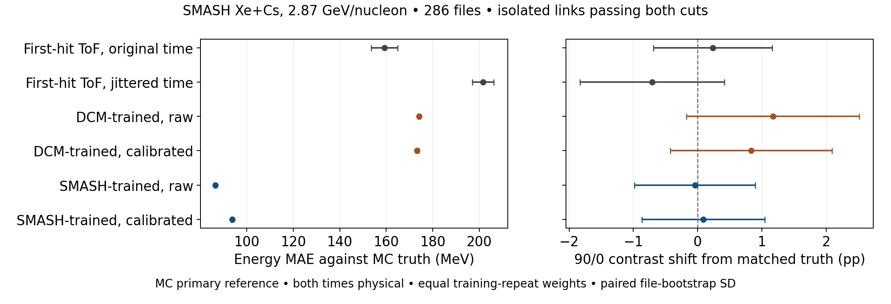

# First-hit ToF and network energy on the same neutrons

On isolated direct neutron links in 286 SMASH Xe+Cs files at 2.87 GeV per
nucleon, the SMASH-trained network has smaller mean absolute error than a
straight-line first-hit ToF estimate. Original ToF has the smaller median
absolute error. For the hardness contrast between 90 and 0 MeV, the
difference between the two energy estimates is smaller than its paired
file-bootstrap uncertainty on these links.

## Common sample and first-hit estimate

Use the nominal HGND front-face window in the processed event span, with
no impact-parameter selection. An isolated link has degree one at both
ends in the full observed direct-neutron graph. The accepted 142,912 links
also require a native qualifying hit. For each training repeat, take the
intersection of the two original score cuts on held-out folds. This
selection depends on both score cuts and includes a ToF condition in the
MC labelling. The result characterizes this subset.

Select the earliest retained hit by exported time, with ties resolved by
Instance. This choice uses detector observables only. For that one hit,
compare original exported time with the same time after the deterministic Gaussian
jitter with SD 0.15 ns used in the network inputs. Compute
`Ekin = m_n (1/sqrt(1 − beta^2) − 1)`, with `beta = L/(c t)`,
where L is the distance from the origin to the cell. Separate event start
and the true path are absent. The estimate is a nominal-path ToF proxy.

| Training repeat | Pass both cuts | Both timestamps give physical speed | Original time invalid | Jittered time invalid |
|---|---:|---:|---:|---:|
| 1 | 80,792 | 80,515 | 80 | 242 |
| 2 | 81,368 | 81,097 | 77 | 238 |
| 3 | 77,623 | 77,384 | 71 | 207 |

All invalid cases have positive time and nonphysical speed. Invalid
categories overlap between timestamps. The common validity requirement
excludes 239–277 objects per repeat, leaving 99.66–99.69%. Valid finite
energies are kept without clipping. Original ToF produces 231–262
estimates above 10 GeV per repeat on the common valid sample.

## Energy and hardness comparisons

All estimates use the initial MC primary kinetic energy as the reference.
The mean column averages the three training repeats with equal weights.
Its uncertainty is the SD of the 400 accepted paired file-bootstrap draws,
shared across estimates and repeats. The median column gives the range of
the central medians across repeats.

| Estimate | Mean absolute error, MeV | Median absolute error, MeV |
|---|---:|---:|
| First-hit ToF, original time | 159.3 ± 5.7 | 41–43 |
| First-hit ToF, jittered time | 201.6 ± 4.6 | 78–81 |
| DCM-trained network, raw | 174.2 ± 0.5 | 110–137 |
| DCM-trained network, calibrated | 173.3 ± 0.7 | 100–118 |
| SMASH-trained network, raw | 86.5 ± 0.4 | 50–52 |
| SMASH-trained network, calibrated | 93.7 ± 0.4 | 52–54 |

Across repeats, the raw SMASH-trained estimate reduces MAE by 69–77 MeV
relative to original ToF, with paired file SD of 5.6–6.0 MeV. The ordering
reverses for the median. Mean and median therefore describe different
parts of the error distribution. The two networks differ in their training
productions, energy, feature scaling, learned weights and operating points.

The left panel compares absolute energy error. The right panel compares
the change in the 90/0 hardness contrast relative to the same selected
MC primaries, which tests how energy assignments affect band counts.
The low band is [0.3, 1) GeV and the high band starts at 2 GeV. Values
average training repeats. Bars show paired whole-file bootstrap SD.

The selected MC reference contrast ranges from 6.79% to 7.64% across
repeats. On those same objects, original ToF gives 7.18–7.83% and the raw
SMASH-trained network gives 6.87–7.61%. The paired network-minus-ToF
difference spans −0.31 to −0.22 percentage points, with paired file SD
0.95–1.09 points. The error improvement therefore does not resolve a
difference in this contrast. The comparison covers isolated direct
links, so the full reconstructed contrast still requires the response
of the other candidates and descendant-mediated associations.

## Reproduction

CPU job 4500616 completed with exit 0:0 on cn-035 in 4:56. The extractor
replayed 286 input files, 5,833,940 hit observations and 1,798,225 cluster
keys. Native labels and targets reproduced exactly. The local comparison
replayed both-cut populations and the prior saved network energy moments
before applying the shared ToF validity mask.

[Protocol](protocol.md) · [Slurm receipt](terminal_slurm.txt) ·
[Input and output receipt](export/receipt.json) · [Numerical results](results.json) ·
[Paired figure data](figure_data.json) · [Figure PDF](first_hit_energy_comparison.pdf)

[Energy linearity and resolution by true-energy bin](energy_response/README.md)
uses the same matched sample and bootstrap draws.
