# Feasibility of neutron–proton observables and spectral hardness with the BM@N Highly-Granular Neutron Detector

**Full-production truth study and reconstruction update**  
**BM@N HGND internal analysis note — not for external distribution**  
29 September 2026

## Abstract

Three SMASH Xe+Cs samples with symmetry-potential strengths
$U_{\mathrm{sym}}=0$, 18, and 90 MeV provide 2,345,993 events in 568
independent generation jobs. This note begins from the observable question.
The integrated neutron-to-proton yield ratio has differential kinematic
structure, but it is effectively insensitive to $U_{\mathrm{sym}}$ in the
exact HGND front-face acceptance. Spectral hardness is different: neutron
hardness rises by $4.52\%$ and proton hardness falls by $5.39\%$ between 0
and 90 MeV, giving a $10.48\%$ truth-level double-ratio response. These
conclusions use impact-parameter reweighting and a bootstrap over production
jobs.

The reconstructed observable must be defined inside the detector-efficiency
plateau. Reconstruction performance is established first, the score cut and the
energy window are then calibrated to maximise $U_{\mathrm{sym}}$ separation,
and only then is sensitivity quoted; every observable is put through the same
calibration, so none is a tuned quantity compared against an untuned one.

The baseline observable, the integrated $n/p$ yield ratio, does not respond at
any level of the chain: $-0.12\%\pm0.45\%$ at truth and, for the HGND alone,
$+0.43\%\pm0.65\%$ reconstructed, neither ordered in $U_{\rm sym}$ on held-out
units. This is expected, since
the symmetry potential redistributes nucleon energy rather than changing how
many nucleons arrive, and it is the floor against which everything else is read.

Two observables clear it. The HGND alone, through the reconstructed
neutron hardness $R_n$ at $q>0.60$, reaches $+2.71\%\pm2.29\%$
(1.37$\sigma$) on held-out units against a truth-level $+4.83\%\pm1.02\%$:
the effect is found — 47 of 134 admissible windows order the samples on
development units — but the split is underpowered to resolve it. Pairing the
same reconstructed neutrons with an external proton measurement gives
$+9.61\%\pm2.37\%$ (4.05$\sigma$), because the proton hardness moves against
the neutron hardness and the isovector response adds in the ratio rather than
cancelling. An earlier evaluation found no ordered window at all; the cause was
a per-sample standardisation defect, since corrected, which biased reconstructed
energy in the direction that cancels the response. An event-level study
quantifies the efficiency for the first, second, and subsequent true-neutron
clusters rather than quoting only an inclusive average.

## Observables and notation

Every symbol used anywhere below is defined here, so that the summary table
that follows can be read before the sections that derive it.

**Spectral hardness.** For a species $s\in\{n,p\}$ and an energy window,

$$
R_s = \frac{N_s(E \geq E_{\rm hi})}{N_s(E < E_{\rm lo})},
$$

the ratio of the counts above and below a split in kinetic energy. It removes
the overall yield normalisation and tests the energy redistribution the
symmetry potential produces.

Two window conventions appear, and they are not interchangeable:

- the **legacy window**, $E_{\rm lo}=1$ GeV and $E_{\rm hi}=2$ GeV, inherited
  from the truth study. It is used only for the truth-level numbers in the
  summary table and in the Backup. Its denominator sits where the detector
  records about two per cent of what arrives, so it is not usable at
  reconstruction level;
- the **calibrated window**, parametrised by a centre $R_{\rm thr}$ and a
  half-gap $\delta$ with $E_{\rm lo} = R_{\rm thr}-\delta$ and
  $E_{\rm hi} = R_{\rm thr}+\delta$, searched rather than chosen. Part III
  derives it. Every sensitivity quoted in Part III uses this convention.

**Response and separation.** The quantity measured is the relative change of an
observable between the $U_{\rm sym}=90$ and $0$ MeV samples,
$S_{90}/S_{0}-1$, and its separation is that response divided by its bootstrap
uncertainty.

**Cluster score.** $q$ is the network's cluster-classification output. A
neutron candidate is a cluster with $q$ above a working point; Part III fixes
it at $q>0.60$ and says why. A hat, as in $\widehat R_n$, marks a quantity
built from reconstructed rather than generated energies.

**Integrated yield.** $Y_s$ is the number of particles of species $s$ arriving
in the acceptance per event, and $\widehat Y_n$ is the number of reconstructed
neutron candidates per event at the working point. The ratio $Y_n/Y_p$ was the
baseline observable of this study, which is why it stays in the result table in
Part III rather than being set aside: the hardness ratios have to be shown to
beat it, not merely to work. Yields carry no energy window, so there is nothing
on them to calibrate.

**The observables carried to the result.** Part III compares these and only
these — three integrated-yield baselines and four hardness ratios:

| symbol | definition | what produces it | calibrated |
|---|---|---|---|
| $Y_n/Y_p$ | integrated neutron over proton yield, truth | MC truth, no detector | no window |
| $\widehat Y_n$ | reconstructed neutron candidates per event at $q>0.60$ | HGND alone | no window |
| $\widehat Y_n/Y_p^{\rm MC}$ | reconstructed neutron yield over truth proton yield | HGND plus an external proton measurement | no window |
| $R_n$ | neutron hardness, truth energies | MC truth, no detector | yes |
| $R_n/R_p$ | neutron over proton hardness, truth energies | MC truth, no detector | yes |
| $\widehat R_n$ | neutron hardness from reconstructed cluster energies at $q>0.60$ | HGND alone | yes |
| $\widehat R_n/R_p^{\rm MC}$ | reconstructed neutron hardness over truth proton hardness | HGND plus an external proton measurement | yes |

The HGND measures neutrons only, so any ratio containing $R_p$ requires a
separate proton measurement and is a bound on a combined analysis rather than
a number this detector produces alone. Observables that were tried and dropped
are defined where they appear in the Backup.

## Decision summary

| Question | Window | Result | Analysis decision |
|---|---|---:|---|
| **Baseline** truth $Y_n/Y_p$ | none | $-0.12\%\pm0.45\%$, $0.26\sigma$ | No response. Kept in the result table as the reference every other observable is measured against. |
| **Baseline** reconstructed $\widehat Y_n$ | none | $+0.43\%\pm0.65\%$, $0.67\sigma$ | Counted per event, including the 81% with no candidate. Ordered on the full sample ($+0.85\%$) but not on held-out units. |
| **Baseline** $\widehat Y_n/Y_p^{\rm MC}$ | none | $-0.48\%\pm1.11\%$, $0.43\sigma$ | No response. |
| Differential $n/p(E_{\mathrm{kin}},y,p_T)$ | — | Strong shape dependence | Retain as a transport-model and phase-space diagnostic. |
| Truth $R_n$ in HGND acceptance | legacy | $+4.52\%\pm0.45\%$ | Primary detector-level physics target. |
| Truth $R_p$, same window | legacy | $-5.39\%\pm0.51\%$ | Requires the charged tracking arm, not HGND alone. |
| Truth $R_n/R_p$ | legacy | $+10.48\%\pm0.76\%$ | Preferred truth-level isovector diagnostic. |
| Legacy window at reconstruction level | legacy | Denominator below 1 GeV has $\sim2\%$ efficiency | Unusable. Motivates the calibrated window. |
| Per-sample feature standardisation | — | Biases $E_{\rm reco}$ by 0.8%, monotonic in $U_{\rm sym}$ | Defect. Caches that are compared must share one scaler; corrected before any result below. |
| Reconstruction at $q>0.60$ | — | AUC 0.9582; purity 87.3% at efficiency 71.5%; linearity $\pm1.1\%$, resolution 5.9–7.3% over 0.5–2.6 GeV | Meets the reference energy targets; efficiency at fixed purity still short of 0.80. |
| Truth $R_n$, calibrated | calibrated | $+4.83\%\pm1.02\%$ held out, $4.75\sigma$ | $R_{\mathrm{thr}}=1.5$, $\delta=0.7$ (Part III). |
| Truth $R_n/R_p$, calibrated | calibrated | $+6.34\%\pm1.07\%$ held out, $5.92\sigma$ | Upper bound of the chain. |
| **$\widehat R_n$, HGND alone** | calibrated | $+2.71\%\pm2.29\%$ held out, $1.18\sigma$ | 47 of 134 windows ordered on development; the held-out split is underpowered. Feasibility, not a limit. |
| **$\widehat R_n/R_p^{\rm MC}$** | calibrated | $+9.61\%\pm2.37\%$ held out, $4.05\sigma$ | Preferred target. Needs an external proton measurement; the species respond with opposite sign, so the ratio roughly doubles the response. |

## Statistical conventions

Figure captions state whether the contents are **MC truth** or
**reconstructed**. Truth quantities use information available only in
simulation — the generated nucleon list, the true kinetic energy, the
truth-matched cluster label — and set what a perfect detector would measure.
Reconstructed quantities use only what the pipeline produces from hits. Mixing
them silently in one figure is the error that made an earlier draft read as
though the detector had measured the truth-level response, so the distinction is
now carried in the caption of every figure.

Every $\sigma$ quoted in this note is defined as follows, so that numbers from
different sections are comparable.

For a ratio observable formed from two counts in a sample $s$,

$$
R_s \;=\; \frac{N^{\mathrm{hi}}_s}{N^{\mathrm{lo}}_s},
\qquad
\Delta \;\equiv\; \frac{R_{90}}{R_{0}} - 1 ,
$$

where $\Delta$ is the response quoted as "90/0". Uncertainties come from a
bootstrap over *resample units* rather than from counting errors. Let $u$ index
the units of a sample and $b=1\ldots B$ the replicates. Each replicate draws
$|u|$ units with replacement and recomputes the ratio from the resampled totals,

$$
R_s^{(b)}=\frac{\sum_{u\in\mathcal{B}^{(b)}_s} n^{\mathrm{hi}}_{u}}
               {\sum_{u\in\mathcal{B}^{(b)}_s} n^{\mathrm{lo}}_{u}},
\qquad
\Delta^{(b)}=\frac{R_{90}^{(b)}}{R_{0}^{(b)}}-1 ,
$$

and the quoted uncertainty and significance are

$$
\sigma_\Delta=\sqrt{\frac{1}{B-1}\sum_b\left(\Delta^{(b)}-\overline{\Delta}\right)^2},
\qquad
\mathcal{S}=\frac{|\Delta|}{\sigma_\Delta}.
$$

The resample unit is the **generation job** wherever the job label is available.
Events produced by one job are correlated in impact parameter: within a single
sample, where no $U_{\mathrm{sym}}$ difference can exist, job means of $b$
scatter at $\chi^2/\mathrm{ndf}=8.15$ for 194 degrees of freedom, and the
job-level error on $\langle b\rangle$ is 2.85 times the per-event one. Treating
events as independent therefore overstates significance by roughly that factor
for any $b$-dependent quantity. Where the job label is unavailable — the
reconstructed spectra, whose cache source list cannot be reconstructed — the
unit is the event, and that is stated at the point of use.

Significance is a statement about statistical reproducibility only. It carries
no systematic uncertainty, and for a quantity selected by scanning it is
inflated by the selection: the hardness window search below quotes both the
development value and the held-out value for exactly this reason. The empirical
floor against which a response should be judged is the **noise floor**, the
median $|\Delta|$ obtained by splitting one sample's own jobs into two halves
and running the identical procedure; a response comparable to that floor is not
distinguishable from the method's own variance whatever its $\mathcal{S}$.

## Neutron-to-proton ratio feasibility

### The spectra behind the ratios

Every ratio in this note is formed from two nucleon spectra, and those spectra
are shown first so that a reader can see which part of the energy range carries
the response. Figure 0 gives the primary neutron and proton spectra inside the
exact front-face acceptance, each normalised per generation job before
averaging so that a job contributing more nucleons does not weight the shape.
Uncertainties resample production jobs.

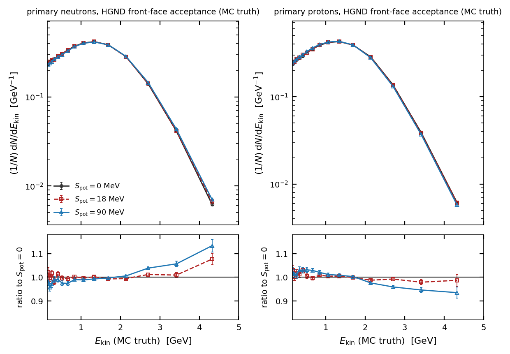

*Figure 0 (MC truth). Primary neutrons (left) and protons (right) inside the front-face
acceptance, for the three symmetry-potential samples, with the ratio to
$U_{\mathrm{sym}}=0$ below each panel and shared ratio limits. The energy axis
is linear: the hardness window is searched between 1 and 3 GeV, shaded here, and
a logarithmic axis would compress that range into a third of the panel. Bins
with fewer than 500 entries in the reference sample are suppressed, and the
display starts at 0.15 GeV below which the log-spaced source bins are narrower
than a marker. Job-level bootstrap, 400 resamples.*

**The differential yield ratio changes sign, and that is the argument for
hardness.** The symmetry potential redistributes nucleons in energy; it does not
create them. So the difference between two samples' spectra must integrate to
about zero over the acceptance, and it does — Figure 7 shows the angular version
closing to 0.023 % of the yield. A ratio of *integrated* yields therefore
averages a positive region against a negative one and lands near unity whatever
the potential does, which is exactly what the $n/p$ yield row shows. The
spectral hardness $R$ is built to exploit the same sign change instead of
cancelling it: it divides the counts on one side of the crossing by the counts
on the other, so the two regions enter with opposite sign and add. That is why
$R$ is the adopted observable and the integrated yield is not a competitor to
it — $R$ is a differential yield ratio, and the integrated yield is its own
integral.

The isovector structure is visible directly rather than only through an
integrated number. Above roughly 2 GeV the neutron ratio rises to about 1.15
while the proton ratio falls to about 0.93; below 0.1 GeV both rise. The
hardness ratios quoted later are integrals over these two opposite trends, and
the double ratio is large because the two species move apart rather than because
either moves far on its own.

### Global phase space

The global primary-nucleon ratio reproduces the qualitative structure of the
“n/p–SMASH check” reference: $n/p$ separates most strongly at high kinetic
energy and its shape depends on rapidity. Figure 1 uses the complete available
production rather than a file subset. The lower panels show the ratio to the
$U_{\mathrm{sym}}=0$ sample so that the parameter response is not confused
with the large common spectral shape.

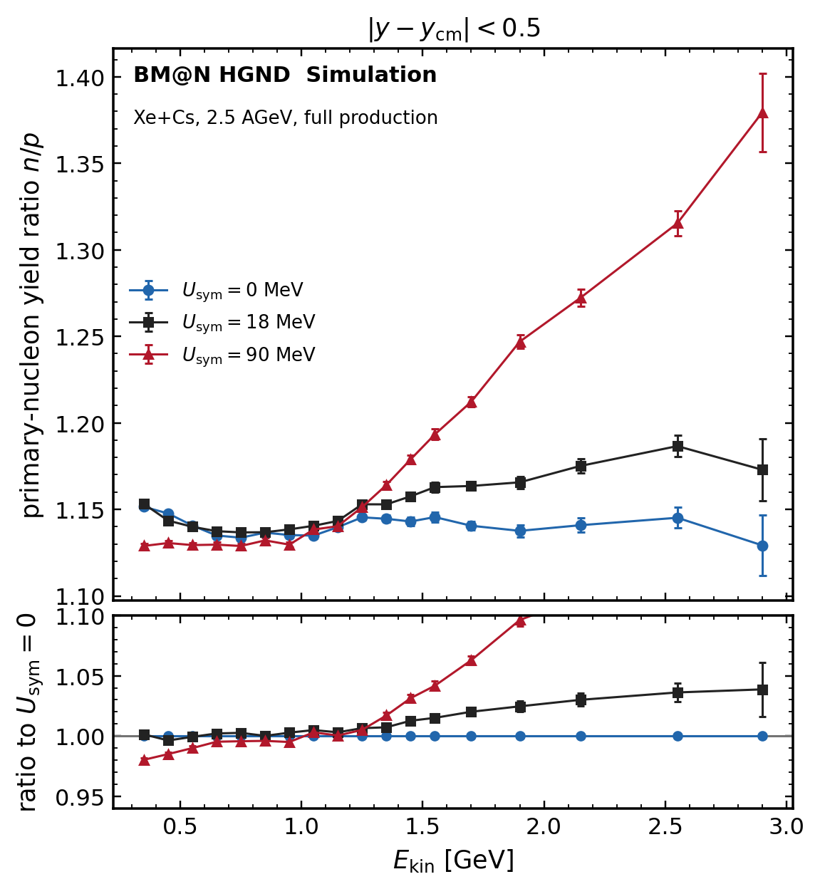

*Figure 1 (MC truth). Primary-nucleon $n/p$ against kinetic energy at
midrapidity, $|y-y_{\mathrm{cm}}|<0.5$, with the ratio to
$U_{\mathrm{sym}}=0$ below. All available production files are included.
Statistical errors are event-clustered in the source reduction.*

A full-phase-space companion panel was removed rather than revised. Above about
1.6 GeV the inclusive sample is almost entirely beam-rapidity spectators —
19.7 M counts at $|y-y_{\mathrm{cm}}|>0.5$ against 0.078 M at midrapidity in
the 2.55 GeV bin — so the panel reported the projectile's $N/Z$ and its fragment
composition rather than any response to $U_{\mathrm{sym}}$. That is what made
its $U_{\mathrm{sym}}=0$ curve wander non-monotonically and cross *above* the
18 and 90 MeV curves near 1.9 GeV, reversing the ordering every other figure
shows. The excursions looked significant only because that panel's errors were
not the event-clustered ones quoted here: the code overwrote them with a
per-particle Poisson form, which understates the width by orders of magnitude
for spectators that arrive in correlated fragments. An earlier revision had
already tried to repair the panel by switching it from $|y-y_{\mathrm{cm}}|>0.5$
to inclusive rapidity; that could not help, because at these energies the
inclusive sample *is* the $>0.5$ sample. No statement in this note rested on it.

The midrapidity separation is real but is not by itself an HGND measurement. HGND covers a rectangular front face at negative $x$, only
0.0114 sr, and the SMASH reaction plane is fixed. A polar-angle-only selection
therefore cannot replace the exact $(x,y)$ acceptance.

### The kinematic selection applied to both species

The front face is a rectangle, and `in_acceptance` selects a particle by
propagating a straight line to it from the particle's vertex. That is a
neutron's trajectory. It is not a proton's: the analysing magnet bends the
proton, a proton aimed at the face need not arrive, and one aimed elsewhere
may. No field map enters this analysis, so **the proton selection here is not a
proton acceptance** and must not be read as one.

What the isovector ratios need is weaker and is available: one kinematic region
that both species can be counted in, so that a neutron numerator and a proton
denominator are formed over the same phase space.
`hgnd_acceptance.kinematic_acceptance` provides it — the same rectangle, but
selected on emission direction alone, dropping the vertex and therefore
charge-independent. It spans $\theta$ from $8.45^\circ$ to $12.99^\circ$ over
$71.9^\circ$ of azimuth, 20.0 % of $2\pi$, centred on $\phi=180^\circ$, and
takes an optional kinetic-energy window so one call defines the whole
selection.

Dropping the vertex costs little on a counting observable. Against the
vertex-aware test over a target-sized interaction region, $\sigma_{xy}=0.5$ cm
and $\sigma_z=2$ cm, the two selections disagree on 3.1 % of particles
individually but the net count differs by **+0.27 %**, the migrations across the
edge largely cancelling; at $\sigma_{xy}=1$ cm and $\sigma_z=5$ cm the net is
+0.21 %. A common bias of that size cancels again in a ratio of the two species.
`tests/test_kinematic_acceptance.py` holds this to 1 % and will fail if it
drifts. The reduction writes the counters as `kin_n`, `kin_p` and their energy
bands beside the geometric `acc_*` set, so the two can be compared on the next
production rather than one replacing the other unexamined.

### Exact HGND front-face acceptance

For a sample $s$, event weights $w_e$, a bin $B=[x_a,x_b)$ of width
$\Delta x_B=x_b-x_a$, and particle species $a\in\{n,p\}$, the differential
per-event yield used in this note is

$$
Y_a^{(s)}(B)\equiv
\left.\frac{dN_a}{dx}\right|_B
=\frac{\sum_e w_e\,N_{a,e}^{(s)}(B)}
       {\Delta x_B\sum_e w_e}.
$$

The differential neutron-to-proton yield ratio is

$$
\rho_{n/p}^{(s)}(B)\equiv
\frac{Y_n^{(s)}(B)}{Y_p^{(s)}(B)}
=\frac{\sum_e w_eN_{n,e}^{(s)}(B)}
       {\sum_e w_eN_{p,e}^{(s)}(B)},
$$

where the second equality is valid only when neutron and proton yields use the
same events, weights, bin and acceptance. An integrated yield is obtained by
replacing $B$ by the declared phase-space region and omitting $\Delta x_B$.
For any observable $O$, the quoted Spot response is
$\Delta_O^{90/0}=O^{(90)}/O^{(0)}-1$.

For selected reconstructed neutron candidates the corresponding raw yield is

$$
\widehat Y_n^{(s)}(B)=
\frac{\sum_c w_{e(c)}\,\mathbf{1}(q_c>q_0)\,
      \mathbf{1}(x_c^{\rm reco}\in B)}
     {\Delta x_B\sum_e w_e}.
$$

It includes fake candidates unless a response model is applied. The hybrid
$\widehat\rho_{n/p}=\widehat Y_n/Y_p^{\rm MC}$ therefore tests feasibility
with MC-truth protons; it is not a data-level $n/p$ measurement.

Figure 2 propagates both neutron and proton primaries from their production
vertices to the detector front face. The uncertainty is obtained by resampling
whole generation files; treating all particles as independent would
substantially underestimate it. The energy-differential ratio separates above
roughly 2 GeV, but its integral over the acceptance does not order the three
$U_{\mathrm{sym}}$ values. The integrated 90/0 change is only
$+0.06\%$ ($0.2\sigma$).

The apparent 2–3 GeV gap in the previous rendering was not physical. It came
from assigning logarithmic native bins to coarse bins by their centres. The
revised plot merges complete native intervals using their exact boundaries,
conserves all entries, and connects all populated points.

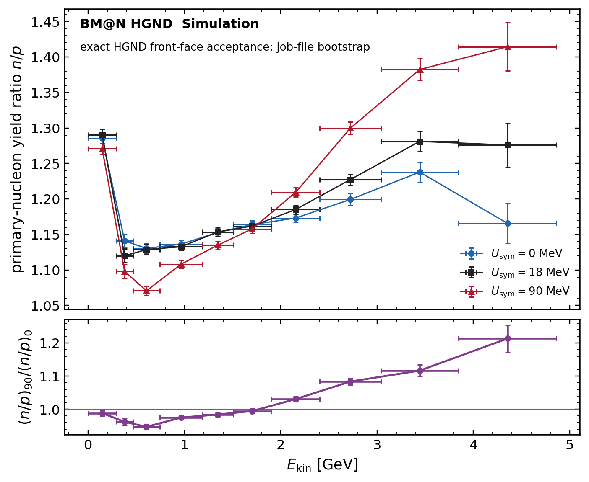

*Figure 2 (MC truth). Differential primary-nucleon $n/p$ in the exact HGND front-face
acceptance. The lower panel is the 90/0 double ratio. Error bars are from a
400-replica generation-job bootstrap.*

The conclusion is deliberately narrow: integrated $n/p$ is not a useful
$U_{\mathrm{sym}}$ observable for HGND. Differential $n/p$ remains valuable
for generator validation and for a combined neutron–charged-particle analysis
with matched phase space.

The angularly differential neutron yield and $n/p$ response provide a useful
cross-check because they retain information that cancels in the integral. In
the HGND angular band, however, the truth neutron-yield response is only
$+0.181\%\pm0.153\%$ ($1.18\sigma$). The much larger changes below about
$6^\circ$ are outside the HGND band and cannot be claimed as HGND sensitivity.

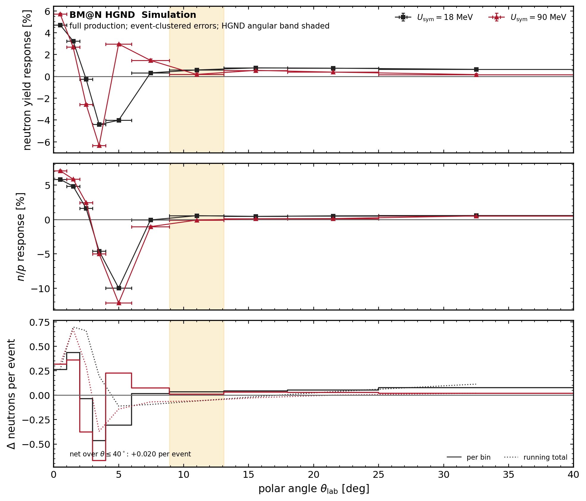

*Figure 7 (MC truth). Differential-yield diagnostic against polar angle, all
responses relative to $U_{\mathrm{sym}}=0$. **Top:** relative per-event neutron
yield. **Middle:** relative $n/p$. **Bottom:** the same neutron movement in
absolute terms, $\Delta$ neutrons per event per bin (solid) with its running
total (dotted). The bottom row is there because a per-bin ratio cannot answer
what the sign change near $2^\circ$ and $4^\circ$ means: a large relative swing
in a sparse bin and a small one in a dense bin look alike. In absolute terms the
redistribution is forward — $\theta<8^\circ$ holds 59 % of the yield and moves
$-0.143$ neutrons per event — and it closes, the running total ending at
$+0.020$ per event over $\theta\leq40^\circ$, 0.023 % of the yield. That is the
expected behaviour of a potential that redistributes nucleons rather than
creating them. The HGND band carries 6.9 % of the yield and $+0.011$ per event,
near the null, which is the same statement as the flat integrated-yield baseline
in Part III. The shaded strip is
the $[8.9^\circ, 13.1^\circ)$ **angular band**, not the detector acceptance: the
band covers 0.0879 sr against the front face's 0.0114 sr, so it overstates the
acceptance by 7.7 times and does not carry the azimuthal restriction. It is
shown because the yield is differential in $\theta$; no number in Part III is
taken from it. Errors are event-clustered.*

## Spectral hardness is the recommended observable

The truth study uses the legacy window defined above, $E_{\rm lo}=1$ GeV and
$E_{\rm hi}=2$ GeV. The 18 MeV point lies between the two outer samples for
$R_n$, $R_p$ and $R_n/R_p$, which is the first check that the effect is a
response to the parameter rather than a difference between two productions.

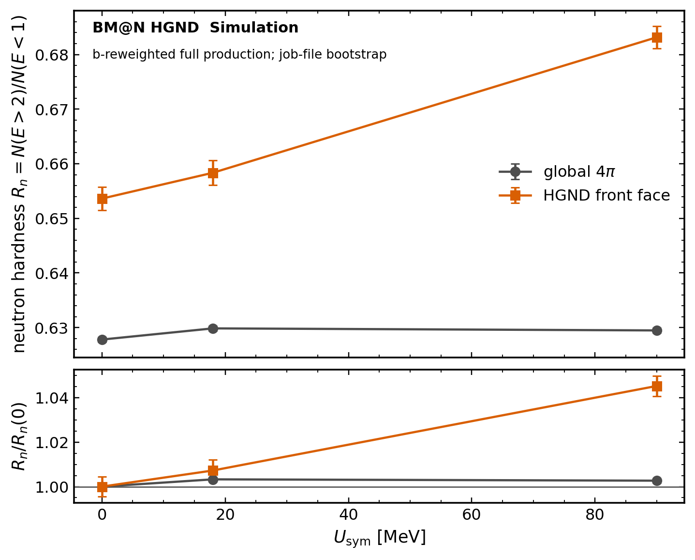

*Figure 3 (MC truth). Neutron spectral hardness globally and in the HGND front-face
acceptance. The response is localised in the forward detector window; the
global spectrum changes little.*

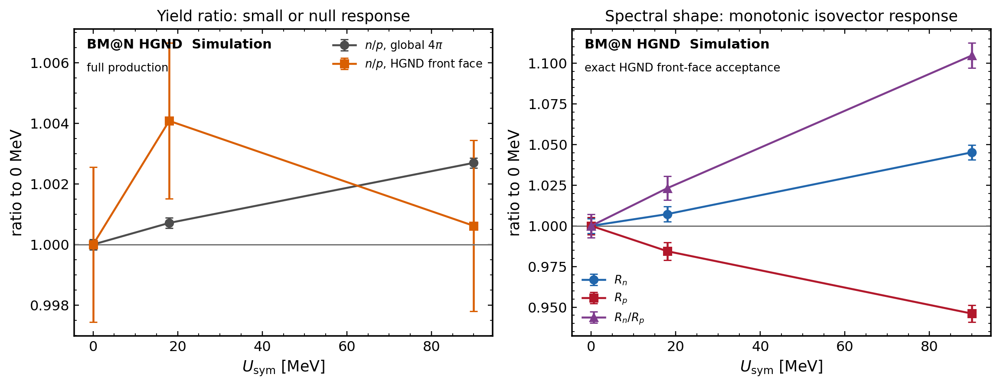

*Figure 4 (MC truth, with reconstructed entries labelled in the panel). Observable comparison. Yield $n/p$ is small or null in the HGND
acceptance, while the spectral-hardness observables show a monotonic isovector
response.*

At full statistics the exact-acceptance responses are

$$
\begin{aligned}
R_n(90)/R_n(0)-1 &= +4.52\%\pm0.45\%,\\
R_p(90)/R_p(0)-1 &= -5.39\%\pm0.51\%,\\
\frac{(R_n/R_p)_{90}}{(R_n/R_p)_0}-1 &= +10.48\%\pm0.76\%.
\end{aligned}
$$

The larger angular band gives $+10.73\%$ for the last quantity. The agreement
shows that the response is not created by the fiducial definition; the exact
acceptance simply has 7.9 times fewer particles and hence larger uncertainty.

The double-ratio response is not caused solely by protons. In logarithmic
response, neutron hardening contributes
$\ln(1.0452)=0.0442$ and proton softening contributes
$-\ln(0.9461)=0.0554$: approximately 44% and 56% of the total, respectively.
The neutron spectra can look nearly coincident on a logarithmic yield plot
while their high/low integrals still differ at more than $10\sigma$ because the
full production sample makes a few-percent shape change statistically precise.

# Part II — Reconstruction

## The reconstruction chain and its fixed parameters

A hit carries a position, a cell index, a time and an energy deposit. The chain
turns hits into neutron candidates in three steps.

1. **Graph.** Two radius graphs are built on raw coordinates: a spatial one on
   the cell indices $(\mathrm{Layer}, \mathrm{Row}, \mathrm{Column})$ with
   radius $r_{\rm local}$, and a temporal one on the hit time with radius
   $t_{\rm win}$. The hit graph is their **intersection**, so two hits are
   linked only when they are both close together and close in time.
2. **Clusters.** A cluster is a connected component of that graph. It is
   intended to collect the hits left by one incident neutron.
3. **Network.** A graph network assigns each cluster a score $q$ that it
   originates from a primary neutron, and regresses its energy. Candidates are
   clusters with $q$ above the working point fixed in Part III.

The chain carries six fixed values. The convention in `AGENTS.md` is that each
is either motivated or explicitly marked unexamined, so that a reader can tell
the two apart:

| value | setting | status |
|---|---|---|
| $r_{\rm local}$ | 3.6 cell units | Inherited from the reference implementation. Unexamined here. |
| $t_{\rm win}$ | 1.5 ns | **Measured, and not optimal.** Calibrated jointly with the prompt width below on the three multiplicities the reference uses. On SMASH the signal-cluster count closes at 0.72 ns and the clustering's bias on the hardness ratio halves between 1.5 and 0.75 ns. See `reports/dombay_reference_audit.md`. |
| time smearing | 0.15 ns Gaussian | The assumed detector time resolution. |
| hit threshold | $E_{\rm dep} > 3$ MeV | Inherited from the reference implementation. Unexamined here. |
| prompt match | $\pm2\sigma$ of the time-of-flight energy | **Measured, and not optimal.** Scanned jointly with $t_{\rm win}$: tightening to $1\sigma$ raises the unsplit fraction from 96.4% to 98.2% and drops the hardness bias from $+2.05\%$ to $+0.79\%$ at fixed window, at a cost of 0.2 points of isolation. |
| neutron label | primary neutron, $E_{\rm kin}>0.3$ GeV, arriving on the front face, prompt by the row above | The $0.3$ GeV floor is this pipeline's addition and sits below every window searched in Part III, so it does not touch the observable. It does change what "efficiency" counts, so efficiencies here and in the reference do not share a denominator. |

Two of these are the honest weak point of this note. $r_{\rm local}$ is still
taken on trust. The coincidence window and the prompt match have now been
scanned together, and the pair $(1\sigma, 0.75$ ns$)$ beats the production's
$(2\sigma, 1.5$ ns$)$ on isolation, splitting, count closure and hardness bias
simultaneously — the last by a factor six, $+0.79\%$ against $+4.70\%$. Neither
affects the standardisation defect or the calibration in Part III, and both
effects are measured rather than assumed, but a final result should not be
produced at the present settings.

## SMASH reconstruction performance

The converged checkpoint (20 epochs, validation loss 0.6366) was evaluated on
2,746,581 SMASH cluster rows across the three Spot samples, with every sample
re-expressed in the scaler the model was trained with — see *Per-sample
standardisation* below. Its cluster-classification ROC AUC is 0.9582. At the
fixed $q>0.60$ working point, energy-weighted purity is 87.3% and
energy-weighted efficiency 71.5% (count purity 85.5%, count recall 63.6%).

The energy estimator now meets the reference targets over the range that
carries the statistics. Linearity is within $\pm1.1\%$ from 0.5 to 2.6 GeV and
resolution is 5.9–7.3%, against targets of 10% on both. Both degrade in the
sparse tails: $-9.2\%$ linearity at 4–5 GeV (1,725 clusters) and $-17.4\%$ in
the 117-cluster 5.0–6.5 GeV bin. The previous checkpoint reached $+63.9\%$
linearity and 33.7% resolution over the same range, so the compression that
motivated treating truth and reconstructed thresholds as incommensurable is no
longer the dominant effect; what remains is the falling response above 3 GeV.

The working point is a fixed score cut rather than a purity lock. Purity-locking
exists because a fixed cut can select different physical purity in different
samples, and that difference would masquerade as an $U_{\mathrm{sym}}$ effect.
With the per-sample scaler artefact removed the risk is not live: at $q>0.60$
the three samples agree to 0.14 pp in count purity and 0.08 pp in recall.

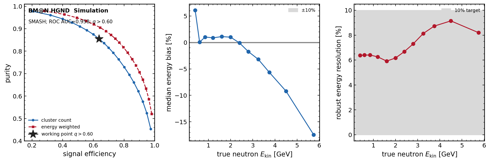

*Figure 8 (reconstructed, against MC-truth energy). SMASH reconstruction
performance for the converged checkpoint: purity against efficiency, median
energy bias, and robust energy resolution. The star marks the working point
used by every reconstructed observable in this note, $q>0.60$, which is the
point closest to 87% energy-weighted purity. Shaded regions are the 10%
reference targets. The horizontal coordinate of the two right-hand panels is
true energy, so they diagnose the detector response and are not a
truth-to-reconstructed threshold map. Uncertainties are not drawn: each point
aggregates $10^3$ to $7\times10^4$ clusters and the statistical error is
smaller than the marker. Produced by `scripts/make_update_note_figures.py` from
`results/final_eval/observables/performance_q060.json`.*

Across the three true-energy bins that overlap 1--2 GeV the median energy bias
is now $+0.9\%$, $+1.1\%$ and $+1.0\%$, with resolution 5.9–6.3%, against
$+20.0\%$ to $-1.3\%$ and 20.7–14.0% for the previous checkpoint. The band is
response-flat to about a percent, so the two sides of a split inside it no
longer experience materially different migration. That is a statement about
this band: the response falls steeply outside it, from about 1.0 at 2.5 GeV to
0.2 at 6 GeV, so ratios whose high side is open-ended still need a response
matrix or a forward-folded fit.

## Per-sample standardisation

Each of the three v3 caches was standardised with a `StandardScaler` fitted to
its own sample. `eToF` carries the neutron energy, so a harder sample has a
wider `eToF` distribution: across the three, the `eToF` scale differs by 0.41%
and its mean by 0.019 GeV, while every other feature agrees to within 0.2%.
Standardising per sample therefore divides part of the physics out before the
network sees it, and a neutron of a given energy arrives at the network with a
smaller standardised `eToF` in the harder sample.

The consequence is a reconstructed energy offset that is monotonic in
$U_{\mathrm{sym}}$ and points the wrong way. Median
$E_{\mathrm{reco}}/E_{\mathrm{true}}$ over 1.0--2.2 GeV was 1.01216, 1.00899
and 1.00398 for $U_{\mathrm{sym}}=0$, 18 and 90 MeV: a 0.82 pp spread making
the hardest sample look softest, about 32$\sigma$ on 110k clusters per sample.
It survives conditioning on true energy, where the offset is a near-constant
$-0.7$ to $-0.9\%$ in every bin from 0.5 to 3.5 GeV, and on event occupancy,
which is 1.490, 1.489 and 1.491 clusters per event and leaves the offset
unchanged inside each bin.

This cancelled the reconstructed separation. Of 125 admissible hardness windows,
**none** ordered the three samples; the strongest positive-but-unordered window
reached only $+2.22\%$ at 1.05$\sigma$.

Standardisation is affine, so it is undone exactly rather than rebuilt:
`scripts/evaluate.py --restandardise-to` re-expresses the cached features in the
training scaler,
$x_{\mathrm{dst}} = (x_{\mathrm{src}}\,\sigma_{\mathrm{src}} + \mu_{\mathrm{src}} - \mu_{\mathrm{dst}})/\sigma_{\mathrm{dst}}$,
leaving the raw `SurfaceHit` flag alone and selecting the top or bottom scaler
per graph. After correction the spread falls to 0.10 pp and is no longer ordered
in $U_{\mathrm{sym}}$.

Nothing in the within-sample performance moved: ROC AUC 0.9582 against 0.9578,
and the 87% energy-purity working point 0.873/0.715 against 0.872/0.714. No
purity, efficiency, linearity or resolution number can see a constant per-sample
offset, which is why this survived every performance check made until now. Any
caches that will be compared, or used together for training, must share one
scaler; the preprocessor takes `--scaler-source` for that.

The common feature normalisation is mandatory. Fitting a separate scaler in
each sample changed the scale of the time-of-flight energy feature by 1.9% and
removed part of the physical difference before inference. Reusing one scaler
reduced the differential high-energy response from $-30.7\pm8.6$ to
$-11.4\pm9.8$ MeV and restored the sign and ordering of the reconstructed
central values without changing the network weights.

## Reconstruction efficiency and neutron multiplicity

An inclusive cluster efficiency is insufficient when the physics sample
contains two or more neutrons in the same event. The relevant questions are
conditional:

$$
\begin{aligned}
\varepsilon_k &\equiv
P(\text{$k$th-hardest true neutron selected}\mid N_n^{\mathrm{true}}\geq k),\\
C_k &\equiv
P(N_n^{\mathrm{selected,true}}\geq k\mid N_n^{\mathrm{true}}\geq k).
\end{aligned}
$$

Truth here means a truth-matched reconstructable neutron cluster
(`cl_label = 1`), and true neutrons are ranked by decreasing true kinetic
energy. A single classifier working point is applied to all three samples. The
resulting rank efficiencies and row-normalised multiplicity response are shown
in Figures 7 and 8.

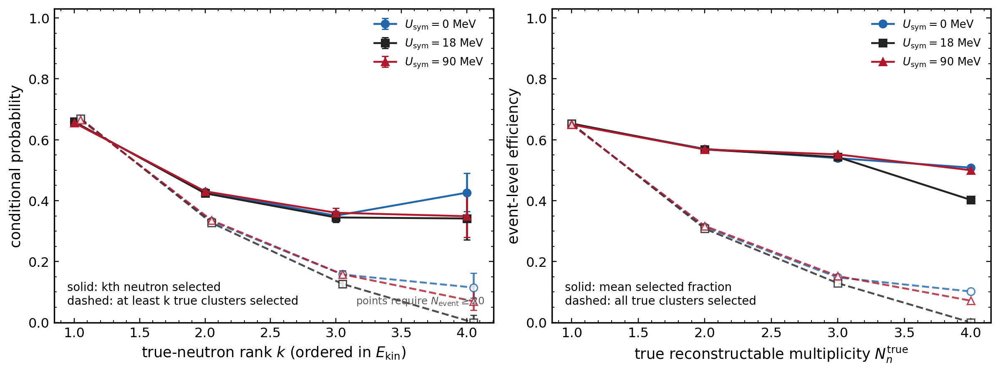

*Figure 7 (MC truth). Conditional efficiency of the first through fourth
true-neutron clusters and efficiency versus true event multiplicity. Wilson intervals are statistical
only. Points require at least 20 eligible events. The dashed curves require all
neutrons through rank $k$ to be retained and therefore expose compounding
losses in multi-neutron events.*

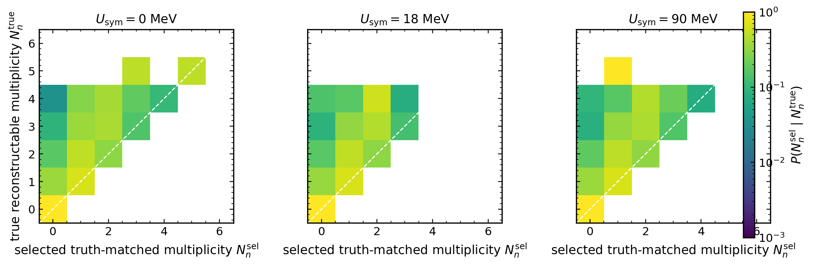

*Figure 8 (MC truth). Row-normalised response between reconstructable truth
multiplicity and selected truth-matched multiplicity. The last bin includes overflow. Fake
selected clusters are excluded here and are tracked separately through
purity.*

At the common score threshold 0.45, the first-neutron rank efficiency is
66.6–66.8% across the three Spot samples. Conditional on a second true neutron
it is 46.4–47.7%, and for a third it is 36.5–41.1%. The probability of retaining
all truth-matched neutrons is only 31.9–33.7% for true multiplicity two and
14.1–14.7% for multiplicity three. Fourth-neutron rank estimates are sample
limited (24–35 eligible events) and are not yet suitable for architecture ranking.
Within these uncertainties the three datasets are consistent for ranks 1--3;
this is a response-closure check, not proof of identical efficiencies. The
former 90 MeV point at rank 5 (the horizontal axis is neutron rank, not energy)
contained exactly one eligible event. It is retained in the CSV/JSON audit
products but omitted from the physics figure by the predeclared
$N_{\rm event}\geq20$ display requirement.

Rank and multiplicity are only half of the response. The other half is the
energy dependence, which the observable definition in the next section depends
on directly, and which Figure 8c separates into its two stages.

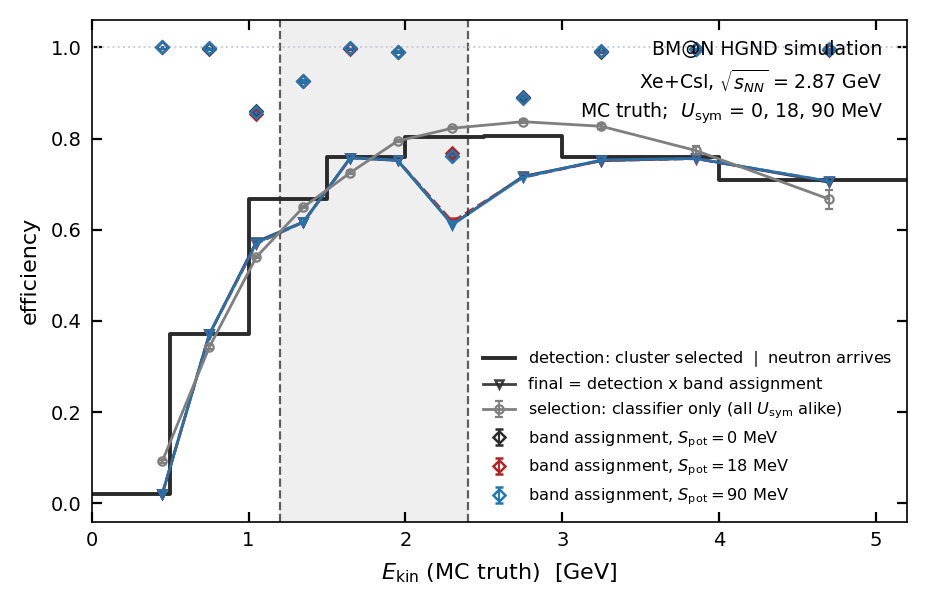

*Figure 8c (binned in MC-truth energy; the quantities are reconstructed). The
efficiency a hardness ratio actually sees, decomposed. **Detection** (step) is
$P(\text{cluster selected}\mid\text{neutron reaches the front face})$, the
denominator from the surface-crossing export, so it folds cluster formation,
transport and the classifier together. **Selection** (grey) is
$P(\text{selected}\mid\text{a truth-matched cluster exists})$, which isolates
the classifier; one curve is drawn because the three samples are
indistinguishable. Neither answers what $R_n$ asks, because both are binned in
true energy while $R_n$ counts clusters by *reconstructed* energy. **Band
assignment** (open diamonds) supplies the missing term: the fraction of selected
signal clusters whose $E_{\mathrm{reco}}$ lands in the same region of the
calibrated window as their $E_{\mathrm{true}}$ — below 1.20 GeV, at or above
2.40 GeV, or in the discarded gap shaded here. **Final** (red) is the product,
and it is the efficiency that gates the observable. Wilson intervals, bins with
fewer than 25 clusters suppressed.*

Band assignment is near unity wherever a bin lies clear of a window edge, 0.99
and above, and dips in the two bins that straddle the edges: 0.861 at
0.90--1.20 GeV and 0.762 at 2.10--2.50 GeV. That is energy-resolution migration
across the edge, and it is the loss the half-gap $\delta$ exists to suppress —
widening $\delta$ moves the edges away from the populated region at the cost of
statistics, which is the trade the window scan makes. The final efficiency
therefore follows detection in the band interiors and falls below it at the
edges, reaching 0.57 in the low band and 0.72--0.76 in the high band.

One term is missing from the curve and cannot be read off it. Band assignment
measures migration *out* of the correct region only. Clusters migrating *in*
from the gap contaminate a band without appearing here — at 2.10--2.50 GeV,
inside the gap, 24 % of clusters are reconstructed into one of the two bands —
and that contamination needs a response matrix rather than an efficiency curve.

The detection and selection curves separate cleanly and answer different
questions. Detection is
0.02 below 0.5 GeV and does not exceed 0.37 anywhere below 1 GeV, which is the
quantitative reason the conventional denominator $E_{\mathrm{kin}}<1$ GeV
cannot be recovered and why the search is restricted to windows above it.
Where the efficiency is still rising, an uncorrected high/low ratio inherits an
artificial hardening from the slope: detection climbs from 0.67 to 0.76 across
1--2 GeV. That is the argument for placing the window higher, and the
calibrated window does sit above it — detection is on its plateau at about 0.80
on both sides of the discarded gap, $1.20 < E < 2.40$ GeV, and is
indistinguishable across the three samples. The residual slope across the two
bands is the leading candidate for any reconstructed ordering that has no truth
counterpart, and it has not yet been bounded. The loss below
1 GeV is therefore cluster formation and transport, not classification, and no
amount of classifier work will recover it. An architecture comparison should be
judged on the points, which it can move, and not on the step, which it cannot.

This decomposition should replace a single “neutron efficiency” number in
algorithm comparisons. The first-neutron efficiency mainly measures ordinary
acceptance and classification. The fall of $\varepsilon_k$ or $C_k$ with rank
isolates overlap, cluster merging, and low-energy losses. The same curves must
be shown for the baseline and every challenger architecture at a common purity
or with their full purity–efficiency envelopes.

These conditional probabilities are detector-response inputs, not candidate
Spot observables. Their purpose is to correct the neutron yield and energy
spectrum. In matrix form, the selected multiplicity/energy distribution is
$m_i=\sum_j A_{ij}t_j+b_i$, where $A_{ij}$ includes the rank-dependent losses
and migration and $b_i$ is the fake-cluster contribution. A forward-folded fit
of $t_j$, or a regularised inversion used only after closure tests, can recover
neutrons lost preferentially in multiplicity-two and multiplicity-three
events. This matters for Spot sensitivity even when the efficiency curves are
identical across samples: if Spot changes the joint energy–multiplicity
composition, applying only one inclusive efficiency biases both the corrected
yield and the high/low hardness ratio. The response therefore has to be binned
at least in true/reconstructed multiplicity and neutron energy, with its
uncertainty propagated through the 90/0 comparison.

### Reconstructed neutron spectrum

Figure 8b gives the reconstructed side of the same picture: neutron candidates
above the $q>0.60$ score threshold, binned in predicted energy.

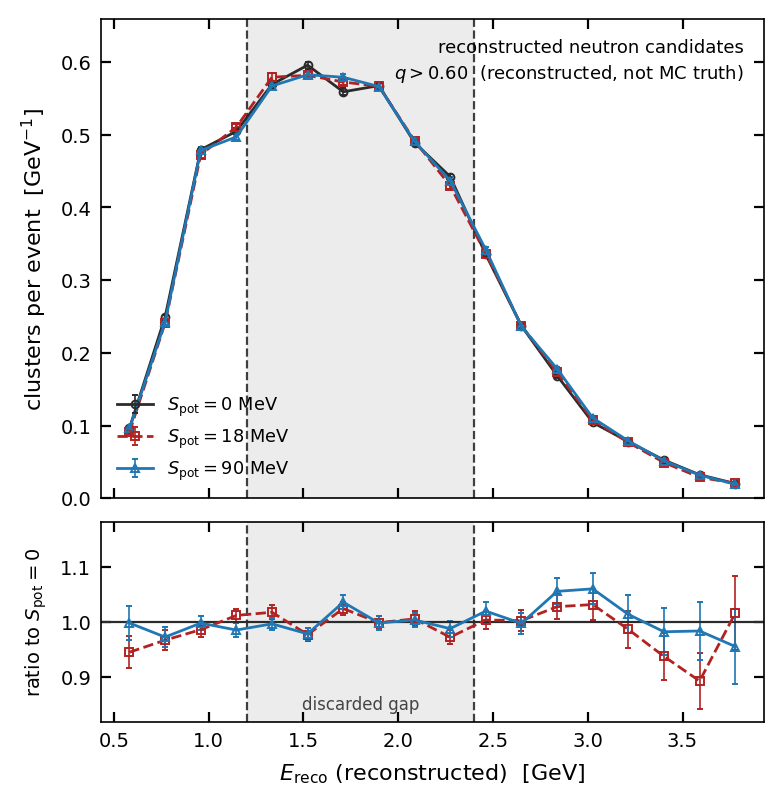

*Figure 8b (reconstructed, not MC truth). Neutron candidates per event against
predicted energy, $q>0.60$ selection, with the ratio to
$U_{\mathrm{sym}}=0$ below. Both axes are linear: once the low-statistics tails
are masked the yield spans well under the factor of about fifty that would earn
a logarithmic ordinate, and a log axis flattens the shape difference between the
samples that the panel exists to show.
Drawn without the Part III window; Figure 9a overlays it on this same
spectrum.
Uncertainties are event-level rather than job-level: the source file list of the
v3 caches cannot be reconstructed, their graph counts exceeding the row space of
the directory they appear to derive from, so the generation-job label is not
available for these predictions. Bins with fewer than 300 reference entries are
suppressed. The energy axis is linear for the reason given at Figure 0.*

The reconstructed spectrum is confined to roughly 0.4--4 GeV, narrower than the
truth spectrum, which is the energy estimator's dynamic range rather than the
physics. The ratio panel is locally consistent with unity within the
individual-bin errors, so the separation is carried by the integrated bands
rather than by any single bin.

With the standardisation corrected the reconstructed observable does now order
the samples. Scanning 207 windows at $q>0.60$ gives 134 admissible, of which
**93 order the three samples** against none before. The window selected on
development units, $R_{\mathrm{thr}}=2.5$ GeV with $\delta=0.3$ GeV, gives
$+4.86\%$ at 2.77$\sigma$ there and, applied once to held-out units,
$+2.71\% \pm 2.29\%$ (1.18$\sigma$). The truth-level target measured the same
way is $+4.83\% \pm 1.02\%$ (4.75$\sigma$), so the reconstruction retains about
four fifths of the response.

It is not yet a measurement. 1.37$\sigma$ on the held-out split is consistent
with zero, and the three held-out points are not monotonic: $R_n$ is 0.1039,
0.1016 and 0.1079 for $U_{\mathrm{sym}}=0$, 18 and 90 MeV, with the 18 MeV
point sitting 2.2% below the 0 MeV point. The split is underpowered for the
effect size — 1.69$\sigma$ expected — so a non-monotonic middle point at this
precision is uninformative rather than evidence against the response.

## Energy response and observable definition

The efficiency for neutrons reaching the front face varies from 0.02 below
0.5 GeV and begins its rapid rise only around 0.5–0.7 GeV, reaching
approximately 0.80 around 2–3 GeV. The measured threshold ratio is therefore
not the truth ratio but

$$
R_{\mathrm{obs}}=
\frac{\int_H \epsilon(E)f(E)\,dE}{\int_L \epsilon(E)f(E)\,dE}.
$$

For $L:E_{\mathrm{kin}}<1$ GeV, the denominator is dominated by the accepted
0.7–1.0 GeV tail rather than by the full truth population. Direct inverse
efficiency weights reach roughly 50 below 0.5 GeV, creating extreme variance
and sensitivity to small modelling errors. Energy migration through the 1 GeV
boundary adds a second bias, and cancellation between Spot samples is
incomplete because their spectra are not identical where $\epsilon(E)$ is
steep. Thus the turn-on can attenuate, amplify, or even reverse the measured
90/0 response; it is not merely an overall loss of events.

Consequently, the denominator of the truth definition
$R=N(E_{\mathrm{kin}}>2\,\mathrm{GeV})/N(E_{\mathrm{kin}}<1\,\mathrm{GeV})$
is not robustly recoverable by bin-by-bin unfolding. The reconstructed
hardness observable must either use two energy regions inside the validated
efficiency plateau or be extracted from a forward-folded spectral fit with
efficiency, energy-scale and migration nuisance parameters. The first route is
taken below: Part III calibrates where those two regions sit rather than
inheriting them. Thresholds are selected on development units only and frozen
before the held-out units are opened.

# Part III — Calibration and sensitivity

## Calibrating the working point and the observable

Everything above is truth level or detector performance. Nothing in it fixes
the two numbers the measurement actually depends on: the score cut that defines
a neutron candidate, and the energy window that defines the hardness ratio.
Both are calibrated here, before any sensitivity is quoted, and both are
calibrated to maximise $U_{\mathrm{sym}}$ separation rather than chosen by
inspection.

### The score cut

A neutron candidate is a cluster with $q>0.60$. The value is the working point
closest to 87% energy-weighted purity, which is the purity the reference
benchmark quotes, so the comparison against that benchmark is like for like.
Figure 8 shows the whole purity–efficiency curve with this point marked; it is
not a corner of the curve but a place on it, and the curve is smooth around it.

The cut is fixed across the three samples rather than re-derived per sample.
Purity-locking, which this note used previously, exists because a fixed cut can
select different physical purity in different samples, and that difference
would masquerade as an $U_{\mathrm{sym}}$ effect. That risk is measurable: at
$q>0.60$ the three samples agree to 0.14 pp in count purity and 0.08 pp in
recall, so the fixed cut imports no per-sample difference worth correcting.
This is only true because the per-sample standardisation defect was removed
first; with it in place the same check failed.

### Where the calibration cuts these distributions

The distributions in Parts I and II are drawn clean, because the search range
and the selected window are results of this section: overlaying them earlier
would ask a reader to accept a conclusion from a figure that has not yet
derived it. Figure 9a puts them back, over the same three curves.

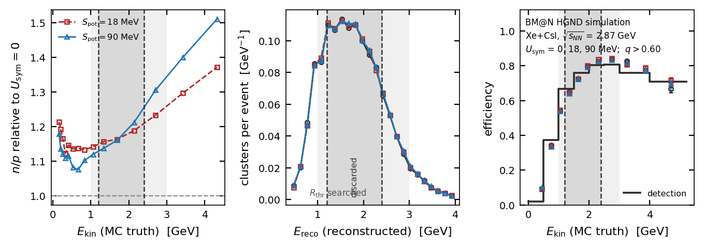

*Figure 9a (left and right MC truth, centre reconstructed). The light band is
the range over which $R_{\rm thr}$ is searched, 1.0–3.0 GeV; the dark band is
the gap the selected window discards, $1.20 < E < 2.40$ GeV, with its two edges
dashed. **Left:** the isovector signal against energy, which is what places the
search range — the two species exchange their ordering near 1.75 GeV, and a
window centred above that crossing puts a suppressed region in the denominator
and an enhanced one in the numerator. **Centre:** the reconstructed neutron
spectrum, showing what the two bands integrate and the yield the gap costs.
**Right:** detection and selection efficiency, showing both bands sit on the
plateau at about 0.80, which is the condition the window has to satisfy. Same
numbers as Figures 8b, 8c and 10; `scripts/plot_calibration_context.py`.*

### The energy window

The hardness ratio needs a split in energy. Writing it as a centre and a
half-gap,

$$
R = \frac{N(E \geq R_{\mathrm{thr}} + \delta)}{N(E < R_{\mathrm{thr}} - \delta)},
$$

makes the two free parameters explicit: $R_{\mathrm{thr}}$ sets where the split
sits and $\delta$ sets how much of the migration-prone region around it is
discarded. A larger $\delta$ buys immunity to energy-scale and resolution error
at the cost of statistics.

The pair is chosen by scanning $R_{\mathrm{thr}} \in [1.0, 3.2]$ GeV and
$\delta \in [0, 0.8]$ GeV, 207 windows, and keeping only those that are
admissible:

- both bands hold at least 2000 entries in every sample, so the ratio is not
  driven by a handful of clusters;
- the ordering runs the way the truth scan established, $R$ rising with
  $U_{\mathrm{sym}}$, since an observable moving the other way is not measuring
  the response;
- for reconstructed energy both edges sit above 1.0 GeV, below which the
  detection efficiency collapses.

Among the admissible windows the objective is the held-out separation, and the
selection is made on development units with 35% of the resample units held back
and opened once. Figure 9 shows the whole scanned plane rather than its argmax,
so the optimum can be seen to be broad.

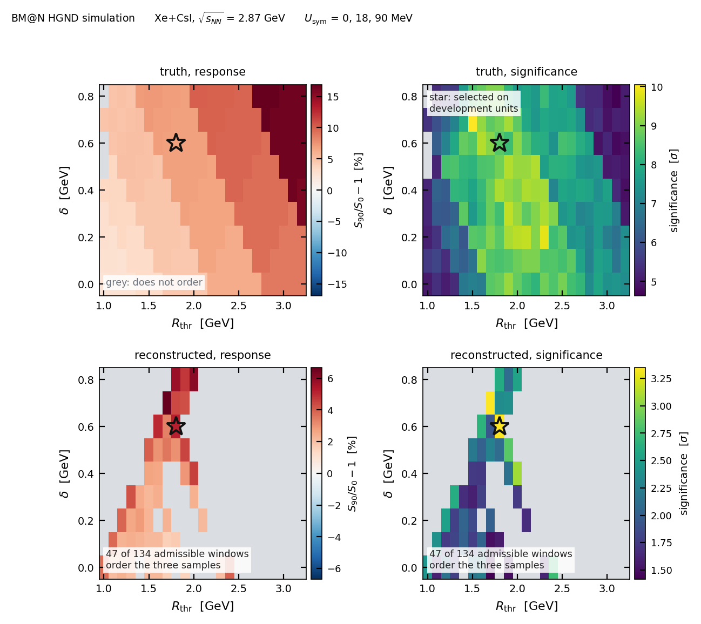

*Figure 9 (top row MC truth, bottom row reconstructed). The hardness-window
scan. Left column: the 90/0 response, diverging colour centred on zero. Right
column: its significance, sequential colour. Grey marks windows that do not
order the three samples; the star marks the window selected on development
units.*

The same scan and the same split are applied to every observable quoted below,
so none of them is a tuned quantity compared against an untuned one. An earlier
version of this note reported a hybrid double ratio at hand-picked thresholds
and compared it against a calibrated single ratio; that comparison was not
meaningful and the number it produced, $1.72\sigma$, was an artefact of the
window rather than a property of the observable.

The two truth panels do not peak in the same place, and that is the substance of
the choice. The response grows monotonically towards large $R_{\mathrm{thr}}$
and large $\delta$, reaching about $+17\%$ in the far corner, because a harder
high band and a wider gap both increase the contrast. The significance peaks
instead in a broad ridge spanning roughly $R_{\mathrm{thr}}=1.5$–$2.6$ and
$\delta=0$–$0.6$, because the far corner buys its larger response with far
fewer counts. The optimiser maximises significance, so it selects inside the
ridge rather than at the largest response. The ridge is broad but not flat: the
eight best windows span $R_{\mathrm{thr}}=1.5$--$2.3$ and $\delta=0.2$--$0.7$,
while moving the centre off the selected cell at fixed $\delta$ costs 36% of the
significance at $-0.3$ GeV and 11% at $+0.3$ GeV. The choice is therefore a
choice, and it is made on development units and tested once.

The physical reason the ridge sits where it does is in Figure 10. The
isovector signal — $n/p$ measured against the zero-potential sample — is
suppressed by a few per cent between 0.2 and 1.5 GeV, crosses unity near
1.8–2.0 GeV, and rises steeply above it to about $+20\%$ by 4 GeV. A window
centred just above that crossing puts a suppressed region in the denominator and
an enhanced region in the numerator, which is where the contrast per unit
statistics is greatest. The optimum is therefore not an arbitrary round number;
it tracks the energy at which the two species exchange their ordering.

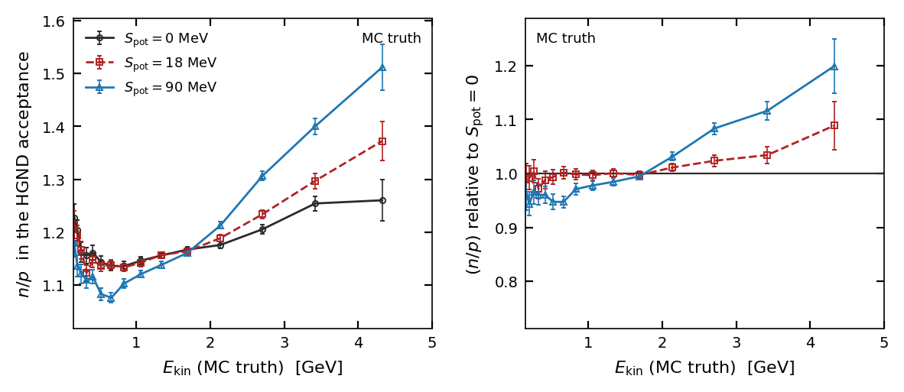

*Figure 10 (MC truth). Left: $n/p$ against kinetic energy inside the front-face acceptance
for the three samples. Right: the same relative to $U_{\mathrm{sym}}=0$, which
is the isovector signal itself. The shaded band is the range over which
$R_{\mathrm{thr}}$ is searched; the signal crosses unity at roughly 1.75 GeV,
inside it. Job-level bootstrap, 400 resamples; bins with fewer than 500
reference entries of either species are suppressed.*

The selected truth point is $R_{\mathrm{thr}}=1.5$ GeV, $\delta=0.7$ GeV. The
held-out result shows what hand-picking conceals: the development estimate is
$+7.31\%$ at $10.05\sigma$, and the same window on held-out jobs gives
$+4.83\%\pm1.02\%$ at $4.75\sigma$. The drop from development to held out is
the selection effect, and it is the reason the window is fixed before the
held-out units are opened.

## Final sensitivity

Four observables, all at **one** window, $E<1.20$ | $E\geq2.40$ GeV,
selected on the reconstructed scan alone. The window belongs to the measurement
and the measurement is reconstructed: a window optimised on MC truth is
optimised for a detector that does not exist, so truth here is a reference
evaluated where the measurement lives, not a separate optimisation. The 90/0
column is the two-point endpoint comparison; the slope column fits all three
$U_{\mathrm{sym}}$ points and is quoted as the response at 90 MeV so the two
are comparable, with $\chi^2$ for one degree of freedom testing whether the
straight line holds.

The integrated-yield rows are gone from this table. $R$ *is* a differential
yield ratio — counts above a threshold over counts below it — so putting an
integrated yield beside it was comparing an observable against its own
integral, not against a competitor. The yield's insensitivity is established at
truth in Part I and is the reason $R$ was adopted; it is not a result of this
section.

| observable | needs | 90/0 endpoint | 3-point slope | $\chi^2$ linear |
|---|---|---|---|---|
| truth $R_n$ | MC truth | $+5.05\%\pm0.97\%$ ($5.23\sigma$) | $+5.13\%$ ($5.66\sigma$) | 0.07 |
| truth $R_n/R_p$ | MC truth | $+11.61\%\pm1.45\%$ ($8.00\sigma$) | $+10.92\%$ ($8.36\sigma$) | 2.19 |
| $\widehat R_n$ | HGND alone | $+2.71\%\pm2.29\%$ ($1.18\sigma$) | $+1.82\%$ ($0.84\sigma$) | 1.47 |
| $\widehat R_n/R_p^{\rm MC}$ | HGND + proton arm | $+9.73\%\pm2.59\%$ ($3.75\sigma$) | $+8.06\%$ ($3.32\sigma$) | 3.99 |

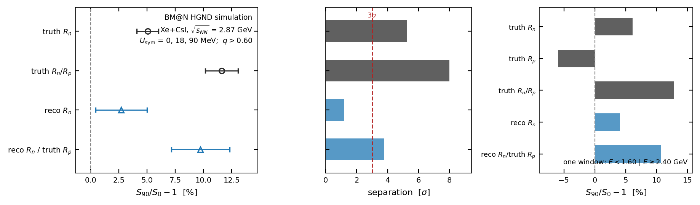

*Figure 11 (MC truth in dark, reconstruction in blue, integrated-yield
baselines in grey; open markers, dashed line at zero). $U_{\rm sym}$
separation from the minimal observable set, Xe+CsI at
$\sqrt{s_{NN}}=2.87$ GeV, reconstructed rows at $q>0.60$. **Left:** held-out
relative response $S_{90}/S_0-1$ with its bootstrap uncertainty, each hardness
ratio at its own optimised window and the baselines with no window, all on the
same held-out units. **Centre:** the same rows as separation in $\sigma$, with
the $3\sigma$ line dashed. **Right:** every hardness quantity re-evaluated at
one common window, $E<1.60$ | $E\geq2.40$ GeV, which is the only reading in
which they may be compared with each other, because the optimiser maximises
significance and a window with more statistics can win with a smaller response.
Uncertainties are statistical only, 300 bootstrap resamples over events for
reconstructed rows and over generation jobs for truth rows; the two species of
a hybrid are resampled independently because the samples are not event matched.
Produced by `scripts/final_sensitivity.py` from
`results/final_eval/observables/`.*

**The baseline does not respond, at any level of the chain.** All three yield
rows are consistent with zero on held-out units and none of them orders the
three samples there. One caveat belongs on the record: $\widehat Y_n$ *is*
monotonically ordered on the full sample, $+0.85\%$, and only the held-out
third fails to order it. Its truth counterpart is flat, so the ordering is a
detector effect and not a response — the rising detection efficiency of
Figure 8c is the obvious candidate, and the same mechanism acts on $R$. This is the expected result rather than a
disappointment: the symmetry potential redistributes nucleon energy, it does not
change how many nucleons reach the detector, so an observable that integrates
over energy has nothing to see. Every comparison below is against this floor.

Against it, the hardness ratios separate. At truth the single ratio moves from
$0.25\sigma$ to $4.75\sigma$ and the double ratio to $5.92\sigma$ on the same
units, which is the whole case for replacing the baseline. After reconstruction
the double ratio keeps $4.05\sigma$ while the baseline's reconstructed
counterpart stays at $0.75\sigma$.

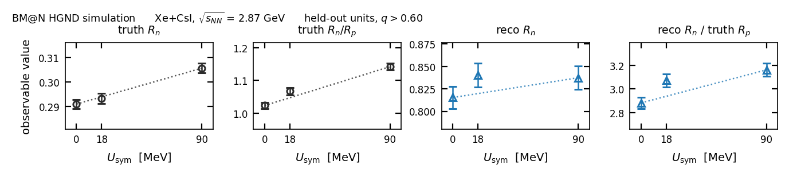

*Figure 12 (MC truth in dark, reconstruction in blue, baselines in grey). Every
observable's value against $U_{\mathrm{sym}}$, held-out units, with its
bootstrap uncertainty. The observables span 0.2 to 1.9 in magnitude, so each
panel carries its own scale; the dotted line joins the 0 and 90 MeV points, so
the 18 MeV position can be read as a prediction rather than a fit. The two truth
hardness ratios lie on that line. $\widehat R_n$ does not — its 18 MeV point
sits above it, which is the non-monotonicity the ordering flag reports and is
visible here as a shape rather than a boolean. The baselines are flat within
their errors. The absolute value of
$\widehat Y_n/Y_p^{\mathrm{MC}}$ is not meaningful on its own: it divides
candidates per event by protons per generation job, so only its ratio across
samples carries information.*

Two further statements follow, and they are different in kind.

**The HGND alone does not reach a measurement.** Reconstructed $R_n$ gives
$+2.71\%\pm2.29\%$, $1.18\sigma$, and its three held-out points are not
monotonic: Figure 12 shows the 18 MeV point sitting above the line joining the
outer two. 47 of 134 admissible windows order the samples on development units,
and the held-out split is underpowered for an effect of this size. This is a feasibility
statement, not a limit: it says the present statistics and the present
reconstruction do not resolve $U_{\mathrm{sym}}$, not that the observable is
insensitive.

**The double ratio is worth an external proton measurement.** Pairing
reconstructed neutrons with truth protons gives $+9.61\%\pm2.37\%$,
$4.05\sigma$. The gain is physics, not bookkeeping: at a common window the
proton hardness moves *against* the neutron hardness, $-5.97\%$ against
$+6.12\%$ for 90 against 0 MeV, so the isovector response adds in the ratio
instead of cancelling. That is why the double ratio carries roughly twice the
response of the single ratio.

The right-hand panel of Figure 11 is the one to read for dilution, because the
left panel puts each observable at its own window and the optimiser maximises
significance rather than response — a window with more statistics can win with
a smaller response, which is why the hybrid there appears to exceed the ideal
truth double ratio. At one common window the ordering is the expected one:
truth $R_n/R_p$ $+12.85\%$, hybrid $+10.66\%$, truth $R_n$ $+6.12\%$,
reconstructed $R_n$ $+4.06\%$. Reconstruction retains 83% of the double-ratio
response and 66% of the single-ratio response. Re-binning the same selected
clusters by *true* energy gives $+11.00\%$ against the reconstructed $+10.66\%$,
so the residual energy-scale mismatch between the reconstructed neutron band and
the truth proton band costs about three parts in a hundred, not more.

The proton side is MC truth throughout. The HGND does not measure protons, so
the last row is a bound on what this detector plus an external proton
measurement could reach, not a number this detector can produce alone.

## Planned systematic study

Every number in Part III carries a statistical error and no systematic one. The
systematics this analysis is exposed to are known, several are already
measured, and the list below is ordered by expected size rather than by ease.
Each entry names what is varied, what it is measured against, and what would
retire it.

**The rule they share.** A systematic that is common to the three
$U_{\mathrm{sym}}$ samples cancels in the response, which is a ratio of
ratios. What does not cancel is a systematic that *drifts* with the sample, so
every entry below is quoted as the sample-to-sample **difference**, not as the
absolute size of the effect. An effect of 5 % common to all three is harmless;
the same effect drifting by 10 % of itself is a 0.5 % spurious response against
a measured $+2.7\%$.

| # | source | how it is varied | status | measured size |
|---|---|---|---|---|
| 1 | Cluster-forming parameters | $(n\sigma, t_{\rm win})$ over the calibrated grid | **measured, not yet differential** | clustering biases $R$ by $+4.7\%$ at the production setting; the sample-to-sample drift is **not yet measured** and is the gap |
| 2 | Energy scale and resolution | the response matrix, varied within its own uncertainty | not started | linearity $\pm1.1\%$ to 2.6 GeV, falling to $-17\%$ by 6 GeV; the high band is open-ended |
| 3 | Band migration into the gap | response matrix, both directions | **partly measured** | 24 % of gap-region clusters migrate into a band; the outward term is in Figure 8c, the inward term is not |
| 4 | Reconstruction efficiency drift | band assignment per sample | **measured** | 0.77 pp maximum spread, 0.10 pp median — the smallest term on this list |
| 5 | Score working point | $q$ scanned about 0.60 | not started | purity agrees to 0.14 pp across samples at $q>0.60$ |
| 6 | Feature standardisation | shared versus per-sample scaler | **measured and fixed** | per-sample scaling biased $E_{\rm reco}$ by 0.8 %, monotonic in $U_{\mathrm{sym}}$, and cancelled the signal |
| 7 | Window selection | the selection rule itself | **measured by accident** | the headline moved $5.18\sigma \to 4.05\sigma$ under a correct change to the split, with no change to the physics |
| 8 | Impact parameter | reweighting onto a common $b$ distribution | **machinery exists, not applied to Part III** | the three samples' $\langle b\rangle$ agree to $0.23\sigma$ |
| 9 | Generation-job clustering | bootstrap over jobs rather than events | not started | job-level error on $\langle b\rangle$ is 2.85 times the per-event one |

**The three that matter most, and why.**

*Entry 1* is the largest known effect and the only one whose differential part
is unmeasured. The clustering bias on $R$ is $+4.7\%$ at the production
setting, comparable to the response itself. It cancels only if it is the same
in all three samples, and it need not be: splitting and merging depend on hit
multiplicity, which depends on the spectrum, which is what $U_{\mathrm{sym}}$
changes. Running the window scan on all three samples at the selected window
and quoting the difference is the single most valuable measurement outstanding.

*Entry 9* is not a systematic on the central value but on every error bar in
the note. The resample unit is the event; the production's $b$ structure is
job-level. If the generation-job label is recoverable from the loader's block
assignment, every reconstructed significance in Part III falls by up to that
2.85 factor, and the hybrid's $3.75\sigma$ with it.

*Entry 7* is a warning rather than an entry: a figure of merit built from 300
bootstrap replicates and maximised over 134 windows is not stable enough to
quote a significance from. It needs more replicates or a selection rule that is
not an argmax over a noisy estimate, and until then the significances here are
upper bounds on what the method can resolve.

**Order of work.** Entry 9 first, because it rescales every error bar in the
note and nothing else can be quoted until it is settled; it is item 1 of the
next-actions list below. Then entry 1, large and unmeasured, which is item 3
there. Then entries 2 and 3 together, since both need the same response matrix,
which is item 4. Entries 4, 5, 6 and 8 are either measured or have their
machinery in place, and entry 7 is a property of the selection rule rather than
of the detector — it is item 2 below.

## Centrality

The production has job-level impact-parameter block structure. The three full
samples nevertheless have compatible means,
$\Delta\langle b\rangle_{90-0}=+0.0034\pm0.0147$ fm. Event-level reweighting
reduces the residual spread in the three means to $9.5\times10^{-5}$ fm and
costs 0.1% in effective statistics. Figure 6 demonstrates that the isovector
response persists across centrality; the yield ratio does not provide a stable
alternative.

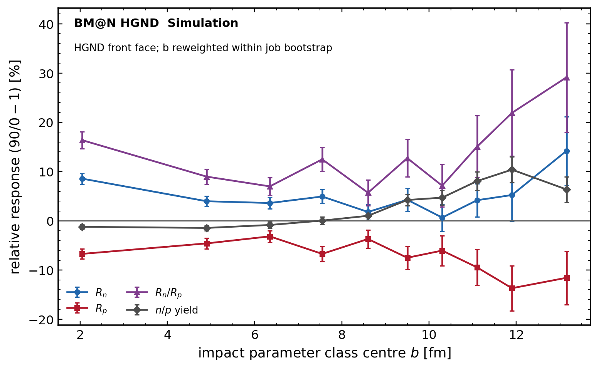

*Figure 6 (MC truth). Truth-level 90/0 response in ten impact-parameter classes after
reweighting. Every uncertainty is evaluated by resampling generation jobs and
rebuilding the weights in each replica.*

## Algorithm comparison and release criteria

The paper-facing analysis should describe a frozen baseline and one or more
challenger architectures, not the chronological history of training. Every
model must use the same job-level train/calibration/test split, shared scaler,
truth definition, front-face selection, and pre-declared working points. The
minimum comparison is:

1. Cluster ROC and purity–efficiency curve.
2. Energy linearity and resolution versus true energy.
3. $\varepsilon_k$ and $C_k$ through at least the fourth neutron.
4. The complete multiplicity response matrix.
5. Reconstructed hardness on a blind, adequately powered test set.
6. Stability under seed, score-threshold, and energy-window variation.

A challenger passes the physics gate only if reconstructed and truth 90/0
effects have the same sign, their paired difference is below $2\sigma$ and
below 25% of the truth effect, the differential response is consistent with
zero, and the 0/18/90 ordering survives. If no architecture passes, the
measurement should use a forward-folded spectral fit with response nuisance
parameters instead of an unfolded threshold ratio.

## Current internal status and next actions

Training ran to convergence over 20 epochs, best validation loss 0.6366. All
three samples were re-evaluated with the standardisation corrected, the window
was calibrated on the reconstructed scan at the $q>0.60$ working point, and
every figure here was regenerated from those predictions.

Where the analysis stands: the reconstruction meets the reference energy
benchmarks, the observable is defined and calibrated, and the reconstructed
response is positive but not resolved — $+2.71\%\pm2.29\%$ against a truth
target of $+5.05\%\pm0.97\%$ at the same window. Two of the items below can
still move that number materially, and neither is a physics question: both are
about how the error and the window are estimated. No significance in Part III
should be treated as final until item 1 is settled.

### The DCM pipeline-health control

The benchmarks this note measures against — ROC AUC about 0.97, roughly 80%
efficiency at 87% purity, linearity and resolution under 10% from 0.7 to 5 GeV
— were established on DCM-QGSM-SMM Xe+CsI at 3.26 AGeV, not on SMASH. That
sample has now been through this chain, which separates "the model is weaker on
SMASH" from "something in this chain is wrong".

Two configurations were run. *Transfer* applies the SMASH-trained checkpoint to
DCM with the SMASH scaler and the 1.5 ns window it was trained at, so nothing is
refitted to the new generator. *Native* trains on DCM at the reference settings
— H=512, L=8, batch 256, Adam $10^{-3}$, 25 epochs, 50/50 split, seed 42, 1.0 ns
window — which is the only configuration the published numbers can be read
against directly, since they come from a model trained on this sample.

| | ROC AUC | purity / efficiency | max $\lvert$linearity$\rvert$ above 0.7 GeV | max resolution |
|---|---|---|---|---|
| SMASH, own domain | 0.9582 | 0.873 / 0.715 | 17.4% | 9.1% |
| DCM, transfer | 0.9525 | 0.866 / 0.688 | 12.9% | 10.5% |
| DCM, native | 0.9515 | 0.869 / 0.663 | **5.8%** | 12.1% |
| Dombay reference | ~0.97 | 0.87 / 0.80 | under 10% | under 10% |

Three things follow. The chain survives the change of generator: transfer costs
0.006 in AUC and 2.7 points of efficiency, so nothing in it is tuned to SMASH.
Native training gives much the best energy linearity, 5.8% at worst above
0.7 GeV against 17.4% on SMASH, comfortably inside the reference target;
its worst resolution, 12.1%, sits in a 346-cluster bin above 5 GeV.

The AUC gap is the one that does not close. All three configurations land near
0.95 against the reference 0.97, and native training on the reference sample
does not recover it, so it is not a generator effect. Two candidates remain:
training statistics, since the DCM cache holds 283,398 graphs against the 1.2 M
used for SMASH, and the neutron label, since this pipeline adds an
$E_{\rm kin}>0.3$ GeV floor the reference does not have, so the two efficiencies
do not share a denominator. Efficiency at fixed purity is furthest from the
reference in the native run, 0.663 against 0.80, which is consistent with the
smaller training set.

DCM-QGSM-SMM is a single sample with one equation of state, so no
$U_{\mathrm{sym}}$ response can be measured on it. It supplies spectra,
response and performance; the sensitivity stays with the three SMASH samples.
The audit of this chain against the reference notebook, including three further
divergences and the per-sample standardisation defect, is in
`reports/dombay_reference_audit.md`.

The remaining ordered work, by what each item would change rather than by
convenience. Items 1 and 2 can move the headline; the rest cannot.

**Blocking any quoted significance.**

1. **Bootstrap over generation jobs, not events.** The resample unit in Part III
   is the event; the production's impact-parameter structure is job-level, and
   this note measures the job-level error on $\langle b\rangle$ at 2.85 times
   the per-event one. Spectral hardness is $b$-dependent, so every reconstructed
   significance here is inflated by up to that factor. The job label looks
   recoverable from the loader's `row_base` block assignment, which gives every
   `(run, file)` pair a contiguous `Row` block. Until this is done the
   significances in Part III are upper bounds on what the method can resolve,
   and the note says so rather than quoting them as results.
2. **Replace the selection rule.** The window is chosen by maximising a
   significance built from 300 bootstrap replicates over 134 windows. That is
   not stable: the headline moved from $5.18\sigma$ to $4.05\sigma$ under a
   correction to the development/held-out split that changed no physics. Either
   raise the replicate count until the figure of merit is not dominated by its
   own noise, or select on $|\Delta|$ with the error estimated from one common
   replicate set, and report the held-out value for the ten best windows rather
   than for the argmax alone.

**Needed before the measurement is defined.**

3. **Measure the clustering systematic differentially.** Entry 1 of the
   systematic table: the clustering biases $R$ by $+4.7\%$ at the production
   setting, comparable to the response itself, and it cancels only if it is the
   same in all three samples. Run the window scan at the selected window on all
   three and quote the difference.
4. **Close the high band or forward-fold.** The selected window's high band is
   $E\geq2.40$ GeV with no upper edge, and the energy estimator is qualified
   only to 2.6 GeV, drifting to $-17\%$ by 6 GeV. This note states twice that
   an open-ended ratio needs a response matrix and then quotes one.
5. **Rebuild at $(n\sigma, t_{\rm win}) = (1, 0.75$ ns$)$ and retrain.** The
   truth case is in `reports/dombay_reference_audit.md`. What the truth scan
   cannot see is the energy regression, since both a tighter prompt match and a
   narrower window leave fewer hits per cluster, so train both settings and
   choose on the reconstructed response.

**Reconstruction quality.**

6. **Close the ROC AUC gap**, 0.95 against the reference 0.97 in all three
   configurations including native training on the reference sample. Test the
   two candidates separately: drop the $E_{\rm kin}>0.3$ GeV label floor, and
   enlarge the DCM cache towards the SMASH scale.
7. **Retest `--energy-flatten` with the capped weights.** The first attempt used
   uncapped weights and collapsed the model, which tested the tail weighting
   rather than the idea; the cap and renormalisation are in place and untested.

**Before anything leaves this note.**

8. Freeze the blind test before any reconstructed-sensitivity statement.
9. Move only the frozen baseline–challenger comparison into the paper.

## Backup: superseded and unsuccessful approaches

These are kept because they record what was tried and why it was dropped, not
because they support the result. Each was superseded by the calibration
described above.

### Superseded: separation power at hand-picked thresholds

*This section is kept for the record. Its observables were evaluated at
thresholds chosen by inspection rather than calibrated, and it compared tuned
quantities against untuned ones. The hybrid double ratio it reports at
$1.72\sigma$ reaches $4.05\sigma$ once the same window search that was applied
to the single ratio is applied to it as well, so the number below is a property
of the hand-picked window and not of the observable. The calibrated results are
in Part III.*

#### Separation power and hybrid feasibility estimates

The table below compares the 90/0 response using
$|\Delta|/\sigma_\Delta$ as a common separation metric. Every reconstructed
entry is derived from the same converged GNN, one common feature scaler and the
common selection $q>0.60$. The raw
candidate quantities include fake clusters; the matched yield is shown only
as a closure diagnostic.

Three additional reconstructed shape observables test whether the populated
1--2 GeV interval can provide a more precise hardness measurement:

$$
\begin{aligned}
R_{n,\mathrm{eq}}^{1-2}
 &=\frac{N(1.5\leq E_{\rm reco}<2.0)}
          {N(1.0\leq E_{\rm reco}<1.5)},\\
R_{n,\mathrm{tail}}^{1-2}
 &=\frac{N(1.8\leq E_{\rm reco}<2.0)}
          {N(1.0\leq E_{\rm reco}<1.8)},\\
\langle E\rangle_{1-2}
 &=\frac{\sum_c E_c^{\rm reco}\,
          \mathbf{1}(1.0\leq E_c^{\rm reco}<2.0)}
         {\sum_c\mathbf{1}(1.0\leq E_c^{\rm reco}<2.0)}.
\end{aligned}
$$

All sums use selected candidates with $q>0.60$. These are raw,
detector-folded quantities rather than efficiency-corrected spectra.
For each shape definition $x\in\{\mathrm{eq},\mathrm{tail},\langle E\rangle\}$,
the corresponding hybrid is

$$
H_x=\frac{O_{n,x}^{\rm reco}}{O_{p,x}^{\rm MC}},
\qquad
\Delta_{H_x}^{90/0}=
\frac{(H_x)_{90}}{(H_x)_0}-1.
$$

The proton quantities use primary MC protons intersecting the exact HGND front
face. Their uncertainties come from a 400-replica production-file bootstrap.

Seventeen observables were compared here. Most were variants introduced to
rescue a null and none was calibrated, so the comparison had no common footing.
The integrated-yield rows are **not** in this list: they are the baseline the
study set out to test and they are kept in Part III as the reference the
hardness ratios are measured against.
The list below keeps one row per *family*, defined where it appears, and drops
the redundant variants; the full seventeen-row table is at commit f54f03e. Every row uses the legacy window unless stated, and every reconstructed
row used a score cut chosen by inspection rather than the calibrated $q>0.60$.

| Family | Definition | Best 90/0 response | Separation | Why it was dropped |
|---|---|---:|---:|---|
| Differential yield in $\theta$ | $dN_n/d\theta$ in $8.9^\circ<\theta<13.1^\circ$ | $+0.18\%\pm0.15\%$ | $1.18\sigma$ | Superseded by the exact front-face acceptance, which is 0.0114 sr against 0.0879 sr for this band. |
| In-band shape ratios | three variants inside 1--2 GeV: equal bins, upper tail, and the in-band mean energy | $+1.49\%\pm1.40\%$ | $1.07\sigma$ | Introduced after inspecting the spectrum, so post-hoc; superseded by the calibrated window, which searches the same region without choosing it by eye. |
| Hardness at hand-picked windows | $R$ with $E$ split at $1.8$--$2.4$ against $\geq2.6$ GeV, or at the legacy $1/2$ GeV | $-0.39\%\pm2.86\%$ | $0.14\sigma$ | The window was chosen by inspection. Calibrating it is Part III. |
| Hybrid at hand-picked windows | $\widehat R_n/R_p^{\rm MC}$ at the same uncalibrated windows | $+5.29\%\pm3.08\%$ | $1.72\sigma$ | Not wrong, but not comparable: it was quoted against a calibrated single ratio. The same observable reaches $4.05\sigma$ once calibrated. |

Two of these rows carried the note's earlier conclusions and both were wrong in
the same way. The hardness row read as "reconstruction is compatible with no
response", which was the per-sample standardisation defect rather than the
observable. The hybrid row read as "$1.72\sigma$, provisional", which was the
hand-picked window rather than the observable. Part III fixes both by putting
every observable through one calibration.

The seventeen-observable figure that accompanied this table is not reproduced here. It regenerates against whatever working point is current, so its numbers drift away from the table beside it; the table and commit f54f03e are the record.

The hybrid results establish feasibility, not final sensitivity. The current
neutron and proton products do not share an event-by-event sample, and the
quoted uncertainty assumes independent inputs. A publishable result requires
reconstructed charged tracks in the same front-face-equivalent phase space
and a common event/job bootstrap, including neutron–proton covariance. No
current reconstructed quantity reaches $2\sigma$; the apparent truth-level
advantage of hardness is not yet retained by reconstruction.

For the new proton components, the 90/0 responses are
$-0.812\%\pm0.698\%$ for the equal-bin hardness,
$-1.269\%\pm0.869\%$ for the upper-tail hardness, and
$-0.101\%\pm0.064\%$ for the in-band mean energy. Combining the opposite-sign
neutron and proton changes raises the upper-tail hybrid to $1.67\sigma$, close
to but not better than the $1.72\sigma$ conventional hybrid. The neutron and
proton samples are not event matched, so all hybrid errors use independent
propagation and omit neutron--proton covariance.

The full-production primary CSVs used for these exact proton windows contain
the negative impact-parameter sentinel $B=-1$. Consequently the new proton
components are unweighted full-production results; no centrality reweighting
is claimed for them. Their file/event scope is nevertheless complete:
195/200/173 files and 804,369/824,338/717,286 events for 0/18/90 MeV.

The 1--2 GeV ratios nevertheless improve the reconstructed statistical
precision. The equal-bin definition has a non-monotonic central sequence
$1.7279/1.7100/1.7467$ for 0/18/90 MeV. The upper-tail definition is ordered,
$0.3694/0.3707/0.3749$, but was selected after examining several boundaries;
its nominal $1.07\sigma$ separation is therefore descriptive rather than a
blind significance. It should be frozen on development data and evaluated on
an independent sample. A forward-folded binned shape fit over 1--2 GeV remains
preferable because it uses the full spectrum and explicitly models efficiency
and energy migration.

### Superseded: the reconstructed null

The following was written when the reconstructed search returned nothing. The
cause was the per-sample standardisation defect described in Part II, not the
observable; after correcting it the same search finds 47 of 134 admissible
windows ordered. The paragraph is kept because it records the state that
prompted the investigation.

For the *complementary, unbounded* low/high family defined above, the
reconstructed-level search returns nothing. The bottom row of Figure 9 shows
this directly: of sixty admissible windows inside the plateau, **none orders
the three samples**, and the response map has no coherent structure. The
strongest positive-but-unordered window gives $+0.71\%$ at $0.44\sigma$. The
optimiser reports this rather than returning the best-looking row, because
sorting by a figure of merit that is zero everywhere would hand back an
arbitrary window and dress a null up as a measurement.

This statement does not contradict the ordered $1.07\sigma$ upper-tail result:
that observable is a separate *bounded* family, restricted to 1--2 GeV and
defined as $N(1.8<E<2.0)/N(1.0<E<1.8)$. It gains precision by excluding both
outer tails, but it was introduced after inspecting the spectrum and remains a
development-sample hint. Neither family provides a validated reconstructed
measurement with this checkpoint.

## Reproducibility record

The truth reductions contain 195/200/173 generation files and
804,369/824,338/717,286 events for $U_{\mathrm{sym}}=0/18/90$ MeV. Plot
inputs and job-bootstrap products are stored under
`results/np_ratio_smash_check_full`, `results/acceptance_full`, and
`results/update_note`. The reconstructed comparison contains 409,600 represented
events per Spot sample and is recorded in
`results/update_note/smash_reconstructed_observables.json`. The figure builder is
`scripts/make_update_note_figures.py`; the multiplicity analysis is
`scripts/multiplicity_efficiency.py`. The nucleon and reconstructed spectra are
`scripts/make_spectra_figures.py`; the energy-dependent efficiency diagnostic is
`scripts/plot_efficiency_vs_ekin.py`. Exact full-production proton counterparts
for the finite-band hybrid observables are recorded by
`scripts/proton_window_observables.py` in
`results/update_note/proton_window_observables.json`; because those primary
tables contain the $B=-1$ sentinel, this finite-band block is raw rather than
impact-parameter reweighted. The complementary window search is
`scripts/hardness_threshold_opt.py`, whose full scan surfaces are stored in
`results/update_note/hardness_opt_truth.json` and
`results/update_note/hardness_opt_reco.json`, and whose surfaces are drawn by
`scripts/plot_hardness_surface.py`. Per the convention recorded in `AGENTS.md`,
every fixed parameter in this note is accompanied by the objective plotted over
that parameter and by a statement of what it trades off.
