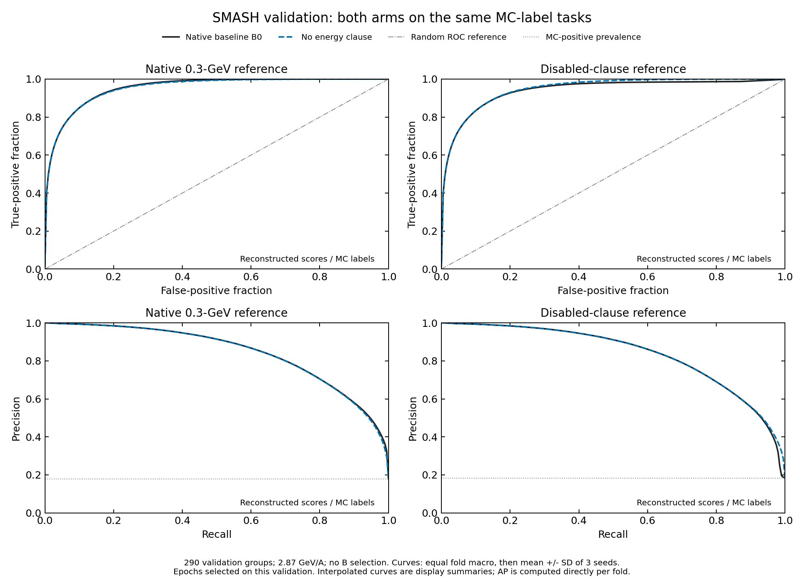
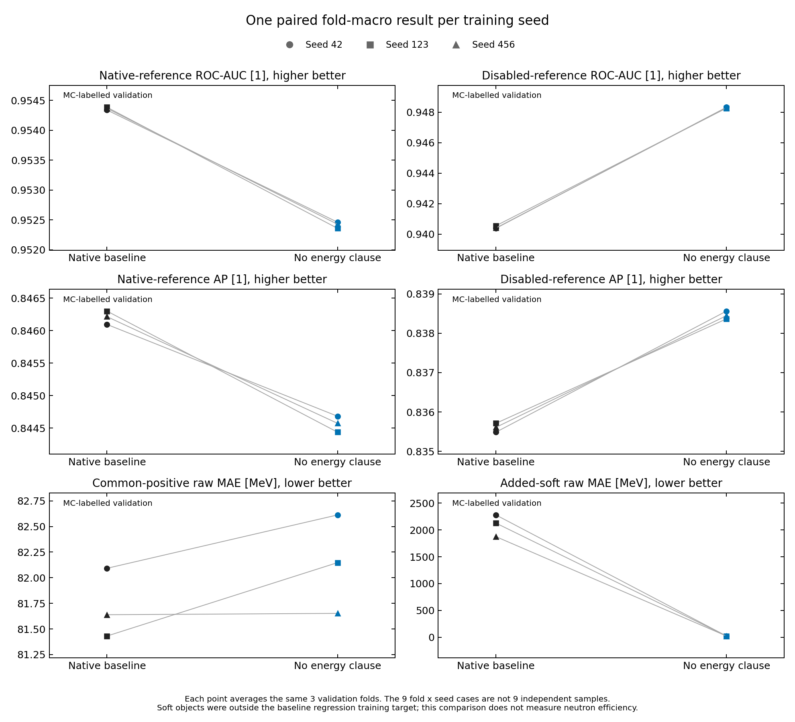
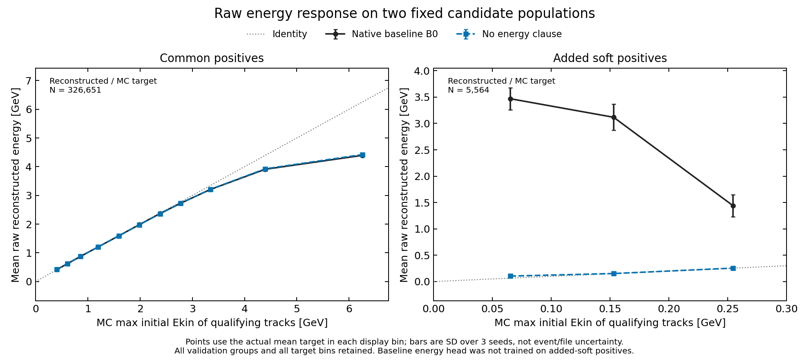
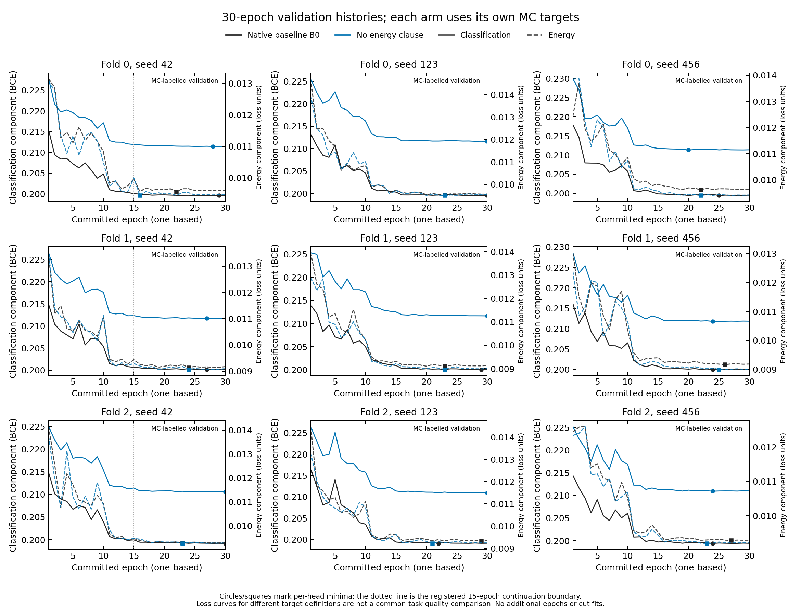

# No-floor MC-label ablation: nine complete SMASH models

04.11.2026. Все девять моделей завершили по 30 эпох, 15+15, без сбоев.
Последняя задача закончилась в 08:38:30 МСК. Архивы, каждый member, coherent
resume и все 262 read-only source-файла проверены. Продолжение сохранило
историю и checkpoints первых 15 эпох. Новых model calls при анализе нет.

**Итог:** снятие energy clause улучшило AUC/AP на общей расширенной
разметке disabled и регрессию добавленных мягких targets. На общей native
разметке AUC/AP снизились. На common positives изменение raw MAE не
разрешено парным сравнением трёх seeds; physical Rₙ здесь не оценивался.

## Популяция и приёмка

Исходные fold-validation роли: **290 групп, 1,823,687 кластеров**.
Native positives **326,651**, disabled **332,215**;
добавлено **5,564** мягких объектов.
Четыре unbound detector-labelled группы сохранены. Это популяция validation,
отличная от truth-bound S286 census с 5480 добавленными объектами.
Наблюдения, графы, scalers, split 848ebf49, recipe и seeds 42/123/456 прежние.
Менялось энергетическое условие MC label/target; Edep/Side/ToF не изменялись.

Baseline — raw B0 на тех же validation candidates, не прежняя test-сводка
с AUC≈0,9547. Новый arm и baseline оцениваются против каждой из **двух
одинаковых reference-разметок**. Энергия — initial MCTrack max-target кластера,
не deposited energy и не независимо восстановленная энергия нейтронного трека.
MC-negative e_true=0 не интерпретируется как физическая нулевая энергия.

Старый `predictions_B.npz` не содержит Row/side/ClusterID. Их порядок внутри
каждого content связан с native pack через actual score_pack/check_prediction
и digest candidate_keys принятого patch. Digest новых CSV совпал с patch;
native pack SHA каждого B/fold совпал с prepare4465983. Native float32
labels/targets, cluster_size и counts воспроизвелись точно. Затем выполнен
join 1:1 по (content, Row, side, ClusterID), без intersection/drop fallback.

## Общие задачи классификации

Ниже равновесное среднее трёх fold-метрик внутри seed, затем mean ± sample
SD трёх training seeds. У каждого arm epochs выбирались на этой validation;
baseline cuts также были настроены на ней. Это selected-validation диагностика
на одной продукции, без fresh holdout и без новой F-оценки. Fold×seed не
образуют девять независимых повторов; pooled cross-fold AUC не используется.

| Общая MC reference | Метрика, единица; направление | Native baseline B0 | No energy clause |
| --- | --- | --- | --- |
| Native Ekin>0.3 GeV | ROC-AUC [1], ↑ | 0.954364 ± 0.000024 | 0.952417 ± 0.000052 |
| Native Ekin>0.3 GeV | AP [1], ↑ | 0.84620 ± 0.00010 | 0.84457 ± 0.00012 |
| Native Ekin>0.3 GeV | Purity [%], ↑ | 70.114 ± 0.061 | 70.054 ± 0.083 |
| Native Ekin>0.3 GeV | Cluster recall [%], ↑ | 80.369 ± 0.045 | 80.370 ± 0.072 |
| Disabled energy clause | ROC-AUC [1], ↑ | 0.940450 ± 0.000092 | 0.948294 ± 0.000029 |
| Disabled energy clause | AP [1], ↑ | 0.83560 ± 0.00011 | 0.838458 ± 0.000099 |
| Disabled energy clause | Purity [%], ↑ | 70.116 ± 0.061 | 70.103 ± 0.082 |
| Disabled energy clause | Cluster recall [%], ↑ | 79.026 ± 0.044 | 79.079 ± 0.072 |

Reconstructed scores против MC labels, SMASH Xe+Cs, 2,87 ГэВ/нуклон;
отбора по B нет. Curves сначала усредняются по folds, затем по seeds;
полосы — seed SD. Grid 201 точка [0;1] — только display interpolation,
не новый подбор cut. AP вычислен непосредственно из каждого fold,
не как площадь под усреднённой нарисованной кривой.

## Raw energy и численный operating point

Soft calibration не подгонялась. Для каждого fold/seed повторно применён
его прежний численный B0 cut. Это проверка переноса cut, а не сравнение
при гарантированно одинаковой purity. Новый cut не выбирался.
Исторический baseline выбирал первый из 401 cuts [0,001;0,999],
достигавший cluster-count purity≥0,70 на validation. Этот выбор связан
с прежним operating point, а не с оптимальностью порога энергии 0,3 ГэВ.

| Фиксированная MC популяция | Метрика, единица; направление | Native B0 | No energy clause |
| --- | --- | --- | --- |
| Common positives, N=326651 | Raw MAE [MeV], ↓ | 81.72 ± 0.34 | 82.14 ± 0.48 |
| Common positives, N=326651 | Raw bias [MeV], ближе к 0 | -8.3 ± 3.1 | -10.1 ± 1.3 |
| Added soft, N=5564 | Raw MAE [MeV], ↓ | (2.10 ± 0.20) ×10³ | 22.20 ± 0.40 |
| Added soft, N=5564 | Raw bias [MeV], ближе к 0 | (2.09 ± 0.21) ×10³ | 6.4 ± 2.8 |
| Added soft, N=5564 | Selected fraction [%], ↑ | 0.171 ± 0.028 | 3.325 ± 0.086 |

Нулевых positive-energy targets нет. Common-positive targets прежние;
все добавленные targets ниже 0,3 ГэВ. На added-soft популяции baseline
energy head работала вне своей исходной regression training target:
эти объекты раньше были native-negative. Поэтому большой raw MAE baseline
на них не описывает её прежнюю signal-energy resolution.

При прежних cuts новый arm выбирает только около 3,3% добавленных мягких
кластеров. Уменьшение их MAE на всех candidates не является измерением
нейтронной detection efficiency, primary spectrum или physical Rₙ.

Каждая линия связывает один training seed после одинакового macro по трём
folds. Разметка и candidates внутри каждой показанной задачи общие.
Небольшой рост common-positive MAE не разрешён на трёх seeds.

Reconstructed raw energy против MC initial matched-track target отдельно
на common positives и added soft. Внутри display bins объединены candidates
трёх folds; точки стоят в фактическом mean target, бары — SD трёх seeds.
Это описательная response-проекция, не primary fold-macro estimator таблиц.
Все target bins сохранены; binning унаследован от report/census и не
используется для выбора label, окна или cut. Средняя response не является
полной resolution distribution.

## Парное сравнение и пределы ошибки

Случай разных обученных весов: Δ=no-floor−baseline на одной reference.
В таблице mean ± SE среднего трёх парных training-seed разностей;
t имеет 2 df, двухсторонний tcrit(0,05)=4,303. Это условная проверка
инициализации на фиксированных данных и recipe. Она не включает
file/domain/production variance, selection bias или новую test-проверку.
Показанные endpoints множественны; p-значения в JSON не имеют поправки
на множественные сравнения и не являются подтверждением generalisation.

| Метрика Δ, единица | Δ seeds 42 / 123 / 456 | Mean ± SE | t, df=2 |
| --- | --- | --- | --- |
| Native ROC-AUC [1] | -0.001877 / -0.002026 / -0.001940 | -0.001947 ± 0.000043 | -45 |
| Disabled ROC-AUC [1] | +0.007938 / +0.007711 / +0.007884 | +0.007844 ± 0.000068 | 115 |
| Native AP [1] | -0.00141 / -0.00186 / -0.00164 | -0.00164 ± 0.00013 | -12.6 |
| Disabled AP [1] | +0.00308 / +0.00265 / +0.00284 | +0.00286 ± 0.00012 | 23.3 |
| Common-positive MAE [MeV] | +0.52 / +0.72 / +0.01 | +0.42 ± 0.21 | 1.99 |
| Added-soft MAE [MeV] | -2260 / -2110 / -1850 | (-2.07 ± 0.12) ×10³ | -17.6 |

## Полнота обучения и selectors

Все строки — полный 30-epoch seed. e_cls/e_en в таблице имеют **нулевую
индексацию**; на рисунке эпохи показаны как 1–30. У четырёх новых моделей
e_cls=29: классификационный selector упирается в конец бюджета.
Обучение завершено по протоколу; сходимость за пределами 30 эпох не проверялась.

| Fold | Seed | Epochs | B0 e_cls/e_en | No-floor e_cls/e_en | Frozen B0 cut |
| --- | --- | --- | --- | --- | --- |
| 0 | 42 | 30 | 28/21 | 27/15 | 0.302895 |
| 0 | 123 | 30 | 29/22 | 29/22 | 0.300400 |
| 0 | 456 | 30 | 24/21 | 19/21 | 0.300400 |
| 1 | 42 | 30 | 26/23 | 26/23 | 0.302895 |
| 1 | 123 | 30 | 28/22 | 29/22 | 0.302895 |
| 1 | 456 | 30 | 23/25 | 23/24 | 0.302895 |
| 2 | 42 | 30 | 29/22 | 29/22 | 0.300400 |
| 2 | 123 | 30 | 21/28 | 29/20 | 0.295410 |
| 2 | 456 | 30 | 23/26 | 23/22 | 0.300400 |

BCE и energy-component histories относятся к собственным training targets
каждого arm. Сравнивать их абсолютные уровни как выигрыш общей задачи нельзя.
Отмечены per-head minima и единственная запланированная граница после 15 эпох.

Выделенное GPU-время: **117,330 с = 32.59 GPU·ч**;
сумма 18 main Slurm records, без повторного счёта batch/extern steps.
Это allocation с I/O/validation, а не pure fit. Одновременно не более
двух campaign tasks, каждый segment в пределах 2:45. Новых test jobs
или дополнительных unit tests не запускалось по прямому human waiver;
source/input/native-label/data assertions сохранены. Ошибка первого
локального collector lookup для отсутствующей fold-role исправлена через
явный .get; исходный traceback сохранён, научные jobs не повторялись.

## Вывод и граница конечного опыта

No-floor подтвердил обучаемость добавленных soft targets и улучшение
расширенной MC-label задачи. Он меняет компромисс с native-задачей;
из этого опыта не следует, что 0,3 ГэВ — оптимальная физическая граница
или что no-floor уже следует заменить основной pipeline.
Nonprimary qualifying MCTrack не означает автоматически material background;
полная genealogy отсутствует. Потери до retained hits этим опытом не оценены.

Эта конечная кампания завершена. F scoring, primary truth/Rₙ comparison,
новый cut fit, soft calibration, второй floor и скан 148 окон не выполнялись.
Ранее принятые baseline-контрасты 18/0, 90/0, 90/18 в
[статусе](../status_20261103.md) сохраняются; новые числа их не заменяют.
Для следующего physical transfer потребуются отдельно зафиксированные
operating policy, исходный primary truth и применимая авторизация.

## Происхождение и воспроизведение

- Source commit `721beff`; sums `921e04a4e6d1faec8e8b1a757e2a08df2b02f34d2a2f35e9d4e34c0ef750eb3c`.
- Accepted target preparation4482805; immutable patch summary SHA в `input_pins.json`.
- Archive acceptance: `acceptance.json`; compact selected-member hashes: `compact_manifest.json`.
- Arrays4482848/4482849, whole-array afterok, registered 15+15; actual accounting in `execution_cost.json`.
- [Все метрики и certified candidate keys](results.json); [data/collector pins](input_pins.json); [paired curve/response arrays](plot_data.npz).
- Подробные fold/seed таблицы: [классификация](per_fold_classification.csv), [raw energy](per_fold_energy.csv).
- Model-free replay: `python reports/label_ablation_results_20261104/collect.py`, затем `plot.py` и `build_report.py` в той же директории.
- Collector требует локальный hash-verified compact archive; raw данные, новые checkpoint forward passes или cluster jobs не нужны.
- Дополнительные unit tests не запускались. Реальные export/native/reference/resume/SHA assertions выполнены на сохранённых данных.
- [Read-only review](review.md) и [visual/font/hash validation](validation.json).
