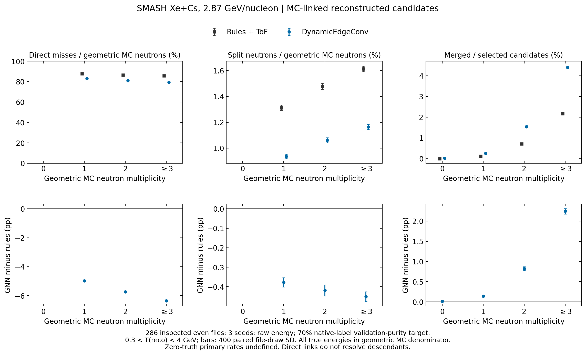
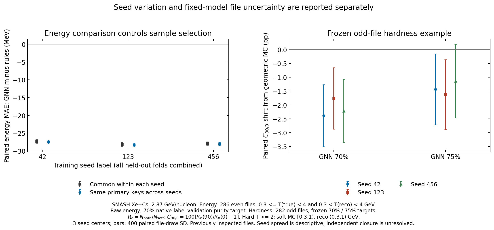
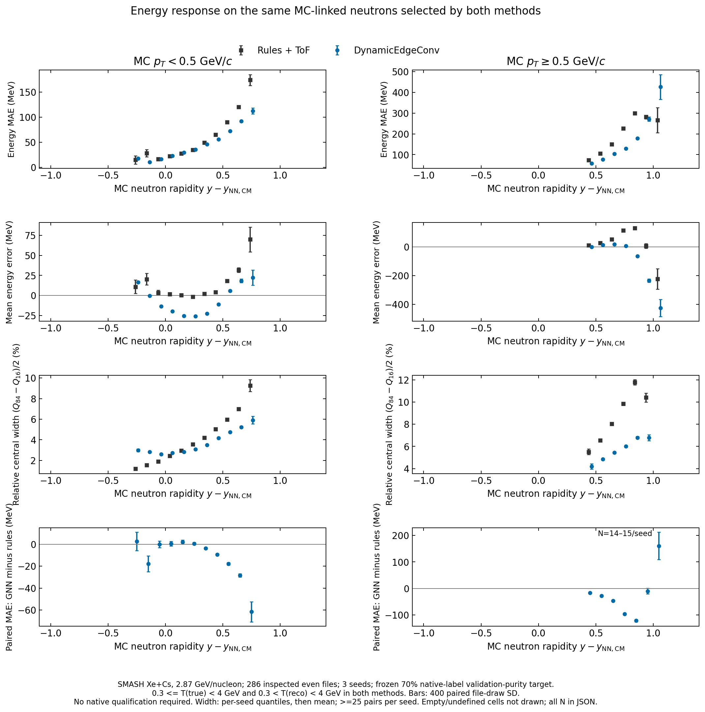

# Локальные проверки реконструкции на SMASH

18 ноября 2026. На сохранённых данных проверены три вопроса: устойчивость
выводов по seeds, зависимость прямых пропусков/дублей/слияний от
MC-множественности и ошибка энергии в общей сетке истинных быстроты и
поперечного импульса. Новые обучение, inference, подбор порогов и доступ
к ROOT не потребовались. Предзапусковые критики приняли ограниченную
методику после исправлений проверок происхождения и счётчиков.

Основная выборка — SMASH Xe+Cs, 2,87 ГэВ/нуклон, 286 ранее просмотренных
чётных файлов, 1 180 595 обработанных событий. Сравниваются правила + ToF
и raw DynamicEdgeConv при целевой native-label purity 70% на валидации;
численные пороги прежние для каждого fold/seed. Кандидаты обоих методов
имеют 0,3 < T(reco) < 4 ГэВ. Все ± ниже — SD 400 общих парных
пофайловых перевыборок при фиксированных моделях. Разброс трёх seeds
показан отдельно и не добавляется к файловому SD в квадратуре.

## Меньше прямых пропусков и дублей сопровождается ростом слияний

В событиях с одним геометрическим MC-нейтроном доля прямых пропусков
снижается с 87,91% до 82,93%; с двумя — с 86,65% до 80,92%; с тремя
и более — с 85,80% до 79,46%. Парные изменения составляют
−4,976 ± 0,047, −5,724 ± 0,053 и −6,347 ± 0,046 п.п.

Доля MC-нейтронов, имеющих несколько выбранных прямых связей, также
меньше у GNN во всех этих категориях. При этом доля выбранных кандидатов
с несколькими прямыми нейтронными источниками растёт: для двух
геометрических MC-нейтронов 0,719% → 1,542%, для трёх и более
2,168% → 4,412%. Парное увеличение в последней категории
составляет +2,244 ± 0,064 п.п. Модель, таким образом, меняет разные
компоненты неоднозначности в разных направлениях.



В числителях пропусков и разбиений — уникальные геометрические первичные
MC-нейтроны, в знаменателях — все такие нейтроны категории, без отбора
по истинной энергии. Для слияний знаменатель — выбранные кандидаты.
Нулевая MC-категория сохранена; её первичные доли не определены.
Граф содержит прямые связи с нейтронами, в том числе вне геометрической
области. Потомки и другие частицы этим анализом не классифицированы.
Результат не измеряет физическую эффективность или фон и не устанавливает
наложение ливней как причину зависимости от множественности.

## Интегральные выводы сохраняются в трёх seeds

Прямое покрытие GNN превосходит правила на 5,729–5,734 п.п. по seeds;
изменение доли дублей отрицательно, слияний — положительно во всех трёх.
На общей для всех seeds выборке из **58 199 одних и тех же нейтронов**
MAE энергии составляет 101,81 ± 0,65 МэВ для правил и
73,86 ± 0,40 МэВ для GNN. Парное изменение −27,95 ± 0,51 МэВ
близко к −27,80 ± 0,50 МэВ на исходных выборках каждого seed.

При фиксированных ключах SD трёх центров GNN-MAE равен 0,44 МэВ,
а для среднего знакового смещения — 1,01 МэВ. Файловый SD последнего
равен 0,47 МэВ. Устойчивость знака интегрального выигрыша не означает
пренебрежимо малого разброса обучения или одинакового поведения всех бинов.



Левая панель проверяет, сохраняется ли энергетическое сравнение на тех
же ключах; повторение по seeds нужно для оценки его зависимости от
обученной процедуры. Справа использованы уже принятые результаты на
282 нечётных файлах, с прежними порогами. Центры сдвига контраста
90/0 от геометрического MC отрицательны во всех seeds: от −2,39
до −1,77 п.п. при 70% и от −1,63 до −1,14 п.п. при замороженных 75%.
SD центров контраста по seeds равен 0,32 и 0,24 п.п.; файловый SD
контраста каждого seed — соответственно 1,15–1,16 и 1,30–1,33 п.п.
Это описательная проверка ранее просмотренных событий, без независимого
подтверждения замыкания или нового выбора порога.

## Ошибки энергии зависят от кинематики

На общих изолированных нейтронах с 0,3 ≤ T(true) < 4 ГэВ при
истинном pT < 0,5 ГэВ/c MAE меняется с 56,80 до 49,11 МэВ,
парная разность −7,68 ± 0,45 МэВ. При pT ≥ 0,5 ГэВ/c —
со 190,62 до 122,78 МэВ, разность −67,84 ± 1,09 МэВ.
Центральная относительная ширина меняется с 4,28% до 3,91% и
с 8,78% до 5,87% соответственно. Эти полосы различаются и по
другой кинематике; различие нельзя причинно приписать одному pT.



Панели разделяют MAE, среднюю знаковую ошибку и центральную ширину:
один показатель не заменяет остальные. Улучшение не универсально.
При низком pT и y в [0,1;0,2) GNN-MAE больше на 2,17 ± 1,74 МэВ,
а в нескольких соседних бинах знак зависит от seed. При высоком pT
и y в [1,0;1,1) парное изменение MAE равно +161 ± 52 МэВ, но остаются только
14–15 пар на seed; центральная ширина для этой ячейки не приводится.
Общий отбор по восстановленной энергии ограничивает интерпретацию у краёв.

Все 50 зарегистрированных ячеек, численности, обе границы Q16/Q84,
отдельные настройки потенциала, native-qualified subset и центры каждого
seed сохранены в [результатах](results/results.json).
[Читаемые таблицы](results/tables.md) генерируются из этого же JSON.
Native qualification зависит от энергии и ToF, поэтому её влияние не
приписывается одному времени. Разность физических процедур не изолирует
различие направлений; для энергетических бинов используется MC-кинематика.

## Воспроизводимость и следующий шаг

[Протокол до расчёта](protocol.md), [независимое ревью](review.md),
[сверка входов](results/assembly.json), [пофайловые счётчики и ключи](results/data.npz),
[хеши рисунков](results/figures.json). Сборка заняла 4,2 с, сведение
7,6 с локального времени при одном вычислительном потоке.
Сохранены исходные пороги, train-only scalers, folds и выбранные checkpoints
через принятую цепочку экспорта; новые оценщики не подгонялись.

Из корня HGNDRecoGNN, в окружении с NumPy/pandas/SciPy/scikit-learn/Matplotlib:

```sh
python reports/local_response_diagnostics_20261118/reduce.py assemble
python reports/local_response_diagnostics_20261118/reduce.py summarize
python reports/local_response_diagnostics_20261118/plot.py
python reports/local_response_diagnostics_20261118/tables.py
```

Первый шаг читает принятые внутренние экспорты и создаёт новый каталог;
для повторной сборки предусмотрен `--output`. Сохранённый компактный
реестр позволяет повторять сведение со второго шага без ROOT и моделей.
Это внутренний комплект результатов, а не публичный архив исходных событий.
Рукопись и презентация в этой задаче не менялись. Для физической
эффективности, состава фона, протонного TOF-отбора и восстановления n/p
по-прежнему нужны исходные ROOT и проверка транспортного отклика.
