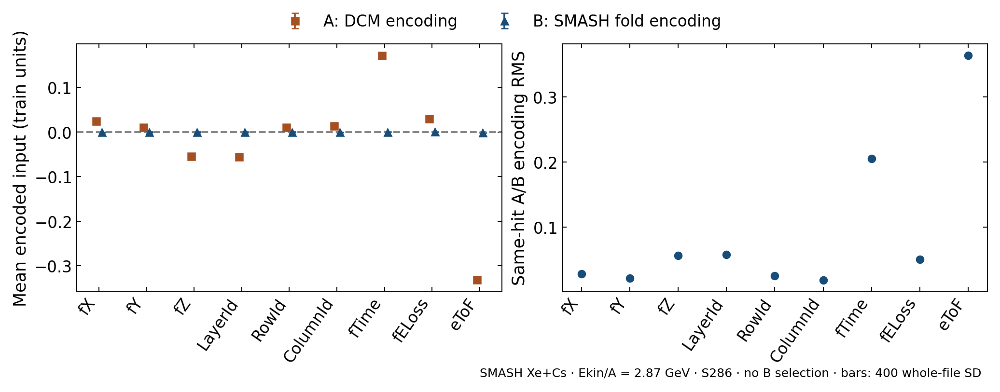

# Native input feature/scaler diagnostic

6 November 2026. Existing S286 TEST-fold native packs only, no new models,
inference, training or fits. A uses frozen DCM scalers plus affine remap, B
uses the original fold train-only SMASH scaler. Different coordinates have
pipeline-specific train units. This is a descriptive input comparison, not
a causal explanation of the A1/B1 performance gap or an OOD test.

Accepted 286 paired files, 1,798,225 clusters, 5,833,940 hits. Every non-x tensor replays byte-exactly; candidate keys, native labels/targets and cluster sizes match pinned prediction digests. Unscaled binary SurfaceHit is identical.

Node-weighted means across identical hits. Differences use paired SD of400whole-file draws stratified potential×evenpart. Hit counts do not act as independent observations. RMS measures encoding distance; its bars are also whole-file SD.

Largest observed numeric encoding distances are eToF (B−A=0.3299, RMS=0.3642) and fTime (B−A=-0.1714, RMS=0.2055). The binary SurfaceHit difference is exactly zero. These describe the preprocessing map on common observations. They do not measure feature importance or the fraction of the A1/B1 performance gap explained by preprocessing. All coordinates are in pipeline-specific train units, with no direction of better. Small error bars can be hidden by markers.

|Feature|Mean A|Mean B|B−A ± paired file SD|Same-hit encoding RMS ± file SD|
|---|---:|---:|---:|---:|
|fX|0.02517|-0.0006111|-0.02578 ± 9.5e-06|0.0274 ± 7.6e-06|
|fY|0.01092|-8.905e-05|-0.011 ± 1.9e-05|0.02111 ± 9.1e-06|
|fZ|-0.05409|-0.0002004|0.05389 ± 1.1e-05|0.05583 ± 1e-05|
|LayerId|-0.05583|-9.617e-05|0.05574 ± 9.6e-06|0.0574 ± 9.9e-06|
|RowId|0.01046|-0.0001192|-0.01058 ± 2.4e-05|0.02468 ± 1.1e-05|
|ColumnId|0.01413|-0.0006385|-0.01477 ± 1.1e-05|0.0183 ± 9.9e-06|
|fTime|0.1714|-3.271e-05|-0.1714 ± 6.7e-05|0.2055 ± 0.00015|
|fELoss|0.03008|0.0004|-0.02968 ± 2.1e-05|0.04962 ± 3e-05|
|eToF|-0.331|-0.001053|0.3299 ± 0.00014|0.3642 ± 0.00018|
|SurfaceHit|0.4577|0.4577|0 ± 0|0 ± 0|

The left panel identifies mean displacement, the right distinguishes encoding
RMS from a simple mean shift. Bars on both panels are whole-file SD. Zero is only
the encoded origin, not proof of in-domain behaviour. SurfaceHit is omitted
from the graph because it is an exact binary control, and retained in the table.
Native cluster labels describe the qualifying-hit rule, not full genealogy.

No scaler was substituted into a ready model. Weights, score cuts and energy
calibration were not evaluated anew. Raw primary efficiency, ancestry and
actual proton tracking/PID remain separate measurements.

Reproduction/provenance: source_package.json, plan.json, preflight.md, the
accepted publication receipt and result/summary.json. Per-file/group moments
and encoding differences remain in result/features.npz; results.json is the
sole generated descriptive table. Monitoring uses Luna/low under shared §11.
