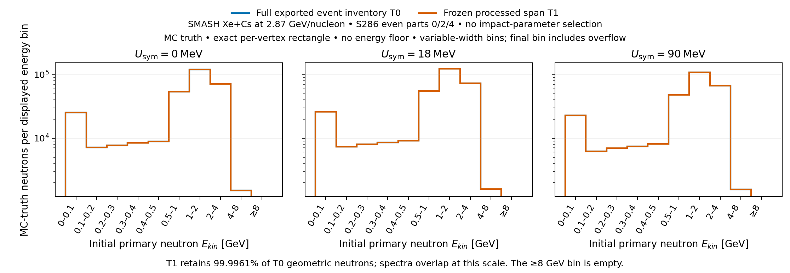
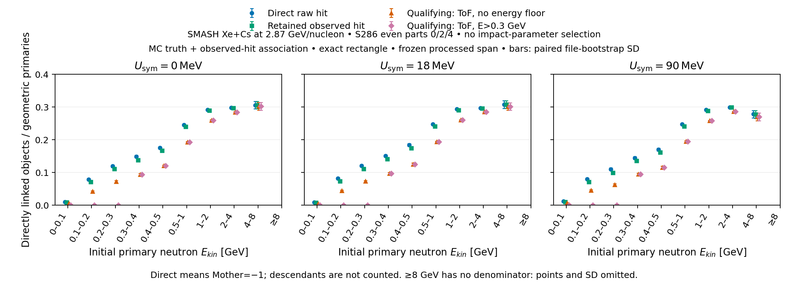

# Uncensored primary neutrons and direct observed associations

6 November 2026. One CPU job4491592 completed0:0 oncn-039 in11:49;
scientific processing574.74s. No model, new inference, cut fit, window scan
or extra unit/test-queue job. Source32a88fb3c6ad was frozen after independent
methodological and technical GO. Numerical export checks passed for286files.

## Geometric denominator and event coverage

This phase tests whether event-range truncation or energy-dependent direct
observability can explain a pre-classifier population difference. The sample is corrected SMASH Xe+Cs at a beam kinetic energy of 2.87 GeV per
nucleon and symmetry potentials of 0, 18 and 90 MeV. The analysis uses the
previously opened S286 truth-bound even parts 0/2/4 and applies no impact-parameter
selection. It follows the accepted split, raw hashes, observation recipe and native
clusters.

The denominator contains PDG2112 primary neutrons whose initial momentum and
vertex project to the fixed rectangle at z=718.42cm, x∈[−146.61,−106.67]cm,
y∈[−77.34,77.34]cm, forward rays and inclusive edges. It has **no energy floor**.
This nominal geometric window omits inactive/module gaps and material transport;
it does not measure actual detector-boundary crossings. Proton counters are
used only to replay the old MC-truth straight-ray definition, not proton tracking/PID.

The input contains1,180,686 exported events and303,276,469 primary nucleon
records. All old per-event keys, multiplicities and n/p counters reproduce
exactly. There are668,559 exported events with zero geometric neutrons, and
they remain in the event table. Row has no gaps in0…max in these files;
collisions absent from the export remain outside this completeness statement.
B/NPrim=-1 remain unknown; no centrality or generator-collision claim follows.

T0 uses every exported event. T1 uses the same pinned historical processed
span as the previous reconstruction result, including exported zero-count
events. T0 has897,598 geometric neutrons; T1 has897,563. Only35 are excluded,
0.003899% of T0. Event-range truncation therefore cannot explain a sizeable
population deficit on this selected sample.

The two spectra test energy coverage and processed-span truncation before
reconstruction. They overlap at this scale; the exact35-object difference is
reported above rather than inferred visually. Bins have unequal widths and
show **objects per bin**, not differential density; ≥8GeV is an explicit empty
overflow bin. No accepted primary has exactly zero energy. Three potential
panels retain their separate populations, rather than duplicating training seeds.

## Direct-primary observability before the classifier

Raw hits join vacs one-to-one by Row/Instance. A direct object has Mother=−1,
Side5/6 and exact Row/Id,PDG,Ekin,Px,Py,Pz,vX,vY,vZ in the pinned primary
file. All348,888 eligible direct **nucleon** records match exactly; neutron
fractions below use PDG2112 only. Mother0 is not primary. Mother>=0 alone
does not establish material background. Full descendant genealogy is unavailable.
Binding is performed before geometric selection, retaining directly linked
out-of-window neutrons as a separate, incomplete external cohort.

The observation recipe is unchanged: fELoss>3MeV, finite fields, fY≠0,
half-event PDG0 rejection and deterministic0.15ns jitter. Its serialized SHA,
cluster ordering and native labels/float32 targets reproduce exactly for all286.
No universal t<35ns cut is claimed. A qualifying neutron hit satisfies the
inherited ±0.3ns ToF-energy condition; native additionally requires Ekin>0.3GeV.
An object passes a stage if at least one of its directly associated hits passes.
There is no neural score selection in this phase.

| U_sym [MeV] | Geometric T1 primaries | Direct raw hit | Retained observed hit | Qualifying, no floor | Qualifying, native |
|---:|---:|---:|---:|---:|---:|
|0|305,848|75,030|73,965|65,602|64,600|
|18|313,478|77,312|76,175|67,505|66,466|
|90|278,237|68,423|67,368|59,814|58,936|

Across potentials,24.53–24.66% of all-energy geometric primaries have a direct
raw hit,24.18–24.30% retain an observed direct hit,21.45–21.53% qualify without
the floor and21.12–21.20% qualify under native labels. The first association
step dominates this **direct-only** ledger. The complement can include an
unseen interaction, descendant-mediated response or missing exported links;
it cannot be called a measured neutron loss or assigned to a particular mechanism.
Above0.3GeV the native qualifying fraction is24.33–24.43%, with pointwise
file-bootstrap SD0.080–0.088percentage points. No-floor and native coincide
there by definition, not through a newly trained performance improvement.

This figure separates raw-hit association, retained observation and qualifying-hit
requirements on the same denominator. Native/no-floor separation below0.3GeV
shows the inherited energy clause. The observed energy dependence is similar
across the three potentials; this is not an independent production-transfer test.
Error bars are pointwise SD of400paired whole-file draws, stratified by
potential×even part and reused across stages. The bins are correlated; these
are neither independent-bin errors nor simultaneous confidence intervals.
The ≥8GeV denominator is empty in all400draws, so its point and SD are omitted.
The reader suppresses a bin's SD unless all400draws have a positive denominator;
valid counts are saved in results.json. No training-seed error applies here.

The frozen hardness bands show the scale of the energy-dependent direct response:

| U_sym [MeV] | Native direct fraction,0.3≤E<1GeV [%] | Native direct fraction,E≥2GeV [%] | f_high/f_low |
|---:|---:|---:|---:|
|0|17.25 ± 0.15|28.50 ± 0.17|1.652 ± 0.018|
|18|17.41 ± 0.13|28.53 ± 0.15|1.638 ± 0.015|
|90|17.31 ± 0.15|28.58 ± 0.16|1.651 ± 0.017|

Uncertainties are paired file-bootstrap SD. The factor≈1.65 quantifies the
hardness distortion of **distinct directly native-qualified primary objects**.
It is not the response of all reconstructed clusters, which also include
secondary-associated objects, split/merged candidates, score selection and
energy migration. It must not be applied as a correction to reconstructed R_n.
No new potential contrast or detector-level closure is claimed here.

## Cluster multiplicity and the next response step

Within the geometric T1 cohort,217,508 primaries with retained direct hits
link to263,950 clusters. There are44,087 split primary objects and4,441 clusters
with multiple in-window direct primaries; maximum one-to-one cardinality is214,853.
For native-qualifying direct hits the corresponding counts are190,002 objects,
189,946 clusters,3,692 split objects,3,651 within-cohort merged clusters and
186,365 maximum cardinality. These structural counts are not interchangeable
with detector efficiency or uniquely assigned primary energies.

The common observed edge table also contains5,716 clusters with multiple direct
neutron primaries and1,273 mixed in/out-of-window clusters. Thus separate
within-cohort merge counts would miss some mixed cases. Each edge retains its
content,Row,detector-side and local cluster identity; the one-to-one cardinality
never chooses one arbitrary matching or energy assignment.

The exact uncensored reduction is now available for a later **registered**
window-choice rule. The148-window scan remains unlaunched. The next response
analysis can join these frozen edges to accepted candidate predictions and
separate direct-primary multiplicity from score/energy effects on the same
objects. Descendant-mediated response still requires fuller MC track links;
without them the direct-only remainder remains unresolved. No new training,
second label arm or correction is justified solely by these counts.

## Reproduction and technical record

Numerical acceptance: [acceptance.json](acceptance.json). Full independent
per-file event-matrix, spectra and graph-cardinality replays passed. Reader
preflight found two provenance/error-bar issues; both were fixed before report
execution: counts SHA is checked and undefined denominator bins suppress SD.
Figures were regenerated for legibility after acceptance; raw inputs/job/source
were not rerun or changed.

[Protocol](protocol.md), [preflight](preflight.md), [plan](plan.json),
[source package](source_package.json), [Slurm](terminal_slurm.txt),
[monitor](monitor.json), [numerical tables](results.json) and counts.npz.
The frozen cluster package and publisher receipt pin the complete27,791,360-byte
archive of860members. Full per-file events/unbinned neutron/edge artifacts are
preserved in the immutable cluster publication and verified local export;
aggregate counts and figures are committed for report reproduction. Large archive
and per-file copies are excluded from git, with receipt/member SHAs committed.
The only monitoring agent was GPT-6Luna/low with a compact read-only brief;
it stopped at terminal. Scientific acceptance belongs to the parent/reviewers.
