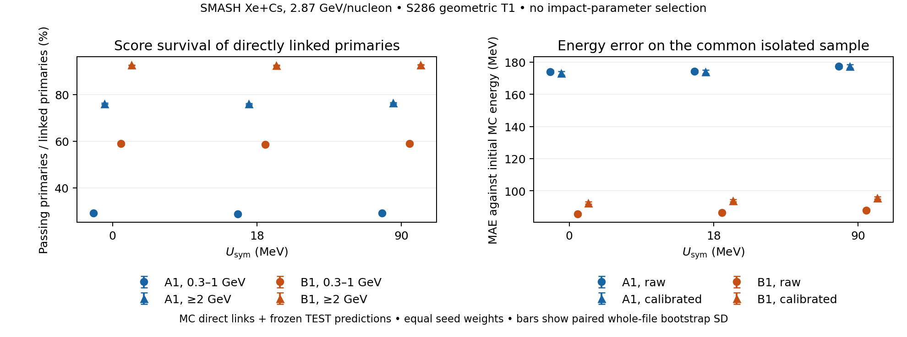

# Score selection and energy response for directly linked primary neutrons

9 November 2026. The accepted A1 and B1 pipelines were compared on the same
direct neutron associations to locate where their responses diverge. B1
retains more linked primary neutrons after its frozen score cut, especially
at low energy. Its energy error is also smaller on objects selected by both
pipelines. These two comparisons isolate stages of the response on a fixed
sample. A1 and B1 differ in preprocessing, learned weights, operating
points and calibration.

The sample is corrected SMASH Xe+Cs at a beam kinetic energy of 2.87 GeV per
nucleon, with symmetry potentials of 0, 18 and 90 MeV. It uses the previously
opened S286 truth-bound even parts 0/2/4 and the nominal straight-ray HGND
rectangle within the accepted T1 processed span. The analysis applies no
impact-parameter selection. It combines MC direct associations with saved
predictions from each file's original TEST fold for seeds 42, 123 and 456.
[Geometric window and direct association definitions](../primary_association_20261106/README.md).

## The score difference is largest in the low band

Count a PDG 2112 primary once when at least one native qualifying direct edge
connects it to a cluster with score strictly above its original fold- and
seed-specific cut. The frozen cuts span 0.352795–0.477545 for A1 and
0.295410–0.302895 for B1. Each fold and seed used the smallest of 401
thresholds on the uniform 0.001–0.999 grid with at least 70% count purity
on pooled-potential validation. The denominator is the corresponding set of distinct linked primaries before
that cut. It contains 190,002 objects across all energies. Their direct
associations come from MC tracks with Mother = −1. The native hit rule
includes the inherited ToF condition and initial kinetic energy above
0.3 GeV. Each cluster is identified by content, event Row, side and local
cluster ID. [Original threshold and calibration protocol](../smash_performance_20261103.md).

| Initial MC energy band | A1 score survival | B1 score survival | Paired B1 − A1 |
|---|---:|---:|---:|
| 0.3–1 GeV | 28.7–29.1% | 58.7–59.1% | +26.4 to +32.5 pp |
| ≥2 GeV | 76.1–76.4% | 92.6–92.8% | +15.4 to +18.6 pp |

Survival columns give the range across the three potentials of the equal
seed means. The paired differences span all nine potential × seed pairs.
Their file-bootstrap SD is 0.42–0.47 pp in the low band and 0.27–0.32 pp
in the high band. Over individual seeds and potentials, A1 survival spans
26.1–32.8% at low energy and 74.0–77.4% at high energy. The corresponding
B1 ranges are 58.6–59.2% and 92.5–92.9%. Both score selections still favor
the high band.

The left panel measures score survival for all linked primaries, including
those with several candidate edges. The right panel compares energy error
on identical isolated objects selected by both arms within each seed.
Colors identify pipelines. Markers distinguish bands or energy definitions.
The three potential points show how consistent the gap is across the
production settings. Bars are pointwise SD from 400 paired whole-file
replicas stratified by potential and even part. Each replica uses the same
file weights across pipelines and seeds. The plotted equal seed means have
conditional file SD. Seed spread is given separately in the text and tables.

## Common-object energy error persists before calibration

The energy cohort requires degree one at both ends of a native qualifying
edge in the full observed direct-neutron graph before geometry or score
selection. This graph includes the exported linked objects outside the
nominal window. Of 190,002 eligible primaries, 142,912 are isolated.
The excluded 47,090 comprise 37,873 split only, 7,300 merge only and 1,917
with both. Split means that the primary has multiple observed direct
edges. Merge means that one of its native edges enters a cluster with
multiple observed direct primaries. The exclusion is 13.5–13.8% in the
low band and 31.1–31.9% in the high band across potentials, so the isolated
cohort has a different energy composition.

For each seed and potential, 24,408–28,451 isolated objects pass both score
cuts. Residuals are predicted cluster energy minus initial MC primary
kinetic energy. A0 and B0 supply raw energies from the same respective heads
and have exactly the same scores as A1 and B1. The frozen monotone
calibration maps were fitted on validation.

| Energy on the common selected objects | A1 MAE | B1 MAE | Paired B1 − A1 MAE |
|---|---:|---:|---:|
| Raw | 174–177 MeV | 86–88 MeV | −104 to −73 MeV |
| Calibrated | 173–177 MeV | 93–96 MeV | −89 to −70 MeV |

Arm columns give the range of equal seed means across potentials. The paired
column spans all potential × seed pairs. The paired file SD is 0.8–1.1 MeV
for raw and 0.9–1.2 MeV for calibrated differences. B1 calibration increases
MAE by 6.3–8.0 MeV on this cohort across individual seeds and potentials.
The paired file SD of that increase is 0.3–0.5 MeV. The same-head comparison
locates this increase at calibration. The larger raw A/B gap belongs to the
full pipelines and does not identify a weight or scaler effect in isolation.

## Migration in the frozen hardness bands

Migration uses isolated objects selected by each arm's own frozen score cut.
The intersection of both cuts is reserved for the common-object error comparison
above. Within the arm-specific samples, 91.6–93.9% of A1 true low-band objects and
90.4–92.9% of A1 true high-band objects stay in their respective band after
calibrated energy assignment. B1 retains 98.1–98.8% and 94.7–95.1%.
These ranges span all potential × seed pairs. The five-state migration
tables include negative predictions, soft energies and the gap between the
two hardness bands. They track entries into bands as well as exits.

Define $R_n=N(E\ge2\,\mathrm{GeV})/N(0.3\le E<1\,\mathrm{GeV})$ on the
isolated subset and compare $100[R_n(90)/R_n(0)-1]$ at each stage. The
initial truth contrast is **5.13 ± 2.01%**. The table gives changes to that
contrast in percentage points, with paired whole-file SD.

| Pipeline and seed | Score selection | Calibrated energy migration after score | Combined shift |
|---|---:|---:|---:|
| A1, 42 | +0.81 ± 2.32 | +0.59 ± 1.35 | +1.39 ± 2.41 |
| A1, 123 | +2.92 ± 2.41 | +1.60 ± 1.58 | +4.52 ± 2.35 |
| A1, 456 | +2.28 ± 2.41 | −0.38 ± 1.65 | +1.90 ± 2.37 |
| B1, 42 | +0.49 ± 1.23 | +0.24 ± 0.69 | +0.74 ± 1.32 |
| B1, 123 | +1.09 ± 1.23 | −0.07 ± 0.67 | +1.01 ± 1.34 |
| B1, 456 | +0.67 ± 1.24 | −0.03 ± 0.69 | +0.64 ± 1.33 |

For B1, all three combined shifts are smaller than their paired file SD.
The isolated direct-object result leaves the response of split and merged
candidates, descendant-mediated associations and selected candidates without
a direct primary edge unresolved. Those populations enter the detector-level
contrast. The present shift cannot establish closure or a transferable
correction for that contrast. The numerical tables also contain 18/0 and
90/18 formed inside the same replicas.

## Reproduction

The local pass verified all 286 association exports and 3,432 prediction
files. The full join covers 1,798,225 candidate keys and reproduces native
targets, sizes and all six accepted prediction-ledger rungs for each
file, seed and arm. Migration rows conserve the score-selected truth counts.
The pass took 15.71 seconds on local CPU using saved outputs.

[Protocol](protocol.md) · [Preflight](preflight.json) ·
[Input pins](input_pins.json) · [Execution](execution.json) ·
[Machine-readable results](results.json) · [Figure PDF](score_energy_response.pdf)
