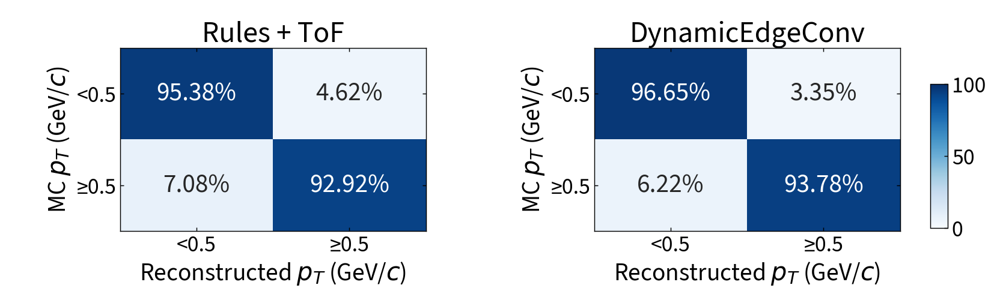

# Совместная миграция по быстроте и поперечному импульсу

18 ноября 2026. Расчёт продолжает [этап A](../../neutron_yield_rapidity_plan_20261117.md) после предзапускового методологического GO. Использованы только принятые S286-карты, исходные прямые связи и сохранённые предсказания. Полная сетка — зарегистрированные бины быстроты шириной 0,1 и две полосы \(p_T\) с границей 0,5 ГэВ/\(c\). [Протокол до расчёта](../joint_protocol_20261118.md).

Сравниваются одни и те же выбранные изолированные нейтроны в обоих методах. Числа по seed 42, 123, 456 — 58 998, 58 909, 58 946. Истинная энергия \(0.3\le T_{\rm MC}<4\) ГэВ, оба кандидата проходят \(0.3<T_{\rm reco}<4\) ГэВ, DynamicEdgeConv использует raw-энергию и прежний порог по целевой чистоте native labels 70% на валидации. Критерии изоляции проверяются на полных графах до отбора.

| Величина среди общих выбранных изолированных пар | Правила + ToF, % | DynamicEdgeConv, % | Парная разность GNN − правила, п.п. |
|---|---:|---:|---:|
| Тот же совместный бин \((y,p_T)\) | 70,70 ± 0,18 | 75,60 ± 0,16 | +4,90 ± 0,17 |
| Та же полоса \(p_T\) | 94,56 ± 0,09 | 95,69 ± 0,08 | +1,13 ± 0,07 |

Знак ± — SD 400 общих файловых перевыборок при фиксированных моделях. Равное среднее по seed берётся внутри draw. Для совместного бина парный Q16–Q84 составляет [4,72; 5,08] п.п. Прирост сохраняется в каждой настройке потенциала, +5,05, +4,49 и +5,20 п.п. соответственно при 0, 18 и 90 МэВ. В native-qualified подмножестве остаётся 56 169–56 242 пары на seed, прирост составляет +4,95 ± 0,18 п.п.

Строки нормированы по истинной полосе \(p_T\). Верхний правый элемент отражает переход из низкой в высокую полосу, нижний левый — обратный. У GNN оба перехода реже на общей выбранной популяции. Эти матрицы показывают только поперечную свёртку полного совместного распределения. Суммирование двух поперечных индексов в точности воспроизводит принятую матрицу быстроты для всех файлов, seed, методов и обеих когорт. Общие числа пар и все веса перевыборок совпадают с предыдущим сканом.

Условная матрица не включает потери и сложные совместные ливни. Направление GNN задаётся исходным временем первого хита. Проверка выбора по измеряемому времени и отклик с входными пересечениями и полной родословной остаются следующими измерениями. Новый расчёт не закрывает физическую эффективность, фон или восстановленный нейтронный выход.

[Полные результаты](joint.json) · [Пофайловые совместные матрицы](joint_counts.npz) · [Редуктор](../joint_scan.py). JSON содержит source/protocol SHA, прежний scan SHA, хеш приёмки и нового ledger. Дополнительно проверяется хеш импортируемого предыдущего редуктора. После добавления этого guard локальная редукция повторена, двоичный ledger совпал точно. Дополнительных model calls, unit tests или Slurm-заданий не было.
