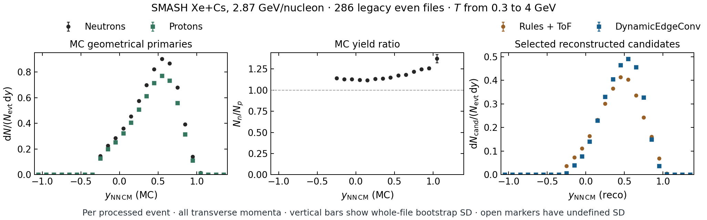
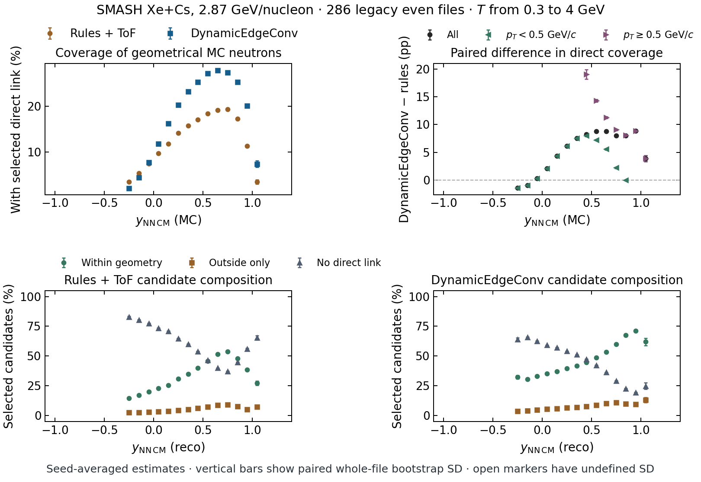
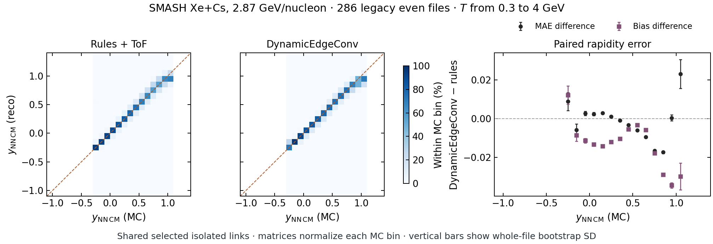

# Скан по быстроте на S286

17 ноября 2026. SMASH Xe+Cs, 2,87 ГэВ на нуклон. Сравниваем DynamicEdgeConv с правилами + ToF на одних и тех же 1 180 595 событиях из 286 ранее использованных чётных файлов. Энергия GNN — raw, порог классификатора — из валидации при целевой чистоте 70% по native labels для каждого fold и seed. Окно кандидатов \(0.3<T_{\rm reco}<4\) ГэВ одинаково. Геометрический MC-референс использует \(0.3\le T_{\rm MC}<4\) ГэВ. Быстрота знаковая, в НН-системе центра масс. Значения и различия усреднены с равными весами по seed 42, 123 и 456 внутри каждого из 400 общих bootstrap-перевыборок целых файлов. Знак ± обозначает SD этих перевыборок при фиксированных моделях. [Протокол](../scan_protocol.md) · [Приёмка](../acceptance_4525207.json).

## MC-ориентир и поток кандидатов

Референс содержит 775 116 геометрических MC-нейтронов и 666 552 MC-протона. Их суммарное \(n/p=1.163\pm0.002\). По быстроте отношение меняется от \(1.118\pm0.006\) в \([0.1,0.2)\) до \(1.373\pm0.050\) в \([1.0,1.1)\). В последнем бине 1 632 нейтрона и 1 189 протонов. Правый график показывает поток всех выбранных кандидатов после реконструкции. Для оценки нейтронного выхода в каждом бине нужны поправки на потери, фон, дубли и миграцию.

Левые панели используют MC-быстроту, правая — реконструированную. MC-протоны отобраны по прямой геометрической проекции. Протонный трекинг и PID в этом сравнении не применялись. [Рисунок в PDF](rapidity_yields.pdf).

## Прямое покрытие и состав выбранных кандидатов

| Величина и знаменатель | Правила + ToF | DynamicEdgeConv | Парная разность GNN − правила, п.п. |
|---|---:|---:|---:|
| Есть выбранная прямая связь / геометрические MC-нейтроны, % | 15,33 | 21,93 | +6,597 ± 0,035 |
| Прямой связи нет / геометрические MC-нейтроны, % | 84,67 | 78,07 | −6,597 ± 0,035 |
| Связь с несколькими кандидатами / геометрические MC-нейтроны, % | 1,707 | 1,221 | −0,485 ± 0,016 |
| Нет прямой связи с первичным нейтроном / выбранные кандидаты, % | 55,65 | 44,60 | −11,056 ± 0,075 |
| Связь с несколькими первичными нейтронами / выбранные кандидаты, % | 0,639 | 1,499 | +0,860 ± 0,020 |

Преимущество по прямому покрытию сосредоточено в положительной быстроте. В бине \([0.5,0.6)\), где 106 547 геометрических MC-нейтронов, разность составляет \(+8.79\pm0.09\) п.п. В \([-0.3,-0.2)\), где 17 232 нейтрона, она меняет знак и составляет \(-1.44\pm0.11\) п.п. Преимущество в отдельных бинах зависит от \(p_T\). Среди выбранных кандидатов в рабочем окне были прямые связи с геометрическими нейтронами с \(T_{\rm MC}\ge4\) ГэВ у 408 кандидатов правил и у 786–808 кандидатов GNN по seed. Кандидат со слиянием может входить в несколько энергетических категорий.

Вверху сравнивается доля MC-нейтронов с хотя бы одной выбранной прямой связью. Внизу каждый кандидат отнесён к одной из трёх групп по его связям, включая прямые связи с нейтронами вне истинного энергетического окна. Группу без прямой связи нельзя интерпретировать как физический фон без родословной ливня. [Рисунок в PDF](rapidity_direct_links.pdf).

## Ошибка быстроты на общих изолированных нейтронах

На одних и тех же 58 909–58 998 нейтронах на seed средняя абсолютная ошибка \(|y_{\rm reco}-y_{\rm MC}|\) составляет \(0.02784\pm0.00015\) для правил + ToF и \(0.02265\pm0.00010\) для GNN. Парная разность равна \(-0.00518\pm0.00012\). Средняя знаковая ошибка меняется с \(+0.00487\pm0.00017\) на \(-0.00533\pm0.00013\). Доля пар в том же бине шириной 0,1 растёт с 73,61% до 78,22% \((+4.61\pm0.17\) п.п.). У GNN меньше средняя абсолютная ошибка на общей выборке, но в части бинов она больше, а интегральное знаковое смещение меняет знак. При дополнительном условии native qualification остаётся 56 169–56 242 пар на seed и практически та же парная разность MAE \(-0.00518\pm0.00013\).

Матрицы нормированы по истинному бину среди нейтронов, выбранных обоими методами. В них нет потерянных объектов. Правый график показывает парные разности GNN − правила для средней абсолютной и средней знаковой ошибок. Для GNN направление задано историческим первым хитом по исходному времени, для правил — хитом с максимальным \(\beta\). Перед переносом на данные нужно проверить выбор первого хита по измеренному времени. [Рисунок в PDF](rapidity_migration.pdf).

## Воспроизводимость и границы вывода

Сведение проверило event spans, числа кандидатов и их категории по прямым связям, числа MC-нейтронов с покрытием и дублями и численности общих изолированных пар по прежнему пофайловому реестру. [Таблицы](scan.json) содержат три настройки потенциала и общую выборку, проекции по всем \(p_T\), по \(p_T<0.5\) и \(p_T\ge0.5\) ГэВ/\(c\), численности и ошибки на всех выбранных прямых рёбрах до изоляции и при native qualification. На этом уровне один нейтрон может учитываться несколько раз, а native qualification зависит и от энергии, и от ToF. [Пофайловые счётчики и перевыборки](counts.npz) сохраняют числители и знаменатели. [Редуктор](../scan.py) и [построение рисунков](../plot_scan.py) работают с [принятым экспортом](../README.md). Предыдущее [сравнение по энергии](../../final_model_comparison_20261117/README.md) дополняет продольную проекцию.

Для физической эффективности и вычитания фона нужна продукция с входными пересечениями HGND и полной родословной. Отклик, восстановление нейтронного выхода и \(n/p\) требуют проверки замыкания на независимом MC. Экспериментальное \(n/p\) дополнительно требует протонного PID на совместимой продукции. [Этапы B–D](../../neutron_yield_rapidity_plan_20261117.md).
