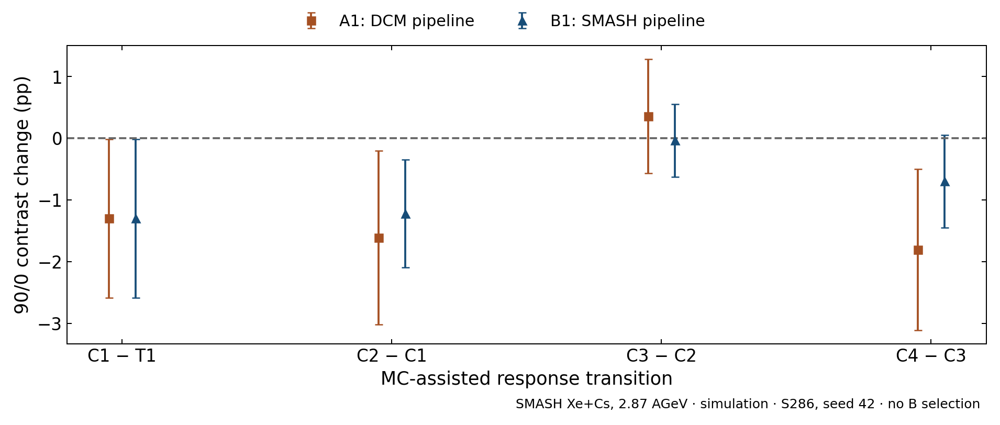
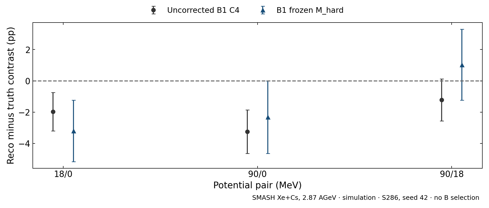
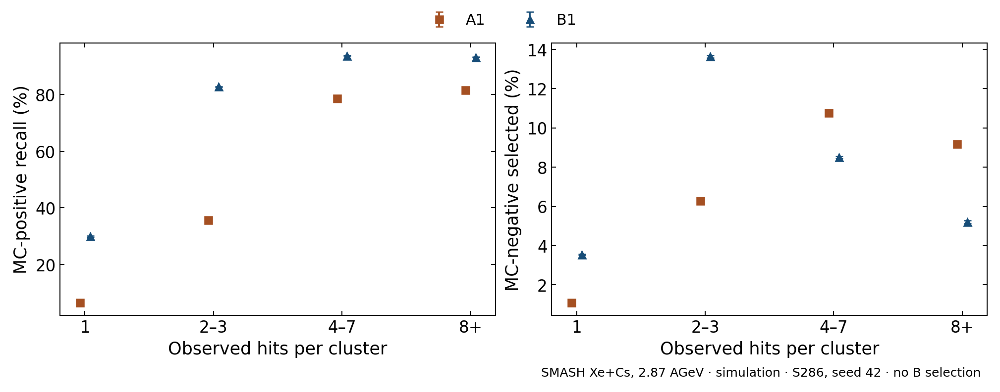
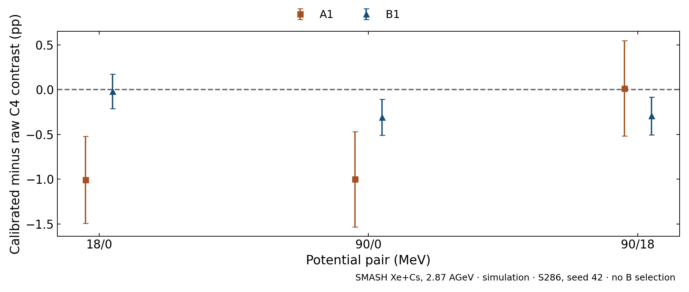

# Отклик реконструкции до новой dE/dx продукции

6 ноября 2026. Расчёт завершён локально, без новых model calls, обучения,
GPU/Slurm jobs, cut/calibration fits, odd report scoring или выбора окон.
S286: 286 truth-bound even-part content, 1 798 225 кандидатов. Прежние TEST
predictions относятся к каждой исходной cross-fit test-role. Это известная
ретроспективная популяция, не новый holdout и не no-floor validation.

Вся арифметика и SHA: [results.json](results.json),
[per-file arrays и shared replicas](counts.npz),
[зарегистрированный до исполнения протокол](protocol.md).

## Основные результаты

На этой S286 популяции primary90/0=4.49 ± 0.84%
(file SD). B1 C4 по трём seeds=1.24–1.44%,
после M_hard=2.17–2.61%. Центральные значения
сдвинулись к truth; corrected−truth residual остаётся около−2п.п.
с file SD около2,3п.п. Это не доказывает closure или разрешённый выигрыш.
Для18/0 коррекция сдвигает центральные значения дальше в отрицательную сторону,
для90/18 они переходят выше truth. Направление эффекта зависит от пары.

У B1 для90/0 C1−T1=−1,30п.п. во всехseeds, C2−C1=−1,22…−0,92п.п.,
C4−C3=−1,24…−0,70п.п. Переход энергии C3−C2 меняется от−0,04 до+0,47п.п.
Это условный stage ledger с коррелированными ошибками из таблицы ниже,
не независимые значимости и не разложение причин веса/scaler.

## Изменения по этапам

Контраст 90/0, central ± paired whole-file bootstrap SD, п.п.
T1 — primary truth в прежнем ray/processed-span окне; C1 — native-positive
кластеры с MC target; C2 — выбранные positives с MC target; C3 — те же
выбранные positives с reconstructed calibrated energy; C4 — все selected.
Переход T1→C1 сопоставляет разные физические объекты, не является
самостоятельной оценкой primary detection efficiency.

|Arm|Seed|C1−T1|C2−C1|C3−C2|C4−C3|
|---|---:|---:|---:|---:|---:|
|A1|42|-1.30 ± 1.29|-1.61 ± 1.41|0.36 ± 0.92|-1.81 ± 1.31|
|A1|123|-1.30 ± 1.29|-0.83 ± 1.46|2.03 ± 1.01|-2.42 ± 1.27|
|A1|456|-1.30 ± 1.29|-0.74 ± 1.46|0.83 ± 1.01|-2.80 ± 1.16|
|B1|42|-1.30 ± 1.29|-1.22 ± 0.87|-0.04 ± 0.59|-0.70 ± 0.75|
|B1|123|-1.30 ± 1.29|-0.92 ± 0.86|0.17 ± 0.54|-1.00 ± 0.79|
|B1|456|-1.30 ± 1.29|-1.10 ± 0.88|0.47 ± 0.56|-1.24 ± 0.75|

MC-assisted reconstructed/primary comparison on SMASH Xe+Cs2.87AGeV, no B
selection, inherited diagnostic0.3≤E<1 and E≥2GeV bands, not optimised here, seed42 as representative. Bars use
400paired whole-file draws, potential×evenpart strata. All3seeds appear in
the table to establish whether stage directions repeat; they share files.
Adjacent shifts telescope to C4−T1 exactly, but their errors correlate.

## Замороженная фоновая поправка

M_hard: high=NH, low=NL−cNH. c=(NL−SL)/NH взят из исходной validation
части того же fold/seed, pooled over potentials, и воспроизведён против
принятого29October результата. Application — другая even TEST часть.
Коэффициент не знает истинный потенциал. Во всех400replicas его
неопределённость пересчитывается теми же весами физических content, что
и application counts. Это сохраняет covariance между двумя ролями файла.

Central ± paired file SD, п.п.; ноль residual означает numerical closure
только для этой продукции и определения.

|Pair|Arm|Seed|M_hard−C4|M_hard−T1|
|---|---|---:|---:|---:|
|18/0|A1|42|-0.53 ± 1.07|-1.64 ± 2.47|
|18/0|A1|123|-0.48 ± 1.20|-1.53 ± 2.72|
|18/0|A1|456|-1.94 ± 1.34|-4.51 ± 2.84|
|18/0|B1|42|-1.22 ± 0.86|-3.19 ± 1.97|
|18/0|B1|123|-0.82 ± 0.86|-2.35 ± 1.96|
|18/0|B1|456|-1.03 ± 0.85|-2.81 ± 1.94|
|90/0|A1|42|0.12 ± 1.20|-4.23 ± 2.72|
|90/0|A1|123|1.77 ± 1.42|-0.75 ± 2.87|
|90/0|A1|456|0.50 ± 1.57|-3.49 ± 3.12|
|90/0|B1|42|0.93 ± 1.04|-2.32 ± 2.31|
|90/0|B1|123|1.17 ± 1.04|-1.88 ± 2.25|
|90/0|B1|456|1.03 ± 1.02|-2.15 ± 2.29|
|90/18|A1|42|0.66 ± 1.13|-2.56 ± 2.44|
|90/18|A1|123|2.28 ± 1.38|0.85 ± 2.81|
|90/18|A1|456|2.60 ± 1.51|1.25 ± 2.91|
|90/18|B1|42|2.24 ± 1.08|1.03 ± 2.27|
|90/18|B1|123|2.05 ± 1.09|0.58 ± 2.24|
|90/18|B1|456|2.13 ± 1.04|0.80 ± 2.15|

B1 seed42 on the same S286 and frozen settings. Both residuals use paired
file SD against identical T1. Correction is a conditional internal transfer,
not an independently validated data correction. It addresses low-band
MC-labelled background only and leaves high-band background and migration.
Training/cut/calibration selection, generator and geometry uncertainty are
not included in file SD. No conclusion of equivalence follows from zero
inside the bars. All three pair contrasts correlate.

## Где расходятся A1/B1

Same candidates, seed42, native MC labels, frozen cuts; bars: shared
whole-file SD. Left is MC-positive candidate recall, right is MC-negative
selection probability, not per-primary efficiency or background species.
The two panels separate signal selection from negative-candidate rejection.
Different weights/scalers/cuts are retained; this does not isolate their causes.
На показанном seed42 B1 recall выше во всех size bins. Отбор MC-negative
кандидатов также выше у B1 для1 и2–3хитов, но ниже для4–7 и8+.
Рост recall не означает равномерного улучшения rejection.

Same S286, seed42. Raw A0 energy uses A1 cut, raw B0 uses B1 cut; exact
scores/keys match. Thus this control changes only the energy map for each
fixed selected set. Bars: paired file SD. Ordinary A0 at its own different cut
is not used as the control. All-seed results are retained in JSON.
На показанном seed42 энергетическая карта A1 сдвигает18/0 и90/0 примерно
на−1п.п.; B1 почти не меняет18/0 и умеренно уменьшает остальные контрасты.
Направление и величина зависят от pipeline/pair; это не универсальный offset
и не проверка применимости calibration к экспериментальным данным.

## Условные требования к протонному отклику

Для D=Rn/Rp имеем dK_D/dln(eta_p)=−(100+K_D),
eta_p=kappa_p(a)/kappa_p(b). Ниже local slope, п.п. на единицу
1% log-response variation; это единица представления, не предположение
об измеренной1% систематике PID. Ideal MC protons use the original forward
ray rectangle and generated energy, without magnetic transport/tracking/PID.

|Pair|Seed|B1 hybrid D contrast (%), file SD|Local proton-response slope (pp per 1% log variation)|
|---|---:|---:|---:|
|18/0|42|1.70 ± 1.50|-1.017|
|18/0|123|2.16 ± 1.49|-1.022|
|18/0|456|1.89 ± 1.48|-1.019|
|90/0|42|9.68 ± 1.64|-1.097|
|90/0|123|9.90 ± 1.66|-1.099|
|90/0|456|9.77 ± 1.68|-1.098|
|90/18|42|7.86 ± 1.68|-1.079|
|90/18|123|7.58 ± 1.71|-1.076|
|90/18|456|7.73 ± 1.65|-1.077|

S286 hybrid values do not replace the existing568-file hybrid report.
A constant common proton response factor cancels in the potential contrast;
an energy-dependent response can yield different effective factors because
the spectra differ. The slope quantifies a requirement, not real proton PID.

## Что пока не измерено

CSV не содержат raw hit features/scaler inputs, полной genealogy или
primary-to-hit denominator. Поэтому видовой состав material background,
причинная scaler/weights ablation и primary detection efficiency здесь не
получены. Пары native MC labels не подменяют происхождение shower.

Для этих частей нужны отдельные native/raw inputs и конкретный CPU plan.
Реальная proton tracking/PID проверка ждёт применимой продукции.
[Требования к новой MC](new_mc_acceptance.md) подготовлены отдельно.
No-floor не повторялся, окна не оптимизировались, новых весов нет.

## Совместные решения и общая популяция энергетического сравнения

Числа на тех жеS286; MC-native positives. MAE относится к сохранённому MCTrack target. Ошибки MAE — paired-content file bootstrap SD, не training-seed uncertainty.

|Seed|A1-only positives|B1-only positives|Both selected positives|A1 MAE on both (MeV)|B1 MAE on both (MeV)|
|---|---:|---:|---:|---:|---:|
|42|5152|87167|171808|174.53 ± 0.51|96.41 ± 0.30|
|123|5366|84770|174295|161.96 ± 0.50|96.08 ± 0.30|
|456|5473|93636|165054|180.30 ± 0.52|96.73 ± 0.31|

Таблица отделяет различия выбора объектов от ошибки энергии на общем selected subset. Различия trained pipelines остаются смешанными: это не изолированная weights/scaler абляция.
