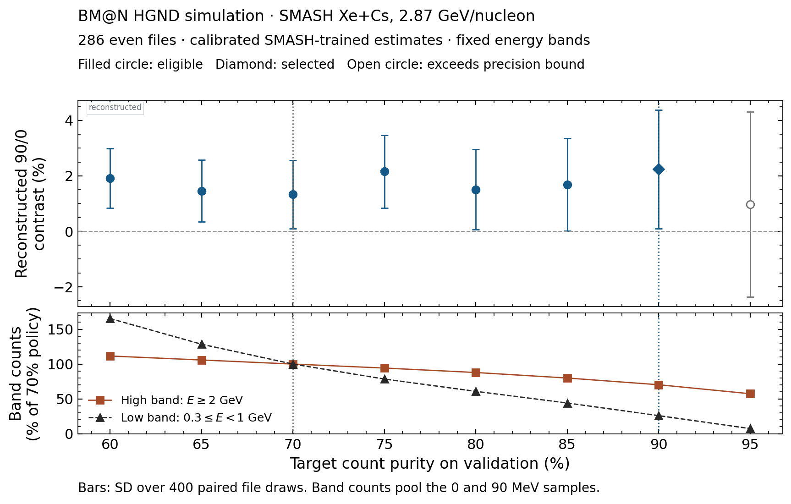

# Classifier score cut for neutron hardness

The baseline used the first of 401 score cuts reaching 70% count purity
on pooled validation for each fold and training repeat. The new policy
instead ranks these validation-purity operating points by the signed
reconstructed 90/0 neutron hardness contrast. Models, energy calibration
and the energy bands stay fixed.

On 286 even files, the eligible maximum is at a 90% validation purity
target, corresponding to score cuts 0.692–0.707 across the nine models.
The 75% target gives a nearby central value, 2.16% versus 2.24% at 90%.
The 95% target exceeds the registered file SD ceiling of 2.46 pp.
The 90% policy retains 70% of the high-band and 26% of the low-band counts
on the even 0 and 90 MeV samples, relative to the original operating point.
The upper panel shows the selection objective. The lower panel shows
the effect of cut tightening on the two parts of the hardness ratio.

| Sample | Original 70% contrast | Frozen 90% contrast | Paired change | MC contrast |
|---|---:|---:|---:|---:|
| 286 even files, selection | 1.33 ± 1.23% | 2.24 ± 2.14% | +0.90 ± 1.57 pp | 4.49 ± 0.84% |
| 282 odd files, fixed check | 2.54 ± 1.18% | 3.76 ± 2.17% | +1.22 ± 1.66 pp | 4.95 ± 0.85% |

Uncertainties are SD over 400 paired whole-file draws, with equal weight
for each training repeat. On the odd files, the optimized result is
1.19 ± 2.16 pp below the fixed MC reference. The gain relative to the
original policy is unresolved. The odd files give a retrospective fixed
check within this simulation production. Their original baseline had
previously been reported.

The local reduction replays all baseline high and low file counts exactly
and verifies prediction and validation scan digests. Its choice is saved
before opening odd-file predictions. [Protocol](protocol.md) ·
[Full scan and cuts](choice.json) · [Fixed odd-file check](fixed_check.json) ·
[Vector figure](score_cut_scan.pdf)
