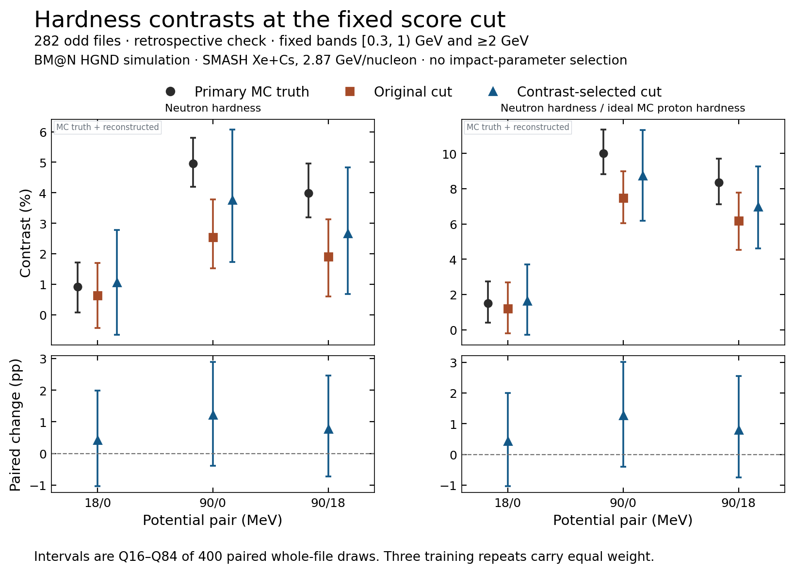
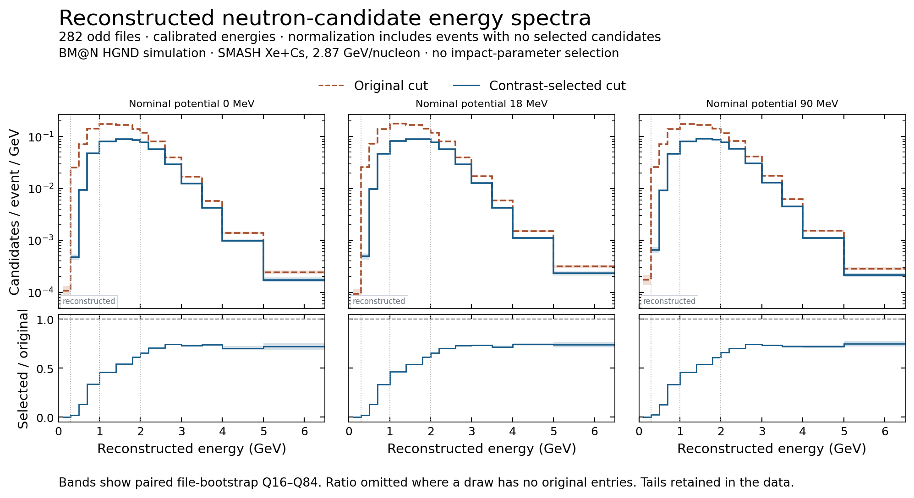
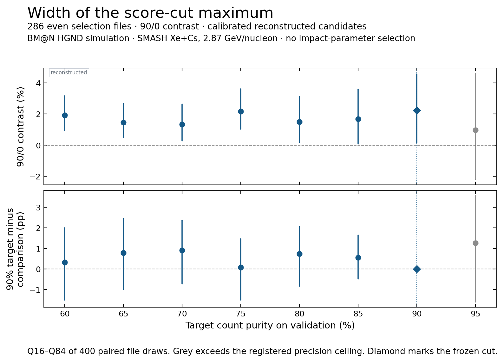

# Neutron hardness at the fixed contrast-selected score cut

At the fixed 90% validation-purity target, the reconstructed 90/0
contrast on 282 odd files is **3.76%**, compared with **2.54%** at the
original 70% target. The central increase is **1.22 p.p.** Its paired
file-bootstrap Q16–Q84 interval is **[−0.39, +2.90] p.p.** The half-width
of the contrast itself grows from **1.13 to 2.17 p.p.** The larger central
contrast comes with a broader sampling distribution.

## All three potential pairs

SMASH Xe+Cs at 2.87 GeV per nucleon, nominal HGND window, no impact-
parameter selection. The hardness denominator is [0.3, 1) GeV and the
numerator is ≥2 GeV. Use calibrated energy for all selected reconstructed
clusters, including native-label negatives. The score cuts are fixed
per fold and training repeat, and identical across potential settings
within each run.

Table entries are central contrast and Q16–Q84 interval from 400 paired
whole-file draws, with equal weight for the three repeats. The 282 odd
files were excluded from the score-policy choice. Their original
baseline had previously been reported.

| Potential pair | Primary MC (%) | Original 70% policy (%) | Frozen 90% policy (%) | Paired 90% − 70% (p.p.) | Half-width, 70% → 90% (p.p.) |
|---|---:|---:|---:|---:|---:|
| 18/0 | 0.92 [0.08, 1.71] | 0.63 [−0.43, 1.69] | 1.06 [−0.65, 2.79] | +0.43 [−1.03, 1.99] | 1.06 → 1.72 |
| 90/0 | 4.95 [4.20, 5.80] | 2.54 [1.52, 3.78] | 3.76 [1.72, 6.07] | +1.22 [−0.39, 2.90] | 1.13 → 2.17 |
| 90/18 | 4.00 [3.19, 4.96] | 1.90 [0.61, 3.13] | 2.68 [0.68, 4.83] | +0.77 [−0.73, 2.46] | 1.26 → 2.08 |

All three paired intervals include zero. The 90/0 residual against
primary MC is −1.19 p.p. at the fixed cut, with Q16–Q84 [−3.29, +1.05]
p.p. The residual and the paired gain have different sampling distributions.
The three potential pairs share replicas and are correlated. The
event-to-candidate delta-method SD ratio for reconstructed hardness
ranges from 0.998 to 1.009 on the odd sample. The file bootstrap
resamples complete files and retains the event grouping.

The right panels use reconstructed neutrons and ideal MC protons from
the same primary members and processed spans. For 90/0 the hybrid
contrast is 8.75% [6.19, 11.33], compared with ideal MC neutron plus MC
proton contrast 10.00% [8.82, 11.35]. Its paired change is +1.28 p.p.
[−0.41, 3.02]. The proton reference is a forward vertex ray in the
nominal rectangle, with no magnetic transport, tracking or PID.

## Where the difference enters

On the odd files the new cut retains 70.2% of hard and 26.2% of soft
candidates, pooling all three potentials before forming the retention
ratio in each repeat. Actual cluster count purity rises from 70.29–70.37%
to 90.07–90.32% across potentials. Native cluster recall falls from
80.31–80.67% to 53.23–53.64%. Calibrated candidate hardness at the new
cut is 3.663, 3.702 and 3.801 for the 0, 18 and 90 MeV settings.

For the 90/0 pair, the contrast on selected positive clusters evaluated
at calibrated energy is 3.04% at the tighter cut. Including the remaining
native-label negatives changes that value by +0.72 p.p., versus −1.37
p.p. at the original cut. The paired change of this contribution is
+2.09 ± 0.87 p.p. (file SD). The corresponding changes in the score
selection and energy migration contributions are −0.75 ± 1.55 and
−0.13 ± 0.61 p.p. The largest central contribution to the change is the step from
selected native positives to all selected clusters. The full
candidate contrast gain still has an interval spanning zero.

The spectrum denominator includes all events in the processed span.
Negative energies and the ≥6.5 GeV overflow are retained in the file
ledger. The plotting range is finite and the hardness numerator includes
the full overflow. The baseline labelled and selected-positive spectra,
raw and calibrated spectra, and the two positive-cluster migration
matrices are available by file and repeat.

## How wide is the maximum?

On the 286 even files, the central contrast at 90% target purity is
2.24%, with Q16–Q84 [0.13, 4.56]. The 75% target gives 2.16%. Their
paired separation is **+0.08 ± 1.48 p.p.** All seven eligible grid
points (60%, 65%, 70%, 75%, 80%, 85%, 90%) lie within one paired file
SD of the central maximum. The 95% target exceeded the registered
precision ceiling. This discrete set describes the width of the
selection result. It does not supply a confidence set after
maximization or identify a replacement operating point.

## Files and scope

[All contrasts, rungs, widths and purity/recall by fold and repeat](results.json) ·
[File counts, spectra and migration matrices](files.npz) ·
[Paired draw weights](draw_weights.npz) ·
[Protocol](protocol.md).

The 286 even-file results are selection diagnostics. The pooled 568-file
results are descriptive. Both are separately labelled in the tables. The even and odd analyses
replay their respective archived draws. Pooled draws use a separate
stream over all potential × part strata to avoid linking disjoint strata.
The archived comparison used a different full-sample bootstrap, so its
quoted SD need not equal the pooled descriptive SD here. The frozen
DCM comparison, truth counts, labels and score-independent results
provide context. A no-floor model uses a different score scale, and
the previously fitted background subtraction is tied to its original
working point. Both remain separate from this score-policy comparison.

[Matched first-hit ToF and energy response under the fixed SMASH cut](matched_tof/README.md)
uses the available even-file timing export. Reproduction runs
`reduce.py`, `summarize.py`, and `plot.py` in this directory on accepted
saved predictions. The baseline file-level four-stage and truth counts,
the fixed two-policy band counts, and the original 90/0 endpoint and
file SD reproduce exactly or to the stored floating-point precision.
