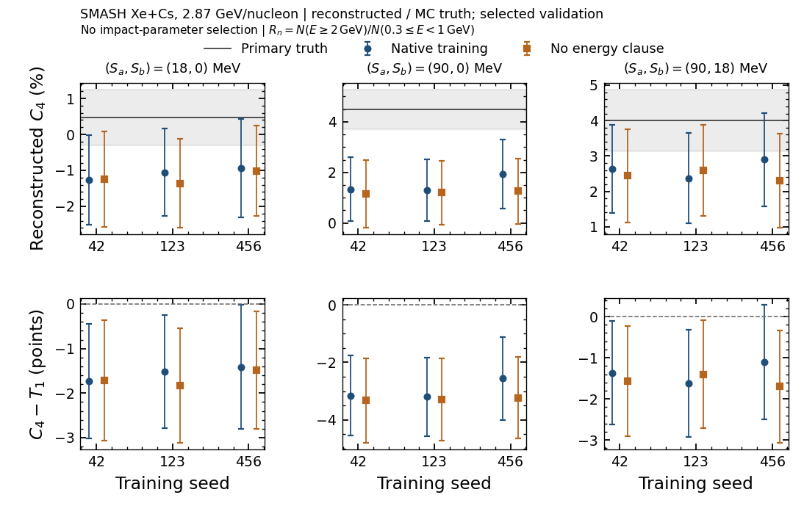

# No-floor: fixed-window Rₙ на selected validation

04.11.2026. Локальный анализ сохранённых predictions завершён без новых моделей,
inference, GPU-задач, F scoring, cut fit, calibration или выбора окон.

**Итог:** улучшение soft-target regression не установило выигрыша Rₙ.
Все три paired training-seed изменения C4 не разрешены при df=2.

## Популяция и определение

286 truth-bound validation content, 1 798 225 candidates; четыре unbound группы
остаются в прежней detector-label диагностике. Rₙ=N(E≥2 ГэВ)/N(0,3≤E<1 ГэВ),
без верхней границы числителя. Native B0 и no-floor используют raw energy,
выбранные e_cls/e_en и одинаковый прежний cut данного validation fold/seed.
C1–C3 используют общие native labels/targets; C4 — всех выбранных кандидатов.
T1 и C1 между arms тождественны по построению.

## Контрасты C4

Ниже central ± whole-file bootstrap SD; Δ=no-floor−native B0, с парной SD.

| Потенциалы, МэВ | Seed | Native B0 C4, % | No-floor C4, % | Δ, п.п. |
| --- | --- | --- | --- | --- |
| 18/0 | 42 | -1.3 ± 1.2 | -1.2 ± 1.3 | 0.02 ± 0.39 |
| 18/0 | 123 | -1.1 ± 1.2 | -1.4 ± 1.2 | -0.31 ± 0.41 |
| 18/0 | 456 | -0.9 ± 1.4 | -1.0 ± 1.3 | -0.08 ± 0.40 |
| 90/0 | 42 | 1.3 ± 1.3 | 1.2 ± 1.3 | -0.17 ± 0.46 |
| 90/0 | 123 | 1.3 ± 1.2 | 1.2 ± 1.3 | -0.10 ± 0.46 |
| 90/0 | 456 | 1.9 ± 1.4 | 1.3 ± 1.3 | -0.67 ± 0.39 |
| 90/18 | 42 | 2.6 ± 1.3 | 2.4 ± 1.3 | -0.19 ± 0.43 |
| 90/18 | 123 | 2.4 ± 1.3 | 2.6 ± 1.3 | 0.22 ± 0.42 |
| 90/18 | 456 | 2.9 ± 1.3 | 2.3 ± 1.3 | -0.60 ± 0.40 |

| Потенциалы | Mean Δ ± SE трёх парных training seeds, п.п. | t, df=2 |
| --- | --- | --- |
| 18/0 | -0.124 ± 0.096 | -1.28 |
| 90/0 | -0.31 ± 0.18 | -1.74 |
| 90/18 | -0.19 ± 0.24 | -0.80 |

Двухсторонний tcrit(0,05)=4,303. SE здесь относится к разным обученным весам
на фиксированных данных; file SD в первой таблице относится к выборкам файлов.
Ни одна из этих ошибок не включает другую production/transport model. Контрасты
коррелированы; дополнительных claims по множественным сравнениям нет. Validation
участвовала в checkpoint/cut selection и не является новым независимым holdout.

Рисунок строится из канонического JSON статьи. Верхний ряд — C4, линия/полоса —
primary MC truth T1/file SD; нижний — C4−T1 с парной file SD. Три training seeds
показаны отдельно. SMASH Xe+Cs, 2,87 ГэВ/нуклон, без отбора по impact parameter.

## Проверки и воспроизводимость

- Технический и методологический preflight конкретного кода: GO до исполнения.
- Порядок baseline связан с source d739c54: digest всех 45 code files совпал
  с recorded identity всех девяти accepted baseline complete records.
- Архив и все 1193 compact members проверены; split/prepare, keys/native targets,
  cluster sizes, selected heads и cuts проверяются на actual path.
- Certified primary events прочитаны прежним reader. Для всех 286 content и всех
  seeds совпали member, все candidate Row, processed span, число candidate events
  и точные T0/T1/T2 counts. Новая raw-primary reduction не потребовалась.
- Старый test-fold не переносится на нынешний validation-fold.
- 400 whole-file draws, seed20261026, независимы между потенциалами и общие
  для arms/rungs/seeds. Counts суммируются до ratio; 90/18 строится в каждой replica.
- Новых unit tests/test-queue jobs не было по human exception; data/source,
  native-reference, численные и coverage assertions выполнены.

Воспроизведение: из HGNDRecoGNN запустить `python reports/rn_validation_20261104/analyze.py`
в окружении pyg. [Протокол](protocol.md), [preflight](preflight.md),
[все per-file counts, coverage, bootstrap и SHA](results.json).
Статья независимо пересчитывает metric macros и Rₙ bootstrap из hash-locked
`HGNDPaper/data/canonical_inputs/label_ablation.json` командой make.

## Дальше

Завершить каноническую/визуальную приёмку Appendix C и commit. Новая оценка F
или оптимизация окон не требуется для этого результата. Для произвольных окон
по-прежнему нужны uncensored primary counters и заранее заданное правило выбора;
fixed-window counters и census не определяют такой optimum. Copilot не используется.
